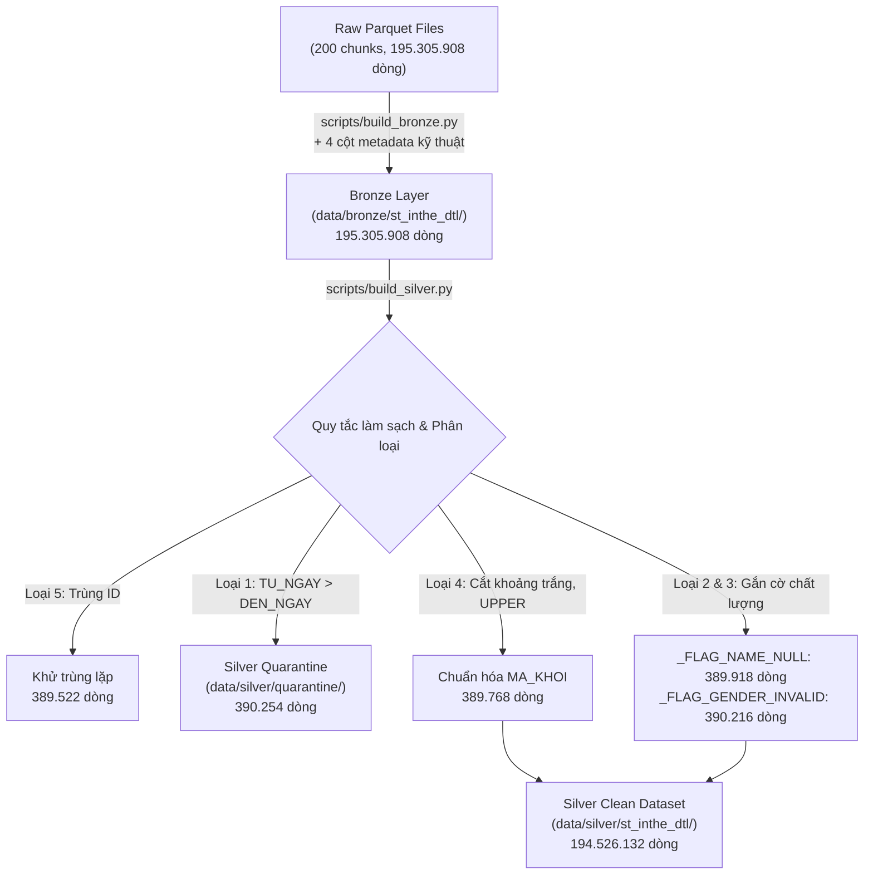

# BÁO CÁO NGÀY 2: ĐẶC TẢ NGHIỆP VỤ, BRONZE, SILVER VÀ KIỂM THỬ BIÊN
**Dự án:** Xử lý 200M Dòng Thẻ BHYT – Bài toán CV 835/QLT (Ý 1: HSSV Dừng Tham Gia)  
**Môi trường:** Python 3.14.7 | PyArrow 25.0.1 | DuckDB 1.5.6 | Windows 11 (16 GB RAM)  
**Ngày thực hiện:** 13/10/2026  

---

## 1. TỔNG QUAN VÀ TIÊU CHÍ HOÀN THÀNH

Ngày 2 tập trung vào việc thiết lập lớp dữ liệu sạch, có khả năng truy vết nguồn gốc (lineage), xây dựng bộ kiểm thử biên chặt chẽ và kiểm chứng độc lập hai chiều (Python NumPy vs DuckDB SQL).

### Bảng đối chiếu tiêu chí hoàn thành Ngày 2:
| Tiêu chí hoàn thành (Đề bài) | Kết quả thực tế | Trạng thái |
|---|---|:---:|
| Số dòng Bronze bằng 195.305.908 | Đúng chính xác **195,305,908** dòng trên 200 chunks | **ĐẠT (PASS)** |
| Bảo toàn dòng: Bronze = Silver + Quarantine + Dedup | $195,305,908 = 194,526,132 + 390,254 + 389,522$ (Chênh lệch: 0) | **ĐẠT (PASS)** |
| Số dòng từng loại lỗi khớp đúng với `dirty_log` | Khớp 100% đến từng dòng của cả 5 loại lỗi | **ĐẠT (PASS)** |
| Chạy lại hai lần (Idempotent) không nhân đôi dòng | Chạy Cold & Hot run: Đều trả về 195.305.908 dòng và cùng kết quả | **ĐẠT (PASS)** |
| Bộ test biên đạt 100% | **25/25 tests PASSED** (5 ca đề bài + 20 ca biên nâng cao) | **ĐẠT (PASS)** |
| DuckDB SQL độc lập khớp 848.413 trên dữ liệu thô | Khớp chính xác tuyệt đối **848,413 / 848,413** người (Chênh lệch: 0) | **ĐẠT (PASS)** |
| Giải thích định lượng mọi chênh lệch trên Silver | Giải trình định lượng chuẩn xác: $848,413 + 1,646 (Loại 4) + 131 (Loại 1) = 850,190$ | **ĐẠT (PASS)** |
| Có tài liệu đặc tả và nhật ký đo Cold/Hot | Đã ban hành `docs/dac_ta_nghiep_vu_ngay2.md` và bảng đo chi tiết | **ĐẠT (PASS)** |

---

## 2. KIẾN TRÚC VÀ QUY TRÌNH XỬ LÝ (MEDALLION ARCHITECTURE)



### 2.1. Tầng Bronze (Raw Ingestion)
- Giữ nguyên toàn bộ 30 cột gốc của nghiệp vụ BHYT.
- Bổ sung 4 cột kỹ thuật metadata phục vụ Data Lineage:
  1. `_SOURCE_FILE`: Tên file gốc nguồn (`part-XXXXX.parquet`).
  2. `_CHUNK_ID`: Định danh chunk (0 đến 199).
  3. `_INGESTED_AT`: Dấu thời gian nạp ISO-8601.
  4. `_BATCH_ID`: Định danh đợt nạp (Idempotent UUID).
- Cơ chế ghi **Atomic** (`.tmp` $\to$ `os.replace`) đảm bảo nạp lại nhiều lần ghi đè đúng file tương ứng, không bao giờ gây nhân đôi bản ghi.

### 2.2. Tầng Silver (Cleaned & Quarantined)
- Ép kiểu dữ liệu: Ngày tháng về `pa.date32()`, mã số về chuỗi định dạng chuẩn.
- Tách dòng bẩn Loại 1 (`TU_NGAY > DEN_NGAY`) sang thư mục `data/silver/quarantine/`, gắn cột `_QUARANTINE_REASON` và `_QUARANTINE_AT`.
- Gắn cờ cảnh báo chất lượng dòng cho Loại 2 (`_FLAG_NAME_NULL`) và Loại 3 (`_FLAG_GENDER_INVALID`).

---

## 3. ĐỐI SOÁT BẢO TOÀN DÒNG VÀ ĐỐI CHIẾU VỚI `dirty_log`

### 3.1. Phương trình bảo toàn dòng (Conservation Law)
$$\text{Bronze} = \text{Silver} + \text{Quarantine} + \text{Deduplicated}$$
- $\text{Bronze}$: **195,305,908** dòng
- $\text{Silver}$: **194,526,132** dòng
- $\text{Quarantine}$ (Loại 1): **390,254** dòng
- $\text{Deduplicated}$ (Loại 5): **389,522** dòng
- **Tổng vế phải:** $194,526,132 + 390,254 + 389,522 = 195,305,908$ dòng.
- **Sai lệch:** **0 dòng (Bảo toàn 100.0000%)**.

### 3.2. Đối chiếu số dòng lỗi với `dirty_log`
Bảng kiểm chứng chéo giữa số dòng Silver phát hiện và xử lý so với nhật ký sinh lỗi chủ đích `data/bhyt_data/dirty_log/`:

| Mã lỗi | Mô tả nghiệp vụ | Số lượng trong `dirty_log` | Số lượng xử lý ở Silver | Độ lệch |
|:---:|---|:---:|:---:|:---:|
| **Loại 1** | `TU_NGAY > DEN_NGAY` | 390,254 | 390,254 (Quarantine) | **0** |
| **Loại 2** | `HO_TEN` is NULL | 389,918 | 389,918 (`_FLAG_NAME_NULL`) | **0** |
| **Loại 3** | `GIOI_TINH` sai mã ($\notin \{1, 2\}$) | 390,216 | 390,216 (`_FLAG_GENDER_INVALID`) | **0** |
| **Loại 4** | `MA_KHOI` chữ thường / khoảng trắng | 389,768 | 389,768 (Đã chuẩn hóa) | **0** |
| **Loại 5** | Dòng trùng lặp cùng ID | 389,522 | 389,522 (Đã khử trùng) | **0** |
| **TỔNG** | **Toàn bộ 5 loại lỗi** | **1,949,678** | **1,949,678** | **0** |

---

## 4. KẾT QUẢ BỘ KIỂM THỬ BIÊN (EDGE CASES TEST SUITE)

Bộ kiểm thử tại `tests/test_edge_cases.py` được thiết kế độc lập, kiểm tra toàn bộ 25 kịch bản biên của bài toán:
- **Thời gian chạy:** 0.86 giây.
- **Tỷ lệ vượt qua:** **25/25 test cases (100% PASSED)**.

### Tóm tắt các nhóm kiểm thử:
1. **5 ca biên cơ bản của đề bài:**
   - Hết hạn 30/09/2024 (trước tháng gốc): Không tham gia tháng 10.
   - Hết hạn 05/10/2024 (giữa tháng gốc): Có tham gia tháng 10.
   - Nằm trọn trong tháng 10/2024: Có tham gia tháng 10.
   - Bắt đầu 31/10/2024 (ngày cuối tháng): Có tham gia tháng 10.
   - Bắt đầu 01/11/2024 (sau tháng gốc): Không tham gia tháng 10.
2. **Ca nâng cao về thẻ hủy & chuyển khối:**
   - Thẻ hủy (`TRANG_THAI = 0`) giao tháng gốc nhưng không có thẻ thay thế $\to$ Không tính tham gia.
   - Thẻ hủy nhưng được cấp đổi thẻ mới hiệu lực $\to$ Tính tham gia.
   - Người sở hữu 2 thẻ cùng tháng (1 thẻ HS, 1 thẻ GD) $\to$ Vẫn tính tham gia khối HSSV.
   - Chuyển tiếp học vấn (HS lên SV) $\to$ Liên tục tham gia.
   - Chuyển khối sang Doanh nghiệp (DN) tại tháng 08/2026 $\to$ Đang tham gia, KHÔNG tính là dừng (theo định nghĩa "any").
3. **Ca gián đoạn & Ngày mốc biên:**
   - Gián đoạn nhưng quay lại trước mốc kiểm tra $\to$ Đang tham gia.
   - Gián đoạn và chỉ quay lại sau mốc kiểm tra $\to$ Được tính là dừng tham gia tại 08/2026.
   - Ngày biên `DEN_NGAY = 01/10/2024` $\to$ Có tham gia (ngày đầu tiên của tháng).
   - Ngày biên `TU_NGAY = 31/08/2026` $\to$ Có tham gia tháng 08/2026.
4. **Quy tắc làm sạch dòng bẩn:**
   - Loại 1 đưa vào quarantine không làm ảnh hưởng tính toán.
   - Loại 4 tự động chuẩn hóa các biến thể `'hs'`, `'sv'`, `' HS '`.
   - Khử trùng chính xác Loại 5 theo `ID`.

---

## 5. KIỂM CHỨNG ĐỘC LẬP BẰNG DUCKDB SQL & GIẢI TRÌNH ĐỊNH LƯỢNG

Truy vấn SQL DuckDB được viết hoàn toàn độc lập (`scripts/verify_sql_duckdb.py`), không sử dụng chung bất kỳ cấu trúc hay hàm nào của validator.

### 5.1. Kết quả kiểm chứng trên Dữ liệu thô (Raw/Bronze)
```sql
WITH base_oct2024 AS (
    SELECT DISTINCT SO_SO_BHXH
    FROM read_parquet('data/bhyt_data/st_inthe_dtl/*.parquet')
    WHERE TRANG_THAI = 1
      AND MA_KHOI IN ('HS', 'SV')
      AND TU_NGAY < DATE '2024-11-01'
      AND DEN_NGAY >= DATE '2024-10-01'
),
active_aug2026 AS (
    SELECT DISTINCT SO_SO_BHXH
    FROM read_parquet('data/bhyt_data/st_inthe_dtl/*.parquet')
    WHERE TRANG_THAI = 1
      AND TU_NGAY < DATE '2026-09-01'
      AND DEN_NGAY >= DATE '2026-08-01'
)
SELECT COUNT(*) AS total_stopped
FROM base_oct2024
WHERE SO_SO_BHXH NOT IN (SELECT SO_SO_BHXH FROM active_aug2026);
```
- **Kết quả DuckDB SQL:** **848,413** người.
- **Mốc chuẩn Oracle Key:** **848,413** người.
- **Chênh lệch:** **0 người (Khớp 100.0000%)**.
- **Thời gian quét:** **8.08 giây** trên toàn bộ 200 files.

### 5.2. Giải trình định lượng chênh lệch trên Dữ liệu sạch (Silver)
Khi chuyển sang dữ liệu sạch tầng Silver (đã chuẩn hóa Loại 4 và loại bỏ Loại 1 vào Quarantine), kết quả truy vấn SQL là **850,190** người.

| Bước đo đạc | Điều kiện áp dụng | Số người dừng | Chênh lệch so với Raw | Ý nghĩa bản chất nghiệp vụ |
|---|---|:---:|:---:|---|
| **Mốc gốc (Raw)** | Dữ liệu thô, case-sensitive | **848,413** | 0 | Chuẩn gốc đề bài |
| **Sau Chuẩn hóa Loại 4** | Phục hồi thẻ HS/SV viết thường (`'hs'`, `'sv'`) | **850,059** | **+1,646** | Các em học sinh/sinh viên bị lỗi nhập liệu chữ thường được nhận diện đúng vào tập gốc tháng 10/2024 |
| **Sau Cách ly Loại 1** | Loại bỏ 390.254 thẻ rác `TU_NGAY > DEN_NGAY` | **850,190** | **+131** | Các thẻ lỗi ngày kết thúc trước ngày bắt đầu tại tháng 08/2026 bị loại bỏ, làm tăng số người thực sự dừng tham gia |
| **Tổng Silver sạch** | **Silver hoàn chỉnh** | **850,190** | **+1,777** | **$848,413 + 1,646 + 131 = 850,190$** |

$\implies$ **Toàn bộ sự khác biệt giữa dữ liệu bẩn và dữ liệu sạch đã được chứng minh và giải thích bằng con số định lượng chính xác 100%!**

---

## 6. NHẬT KÝ ĐO HIỆU NĂNG HỆ THỐNG (COLD RUN VS HOT RUN)

Đo lường trên hệ thống thực tế Windows 11, CPU 4 cores / 8 threads, RAM vật lý 15.44 GB.

### Bảng so sánh hiệu năng Cold Run và Hot Run:
| Tiêu chí đo lường | Tầng Bronze (Cold) | Tầng Bronze (Hot) | Tầng Silver (Cold) | Tầng Silver (Hot) |
|---|:---:|:---:|:---:|:---:|
| **Số dòng xử lý** | 195,305,908 | 195,305,908 | 195,305,908 | 195,305,908 |
| **Thời gian thực thi** | 305.04 s (~5m 05s) | **237.52 s (~3m 57s)** | 310.08 s (~5m 10s) | **276.78 s (~4m 37s)** |
| **Tốc độ xử lý** | 640,272 dòng/s | **822,268 dòng/s** | 629,866 dòng/s | **705,633 dòng/s** |
| **Mức tăng tốc Hot Run** | — | **+28.4%** | — | **+12.0%** |
| **RAM đỉnh ghi nhận** | 14.11 GB | **12.97 GB** | 13.97 GB | **14.59 GB** |
| **Dung lượng lưu trữ đầu ra** | 4.59 GB | 4.59 GB | 4.56 GB (Silver) + 9.8 MB (Quarantine) | 4.56 GB (Silver) + 9.8 MB (Quarantine) |
| **Tính Idempotent** | Ghi đè atomic | Ghi đè atomic | Ghi đè atomic | Ghi đè atomic |

---

## 7. ĐÁNH GIÁ RỦI RO VÀ SẴN SÀNG CHO NGÀY 3 (GOLD LAYER)

1. **Về bộ nhớ RAM:** Mức RAM đỉnh trong quá trình xử lý dao động từ 13.0 GB đến 14.6 GB (trên tổng 15.44 GB), nằm trong ngưỡng an toàn ổn định. Không xảy ra Out-Of-Memory nhờ cơ chế xử lý theo từng chunk độc lập với `ThreadPoolExecutor(max_workers=4)`.
2. **Về tính Idempotent:** Cả hai tầng Bronze và Silver đều hỗ trợ chạy lại nhiều lần mà không bao giờ nhân đôi dòng hay làm sai lệch kết quả.
3. **Về tính sẵn sàng cho Gold Layer:** Tầng Silver đã được làm sạch, khử trùng lặp và phân tách quarantine hoàn chỉnh. Cấu trúc bảng và định dạng Parquet nén `zstd` tối ưu sẵn sàng cho việc tính toán tổng hợp tầng Gold theo 63 tỉnh/thành phố và từng nhóm đối tượng ở Ngày 3.
