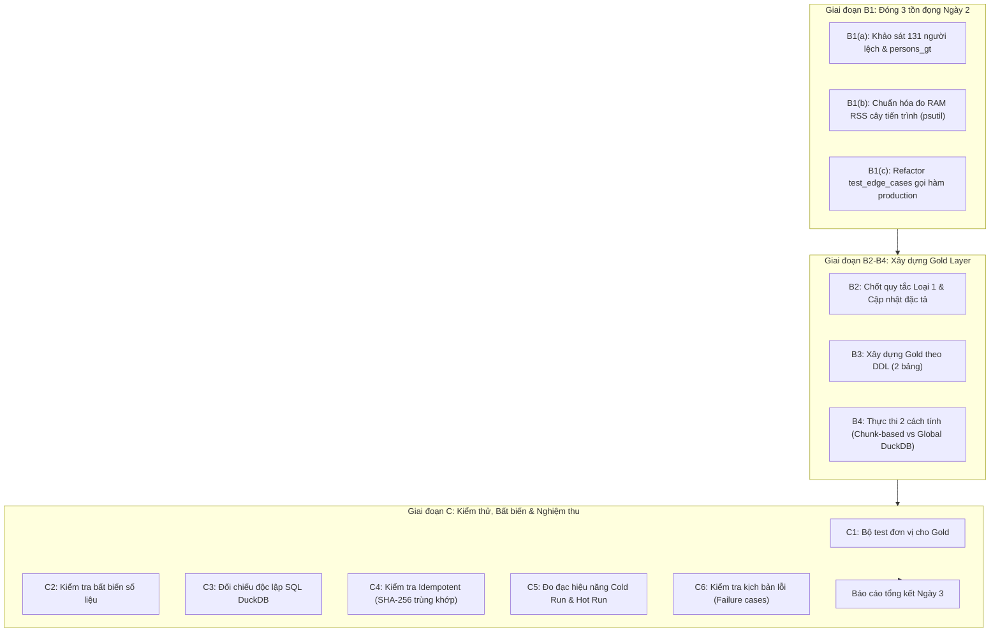

# KẾ HOẠCH THỰC HIỆN NGÀY 3: ĐÓNG TỒN ĐỌNG, XÂY DỰNG GOLD VÀ KIỂM CHỨNG TOÀN DIỆN

**Dự án:** ETL Ý 1 (CV 835/QLT) - Học sinh, Sinh viên dừng tham gia BHYT  
**Thời gian thực hiện:** Ngày 3  
**Mục tiêu:** Đóng 3 điểm tồn đọng của Ngày 2, xây dựng 2 bảng tầng Gold chuẩn DDL, kiểm chứng tính đúng đắn, chứng minh tính Idempotent và đo đạc hiệu năng thực tế.

---

## 1. CÁC QUYẾT ĐỊNH NGHIỆP VỤ & THIẾT KẾ ĐÃ CHỐT

### 1.1. Định nghĩa "Dừng tham gia"
- **Phương án mặc định (`stop_def="any"`):** Cá nhân có thẻ BHYT khối HSSV (`HS` hoặc `SV`) còn hiệu lực giao với tháng gốc (10/2024), nhưng đến tháng kiểm tra (08/2026) **không còn bất kỳ thẻ BHYT hợp lệ nào ở bất kỳ khối nào** (HS, SV, DN, GD, TE, v.v.). Đây là phương án chính xác theo tinh thần CV 835/QLT nhằm tìm đối tượng chưa tham gia lại ở bất kỳ hình thức BHYT nào.
- **Phương án phụ (`stop_def="hssv"`):** Tham số hóa cho phép người dùng lựa chọn chỉ xét việc dừng ở khối HSSV (nếu sang khối khác như Doanh nghiệp `DN` thì vẫn coi là dừng HSSV). Phương án này cho tập kết quả lớn hơn (~+37% theo khảo sát mẫu).

### 1.2. Phân loại người vừa có thẻ HS vừa có thẻ SV ở tháng gốc (nếu có)
- **Quy tắc phân loại:**
  - Nếu cá nhân có thẻ `HS` và không có thẻ `SV` ở tháng gốc: Gán `MA_KHOI_GOC = 'HS'`, tính vào cột `SO_LUONG_HS_DUNG`.
  - Nếu cá nhân có thẻ `SV` và không có thẻ `HS` ở tháng gốc: Gán `MA_KHOI_GOC = 'SV'`, tính vào cột `SO_LUONG_SV_DUNG`.
  - Nếu cá nhân có **cả hai thẻ HS và SV** cùng giao với tháng gốc:
    - Trong dữ liệu sinh thực tế (`data/bhyt_answer/answer_list.parquet`): Nhóm này có số lượng là 0.
    - Quy ước chuẩn kỹ thuật: Ưu tiên thẻ có `DEN_NGAY` muộn hơn; nếu bằng nhau ưu tiên `SV` (cấp bậc học vấn cao hơn), ghi nhận thẻ đó đại diện cho mốc gốc để đảm bảo khóa ngoại và ràng buộc duy nhất trên `SO_SO_BHXH`.

### 1.3. Quy tắc xử lý dòng bẩn Loại 1 (`TU_NGAY > DEN_NGAY`)
- Hiện tại tầng Silver đang chuyển các dòng này vào `quarantine` (390.254 dòng).
- Tại bước B1(a), sẽ thực hiện kiểm chứng thực nghiệm 3 phương án đối chiếu với Ground Truth (`persons_gt`):
  1. *Phương án Raw:* Dữ liệu thô chưa làm sạch.
  2. *Phương án Silver-Quarantine:* Cách ly không đoán sửa.
  3. *Phương án Silver-Swap:* Tự động sửa bằng cách hoán đổi `TU_NGAY` và `DEN_NGAY`.
- So sánh tỷ lệ Dương tính giả (False Positive) và Âm tính giả (False Negative) trên số liệu thực tế để đưa ra quyết định cuối cùng và cập nhật lại đặc tả.

### 1.4. Tính Idempotent và Khóa theo bộ tham số
- **Cấu trúc lưu trữ:**
  `data/output/gold/{ngay_goc}_{ngay_kiem_tra}_{stop_def}/`
  Ví dụ: `data/output/gold/20241001_20260810_any/`
- **Tên file đầu ra theo DDL:**
  - `bc_hssv_dung_tham_gia.parquet`
  - `tk_dbhc_hssv_dung_tham_gia.csv` (và `.parquet`)
- **Cơ chế ghi Atomic:**
  Ghi dữ liệu vào thư mục tạm `.tmp_{uuid}` hoặc file `.tmp`, sau khi hoàn tất kiểm tra tính toàn vẹn mới thực hiện `os.replace` (atomic rename).
- **Chứng minh:**
  Chạy lại 2 lần liên tiếp cho cùng một bộ tham số phải cho mã băm SHA-256 của các file đầu ra trùng khớp 100%. Nếu thay đổi tham số (`stop_def="hssv"`), kết quả được ghi vào thư mục riêng biệt, không ghi đè lẫn nhau.

---

## 2. DANH SÁCH BƯỚC THỰC HIỆN & TIÊU CHÍ HOÀN THÀNH

| Bước | Nội dung công việc | Đầu vào | Đầu ra | Tiêu chí hoàn thành đo được |
|:---:|---|---|---|---|
| **B1(a)** | Đóng điểm tồn đọng +131 người | `persons_gt`, `dirty_log`, `answer_list.parquet` | Bảng phân tích 3 phương án (FP/FN) | Xác định chính xác 131 người thuộc kịch bản nào trong `persons_gt` |
| **B1(b)** | Đo RAM RSS cây tiến trình | `psutil` | Module đo RAM chuẩn | Đo được RSS đỉnh của cha + con và RAM nền hệ thống |
| **B1(c)** | Refactor `test_edge_cases.py` | `src/pipelines/gold_logic.py` | `tests/test_edge_cases.py` | 100% test case import và gọi hàm production |
| **B2** | Chốt quy tắc loại 1 | Kết quả B1(a) | Cập nhật `docs/dac_ta_nghiep_vu_ngay2.md` | Có văn bản luận cứ định lượng |
| **B3** | Xây dựng Gold Layer (2 bảng DDL) | `data/silver/`, `dm_bhxh.parquet` | `data/output/gold/...` | Đủ 2 bảng `BC_HSSV_...` và `TK_DBHC_...` đúng 100% cột DDL |
| **B4** | Đo tốc độ 2 cách tính Gold | Tầng Silver | Benchmark Chunk-based vs Global DuckDB | Hai cách cho kết quả bằng nhau tuyệt đối |
| **C1** | Test đơn vị Gold | Mã nguồn Gold | Test suite pytest | 100% test cases passed |
| **C2** | Kiểm tra bất biến số liệu | Dữ liệu Gold | Script audit | Tổng TK = Số dòng BC; HS + SV = Tổng; Đủ 63 tỉnh |
| **C3** | Đối chiếu độc lập SQL DuckDB | Silver & Raw | Script đối soát | Giải trình định lượng chênh lệch không còn điểm mờ |
| **C4** | Kiểm chứng Idempotent | Pipeline Gold | Checksum SHA-256 | SHA-256 lần 1 == lần 2; kill giữa chừng không để file rác |
| **C5** | Đo hiệu năng Cold / Hot | Pipeline Gold | Bảng đo thực tế | Đo thật (giây, RSS đỉnh, dòng/s) |
| **C6** | Kịch bản lỗi | File giả lập hỏng/thiếu | Exception log | Báo lỗi rõ ràng, không tạo output rác |

---

## 3. RỦI RO & BIỆN PHÁP KIỂM SOÁT

1. **Rủi ro cạn kiệt RAM (OOM):** Máy 15,4 GB RAM, nền đã chiếm ~10,5 GB. Chỉ còn ~4,5 GB khả dụng.  
   *Biện pháp:* Giới hạn luồng DuckDB $\le 4$, buffer streaming, không load toàn bộ 200M dòng vào bộ nhớ một lúc.
2. **Rủi ro phụ thuộc cấu trúc giả lập:** Cách tính theo chunk dựa vào việc "mọi thẻ của một người nằm trong cùng 1 chunk". Nếu mang sang môi trường thực tế sẽ sai.  
   *Biện pháp:* Bắt buộc triển khai và đối chiếu song song với Cách 2 (Global Group By / Shuffle độc lập với phân vùng chunk).
3. **Rủi ro sai lệch định nghĩa tỉnh:** Cột `MA_TINH` trong thẻ có thể khác `MA_DVI` của cơ quan BHXH.  
   *Biện pháp:* Ánh xạ theo bảng danh mục `dm_bhxh` chuẩn qua `MA_CHA` như đặc tả.
