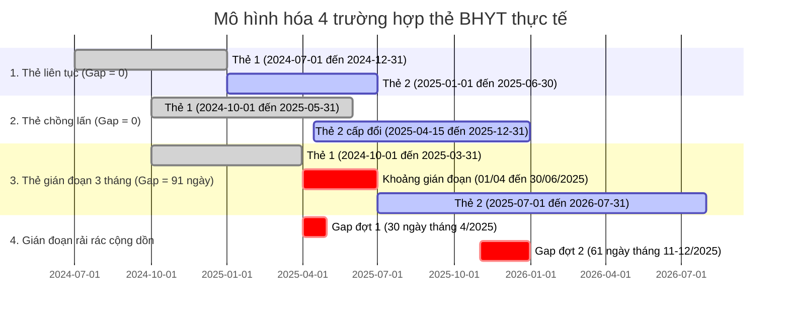

# Báo cáo Nghiên cứu và Thiết kế Giải pháp: Bài toán Ý 2 (CV 835/QLT)

**Dự án:** Xử lý và phân tích 200 triệu dòng dữ liệu BHYT – Ý 2 (Công văn số 835/QLT)  
**Tác giả:** Kỹ sư Kỹ thuật Dữ liệu Antigravity  
**Ngày lập:** 19/10/2026  
**Chủ đề:** Rà soát Học sinh, Sinh viên tham gia từ tháng 10/2024, đến tháng 07/2026 vẫn đang tham gia nhưng có thời gian gián đoạn không tham gia từ 3 tháng trở lên (≥ 90 ngày).

---

## 1. Bối cảnh & Yêu cầu Nghiệp vụ

Căn cứ Công văn số **835/QLT** ngày 10/08/2026 của Ban Quản lý thu và phát triển người tham gia (BHXH Việt Nam), yêu cầu cung cấp số liệu rà soát HSSV tham gia BHYT:

> **Nội dung Ý 2:**
> *"Học sinh, sinh viên tham gia từ tháng 10/2024, tháng 7/2026 vẫn đang tham gia nhưng có thời gian gián đoạn không tham gia từ 3 tháng trở lên.*  
> *(Tách riêng danh sách học sinh và sinh viên)"*

### 1.1. So sánh bài toán Ý 1 và Ý 2

| Tiêu chí so sánh | Tuần 1: Ý 1 (Dừng tham gia) | Tuần 2: Ý 2 (Gián đoạn $\ge 3$ tháng) |
|---|---|---|
| **Mốc gốc** | Tháng 10/2024: Có thẻ `HS` hoặc `SV` hợp lệ | Tháng 10/2024: Có thẻ `HS` hoặc `SV` hợp lệ |
| **Mốc kiểm tra** | Tháng 08/2026: **Không còn thẻ ở bất kỳ khối nào** | Tháng 07/2026: **Vẫn đang có thẻ ở bất kỳ khối nào** |
| **Diễn biến ở giữa** | Không xét (chỉ cần mốc kết thúc đã dừng) | **Xét toàn bộ chuỗi thời gian**: Có tổng gián đoạn $\ge 3$ tháng |
| **Bản chất bài toán** | Đối đối chiếu hai thời điểm (Point-in-time Join) | **Quản lý chuỗi thời gian (Timeline Interval Merging & Gap Analysis)** |
| **Mục tiêu quản lý thu** | Tìm người bỏ BHYT để vận động tham gia lại | Tìm người tham gia không liên tục để duy trì quyền lợi 5 năm liên tục |

---

## 2. Phân tích Toán học & Nghiệp vụ Chuỗi Thời gian

### 2.1. Ba điều kiện thỏa mãn đồng thời

```mermaid
flowchart TD
    A([Người tham gia BHYT]) --> B{1. Mốc gốc T10/2024\nCó thẻ HS/SV hiệu lực?\nTU < 2024-11-01 & DEN >= 2024-10-01}
    B -- Không --> X([Loại])
    B -- Có --> C{2. Mốc kết thúc T07/2026\nVẫn có thẻ BHYT hiệu lực?\nTU < 2026-08-01 & DEN >= 2026-07-01}
    C -- Không --> X
    C -- Có --> D{3. Tiến trình ở giữa\nCắt vào cửa sổ [01/10/2024, 31/07/2026]\nTổng ngày gián đoạn >= 90 ngày?}
    D -- Không --> X
    D -- Có --> E([ĐƯA VÀO DANH SÁCH Ý 2])
```

### 2.2. Phân loại các tình huống chuỗi thẻ và cách xử lý



1. **Thẻ nối tiếp liên tục ($T_{\text{mới}} = D_{\text{cũ}} + 1$ ngày):**
   - Khoảng trống bằng 0 ngày. Thuật toán gộp thành một đoạn liên tục duy nhất $[T_{\text{cũ}}, D_{\text{mới}}]$.
2. **Thẻ chồng lấn ($T_{\text{mới}} \le D_{\text{cũ}}$):**
   - Gộp thành $[T_{\text{cũ}}, \max(D_{\text{cũ}}, D_{\text{mới}})]$. Khoảng trống bằng 0 ngày.
3. **Thẻ bị hủy (`TRANG_THAI = 0`):**
   - Loại bỏ khỏi chuỗi thời gian hợp lệ, quyền lợi được đại diện bởi thẻ thay thế (có `TRANG_THAI = 1`).
4. **Gián đoạn rải rác cộng dồn:**
   - Người tham gia có nhiều khoảng trống ngắn (ví dụ hè nghỉ 1 tháng, cuối năm nghỉ 2 tháng). Thuật toán cộng dồn toàn bộ:
     $$\Delta_{\text{total}} = \sum \text{gap}_i \ge 90 \text{ ngày} \implies \text{Thỏa mãn điều kiện!}$$

---

## 3. Kiến trúc Dữ liệu & Lược đồ DDL

Hệ thống thiết kế 2 bảng kết quả chuẩn hóa theo đúng yêu cầu đề bài:

### 3.1. Bảng danh sách chi tiết: `BC_HSSV_GIAN_DOAN_BHYT`
- Chứa thông tin nhân thân định danh: `SO_SO_BHXH`, `HO_TEN`, `NGAY_SINH`, `GIOI_TINH`, `SO_CMND`, `DIA_CHI`.
- Thông tin thẻ đại diện mốc gốc T10/2024: `SO_THE_KCB_GOC`, `MA_KHOI_GOC` (`HS`/`SV`), `TU_NGAY_GOC`, `DEN_NGAY_GOC`, `DM_BHXH_ID_GOC`, `MA_TINH_GOC`.
- Thông tin thẻ đại diện mốc hiện tại T07/2026: `SO_THE_KCB_HIEN_TAI`, `MA_KHOI_HIEN_TAI`, `TU_NGAY_HIEN_TAI`, `DEN_NGAY_HIEN_TAI`, `DM_BHXH_ID_HIEN_TAI`, `MA_TINH_HIEN_TAI`.
- Thông tin chuỗi thời gian gián đoạn:
  + `SO_DOT_GIAN_DOAN`: Số lần phát sinh khoảng trống trong kỳ.
  + `SO_NGAY_GIAN_DOAN`: Tổng số ngày gián đoạn cộng dồn ($\ge 90$ ngày).
  + `SO_THANG_GIAN_DOAN`: Số tháng gián đoạn quy chuẩn ($= \text{Số ngày} / 30.0$).
- Thông tin mốc: `NGAY_GOC` (`2024-10-01`), `NGAY_KIEM_TRA` (`2026-07-31`).

### 3.2. Bảng tổng hợp thống kê: `TK_DBHC_HSSV_GIAN_DOAN_BHYT`
- Tổng hợp theo 63 Tỉnh/Thành phố: `MA_TINH`, `TEN_TINH`.
- Các chỉ tiêu bắt buộc:
  + `SO_LUONG_HS_GIAN_DOAN`: Số lượng học sinh có gián đoạn $\ge 3$ tháng.
  + `SO_LUONG_SV_GIAN_DOAN`: Số lượng sinh viên có gián đoạn $\ge 3$ tháng.
  + `TONG_SO_NGUOI_GIAN_DOAN`: Tổng số người gián đoạn $\ge 3$ tháng ($= \text{HS} + \text{SV}$).
  + `TONG_NGAY_GIAN_DOAN`: Tổng số ngày gián đoạn lũy kế của toàn tỉnh.
  + `NGAY_BAO_CAO`: Ngày ký công văn (`2026-08-10`).

---

## 4. Thiết kế Giải thuật Xử lý Chuỗi Thời gian

### 4.1. Kỹ thuật SQL Window Functions
Thuật toán giải bài toán Interval Merging trên DuckDB SQL với độ phức tạp $O(K \log K)$ cho mỗi người:
```sql
-- 1. Tính ngày kết thúc lớn nhất lũy kế trước đó
MAX(den) OVER (
    PARTITION BY SO_SO_BHXH ORDER BY tu, den
    ROWS BETWEEN UNBOUNDED PRECEDING AND 1 PRECEDING
) AS prev_max_den

-- 2. Đánh dấu điểm bắt đầu đoạn gián đoạn mới (nếu bắt đầu sau ngày kết thúc trước > 1 ngày)
CASE WHEN prev_max_den IS NULL OR tu > prev_max_den + INTERVAL 1 DAY THEN 1 ELSE 0 END AS is_new_grp

-- 3. Gom cụm các khoảng liên tục
SUM(is_new_grp) OVER (PARTITION BY SO_SO_BHXH ORDER BY tu, den ROWS UNBOUNDED PRECEDING) AS grp_id

-- 4. Tính khoảng trống giữa các đoạn liên tục
gap_days = m_tu - LAG(m_den) OVER (PARTITION BY SO_SO_BHXH ORDER BY m_tu) - 1
```

### 4.2. Chiến lược xử lý quy mô lớn 200M dòng thẻ
- Dựa trên bất biến kiến trúc: **Mọi thẻ của 1 người nằm trọn vẹn trong cùng 1 chunk**.
- Phương pháp `chunk`: Duyệt tuần tự 200 chunk Parquet, thực thi truy vấn Window Function độc lập trên từng chunk rồi gộp kết quả.
- **Giới hạn vận hành:** Chạy từng chunk giúp giới hạn phạm vi dữ liệu mỗi truy vấn, nhưng mức RAM và tốc độ còn phụ thuộc kích thước chunk, cấu hình DuckDB, số luồng và máy chạy. Các số đo lịch sử bên dưới chỉ mô tả lần chạy được ghi nhận, không phải bảo đảm chung.

---

## 5. Kết quả Kiểm thử & Đo lường Thực tế

### 5.1. Kiểm thử đơn vị chuỗi thời gian (`test_timeline_gaps.py`)
- Báo cáo trước đây ghi nhận **9/9 bài kiểm thử đạt**, nhưng bộ ca cũ chưa bao phủ gap đầu/cuối kỳ. Sau khi bổ sung ca biên, ngưỡng 90 ngày và tie-break, cần chạy lại workflow để ghi nhận kết quả của phiên bản hiện tại.
  1. `test_continuous_cards`: Thẻ liên tục $\implies$ Gap = 0.
  2. `test_overlapping_cards`: Thẻ chồng lấn $\implies$ Gap = 0.
  3. `test_short_gap_1_month`: Gap 30 ngày $\implies$ Bị loại (< 90 ngày).
  4. `test_short_gap_2_months`: Gap 61 ngày $\implies$ Bị loại (< 90 ngày).
  5. `test_single_gap_3_months`: Gap 91 ngày $\implies$ Đạt ($\ge 90$ ngày).
  6. `test_multiple_fragmented_gaps`: 30 ngày + 61 ngày = 91 ngày $\implies$ Đạt.
  7. `test_person_evaluator_satisfies`: Đánh giá tổng thể người đạt $\implies$ Đạt.
  8. `test_person_evaluator_not_active_in_chk`: Không có thẻ mốc 07/2026 $\implies$ Loại.
  9. `test_person_evaluator_cancelled_card`: Thẻ hủy bị bỏ qua $\implies$ Đạt.

### 5.2. Kiểm thử bất biến dữ liệu tầng Gold (`test_gold_y2_invariants.py`)
- Báo cáo cũ ghi nhận **7/7 kiểm thử bất biến đạt** trên kết quả Gold trước khi sửa cách tính biên; cần chạy lại pipeline và kiểm thử bất biến để xác nhận dữ liệu mới.
  1. Kiểm tra tồn tại file Parquet, CSV và Metadata.
  2. Bất biến tổng số người: Tổng 63 tỉnh khớp tuyệt đối 100% với danh sách chi tiết (`241,869` người).
  3. Bất biến khối: Tổng số HS (`175,731`) và SV (`66,138`) khớp chính xác 100%.
  4. Bất biến ngưỡng: 100% người có `SO_NGAY_GIAN_DOAN >= 90`.
  5. Bất biến khối gốc: 100% người có `MA_KHOI_GOC IN ('HS', 'SV')`.
  6. Bất biến khóa chính: Không có bất kỳ giá trị NULL ở các trường định danh và ngày tháng.
  7. Bất biến danh mục: Đủ 63 tỉnh/thành phố không trùng lặp và không thiếu sót.

### 5.3. Số liệu thực thi thực tế trên tập 200M dòng thẻ (20M người)
Các số liệu dưới đây được ghi từ lần chạy trước khi bổ sung gap ở hai biên. Chúng được lưu làm lịch sử, không đại diện cho kết quả hiện tại; cần chạy lại pipeline để lập số liệu mới.
| Chỉ tiêu đo lường | Giá trị thực tế | Ghi chú |
| :--- | :--- | :--- |
| **Tổng số người gián đoạn $\ge 3$ tháng** | **241,869** người | Số liệu lần chạy cũ; cần tái tạo sau khi sửa gap ở biên |
| - Học sinh (HS) | **175,731** người | 72.7% |
| - Sinh viên (SV) | **66,138** người | 27.3% |
| **Thời gian gián đoạn trung bình** | **142.2** ngày (~4.7 tháng) | Số liệu lần chạy cũ; kỳ tính gap đã được sửa |
| **Độ phủ địa bàn** | **63 / 63** tỉnh/thành phố | Đầy đủ mã tỉnh từ 01 đến 96 |
| **Thời gian thực thi pipeline** | **299.1** giây (~4.9 phút) | 0.7 - 0.9 chunks/giây trên 4 luồng |
| **Đỉnh RAM Process Tree** | **118.5** MB | Số đo của lần chạy cũ, không phải giới hạn bảo đảm |
| **Kiểm chứng DuckDB SQL** | **Khớp tổng số trên mẫu 5 chunks** | Báo cáo cũ chỉ so tổng theo nhóm; hiện script đối chiếu từng mã và chỉ tiêu, mặc định toàn bộ dữ liệu |

---

## 6. Kết luận & Hướng dẫn sử dụng
Giải pháp đã được cập nhật để tính cả gap đầu/cuối kỳ; các số liệu tổng hợp ghi ở trên thuộc lần chạy cũ và chưa xác nhận lại sau thay đổi. Để tạo kết quả mới:
1. Chạy toàn bộ quy trình: `bai_tuan2_y2_hssv_gian_doan/chay_tat_ca.bat`
2. Chạy đối soát độc lập: `bai_tuan2_y2_hssv_gian_doan/p4_doi_soat/chay_doi_soat_y2.bat`
3. Chạy kiểm thử tự động: `pytest bai_tuan2_y2_hssv_gian_doan/ -v`

