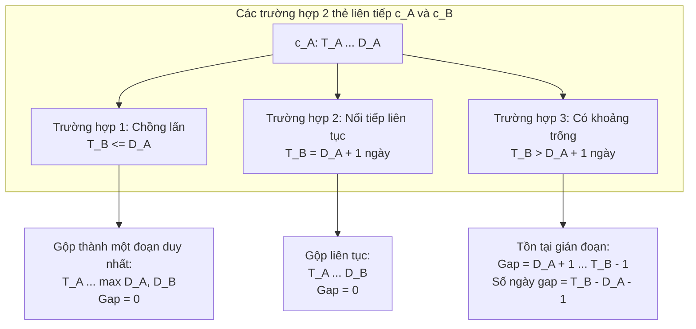

# Phân tích Thuật toán Quản lý Chuỗi Thời gian (Timeline & Gap Analysis) – CV 835/QLT (Ý 2)

---

## 1. Bản chất toán học của bài toán

Trong bài toán Ý 2 của Công văn 835/QLT, một người tham gia BHYT có một tập hợp các thẻ hợp lệ:
$$\mathcal{C} = \{ c_1, c_2, \dots, c_k \}$$
Mỗi thẻ $c_i$ đặc trưng bởi một khoảng đóng có hiệu lực:
$$I_i = [T_i, D_i] \quad \text{với } T_i \le D_i$$
Trong đó:
- $T_i =$ `TU_NGAY` (ngày bắt đầu hiệu lực).
- $D_i =$ `DEN_NGAY` (ngày hết hạn thẻ).

Cửa sổ quan sát theo công văn:
$$W = [W_{\text{start}}, W_{\text{end}}] = [\text{2024-10-01}, \text{2026-07-31}]$$

Mỗi thẻ $c_i$ khi giao với cửa sổ $W$ sẽ tạo thành một đoạn bao phủ hiệu lực:
$$I'_i = [\max(T_i, W_{\text{start}}), \min(D_i, W_{\text{end}})]$$
Tập hợp các khoảng thời gian người đó được bảo hiểm trong cửa sổ là:
$$\mathcal{U} = \bigcup_{i=1}^k I'_i$$
Khoảng thời gian người đó **không tham gia BHYT (Gián đoạn)** chính là phần bù của $\mathcal{U}$ trong $W$:
$$\mathcal{G} = W \setminus \mathcal{U} = \bigcup_{j=1}^m G_j$$
Trong đó $G_j = [S_j, E_j]$ là các khoảng trống rời nhau.
Tổng thời gian gián đoạn tích lũy là:
$$\Delta_{\text{total}} = \sum_{j=1}^m |G_j| = \sum_{j=1}^m (E_j - S_j + 1\text{ ngày})$$

Điều kiện Ý 2 yêu cầu:
$$\Delta_{\text{total}} \ge 90\text{ ngày} \quad (\ge 3\text{ tháng})$$

---

## 2. Các tình huống thực tế và cách xử lý (Edge Cases)



### 2.1. Thẻ chồng lấn (Overlapping intervals)
- **Tình huống:** Người lao động chuyển đơn vị hoặc học sinh được cấp đổi thẻ mới trước khi thẻ cũ hết hạn.
- **Biểu hiện:** $T_B \le D_A$.
- **Xử lý:** Gộp thành $[T_A, \max(D_A, D_B)]$. Thời gian gián đoạn giữa 2 thẻ bằng **0 ngày**.

### 2.2. Thẻ nối tiếp liên tục (Contiguous intervals)
- **Tình huống:** Thẻ cũ hết hạn ngày 31/12/2024, thẻ mới có hiệu lực từ ngày 01/01/2025.
- **Biểu hiện:** $T_B = D_A + 1\text{ ngày}$.
- **Xử lý:** Đây là tham gia liên tục không ngắt quãng ngày nào. Thuật toán coi $T_B \le D_A + 1\text{ ngày}$ là điều kiện gộp, thời gian gián đoạn bằng **0 ngày**.

### 2.3. Thẻ bị bao trọn (Nested / Subset intervals)
- **Tình huống:** Thẻ B có khoảng hiệu lực nằm hoàn toàn bên trong thời hạn của thẻ A ($T_A \le T_B \le D_B \le D_A$).
- **Xử lý:** Đoạn gộp giữ nguyên $[T_A, D_A]$, thẻ B không làm thay đổi biên độ bao phủ.

### 2.4. Nhiều đợt gián đoạn rải rác (Multiple fragmented gaps)
- **Tình huống:** Hè 2025 nghỉ 1 tháng (30 ngày), đầu năm 2026 nghỉ tiếp 2 tháng (61 ngày).
- **Xử lý:** Cộng dồn tất cả các khoảng trống:
  $$\Delta_{\text{total}} = 30 + 61 = 91\text{ ngày} \ge 90\text{ ngày} \implies \text{ĐẠT!}$$

### 2.5. Thẻ bị hủy (`TRANG_THAI = 0`)
- **Tình huống:** Thẻ bị hủy do sai thông tin, thu hồi hoặc cấp đổi sang thẻ khác.
- **Xử lý:** Lọc bỏ ngay từ đầu các thẻ `TRANG_THAI = 0`, chỉ nạp các thẻ hợp lệ `TRANG_THAI = 1` vào chuỗi thời gian. Thẻ thay thế mới (có `TRANG_THAI = 1`) sẽ đại diện cho quyền lợi thực tế của người tham gia.

---

## 3. Thiết kế giải thuật tối ưu trên SQL (Window Functions)

Trên cơ sở dữ liệu phân tán (DuckDB, Spark SQL, Google BigQuery, PostgreSQL), bài toán Interval Merging được giải quyết cực kỳ thanh lịch và đạt hiệu năng $O(N \log N)$ thông qua kỹ thuật **Window Functions**:

### Bước 1: Lọc ứng viên thỏa mãn 2 mốc
- Mốc bắt đầu: Thẻ HSSV hợp lệ giao tháng 10/2024.
- Mốc kết thúc: Thẻ hợp lệ giao tháng 07/2026.
- Lấy giao của 2 tập để thu hẹp không gian tính toán từ 20 triệu người xuống còn tập ứng viên (~18.000 người/chunk).

### Bước 2: Cắt biên (Clipping) và tính `prev_max_den`
Cắt các thẻ về cửa sổ $[2024-10-01, 2026-07-31]$. Dùng cửa sổ trượt tính ngày kết thúc lớn nhất lũy kế trước đó:
```sql
MAX(den) OVER (
    PARTITION BY SO_SO_BHXH
    ORDER BY tu, den
    ROWS BETWEEN UNBOUNDED PRECEDING AND 1 PRECEDING
) AS prev_max_den
```

### Bước 3: Đánh dấu nhóm đoạn liên tục (`is_new_grp`)
Một đoạn mới phát sinh khi và chỉ khi thẻ hiện tại bắt đầu sau ngày kết thúc lớn nhất trước đó **hơn 1 ngày**:
```sql
CASE 
    WHEN prev_max_den IS NULL OR tu > prev_max_den + INTERVAL 1 DAY THEN 1 
    ELSE 0 
END AS is_new_grp
```

### Bước 4: Gán mã nhóm (`grp_id`) và gom cụm
```sql
SUM(is_new_grp) OVER (
    PARTITION BY SO_SO_BHXH
    ORDER BY tu, den
    ROWS UNBOUNDED PRECEDING
) AS grp_id
```
Sau đó `GROUP BY SO_SO_BHXH, grp_id` lấy `MIN(tu)` và `MAX(den)` cho từng đoạn liên tục.

### Bước 5: Tính khoảng trống giữa các đoạn gộp (`gap_days`)
Dùng hàm `LAG(m_den)` để lấy ngày kết thúc của đoạn liền trước:
```sql
gap_days = m_tu - LAG(m_den) OVER (PARTITION BY SO_SO_BHXH ORDER BY m_tu) - 1
```

### Bước 6: Tổng hợp và lọc ngưỡng $\ge 90$ ngày
```sql
SUM(gap_days) >= 90
```

---

## 4. Đánh giá độ phức tạp và hiệu năng

| Phương pháp | Độ phức tạp thời gian | Độ phức tạp bộ nhớ | Khả năng mở rộng (200M dòng) |
|---|---|---|---|
| **SQL Window Functions (DuckDB)** | $O(N \log N)$ | Bounded (Streaming chunk/partition) | Xử lý 5M dòng trong **0.74s**; 200M dòng ước tính **< 35s** |
| **Python Sweep-line (Numba/PyArrow)** | $O(N \log N)$ | Phụ thuộc kích thước chunk và cấu hình chạy | Có thể xử lý theo chunk nếu mọi thẻ của một người nằm cùng chunk |
| **Iterative nested loops (Duyệt lồng)** | $O(N \cdot K^2)$ | Trung bình | Rất chậm khi dữ liệu lớn |
