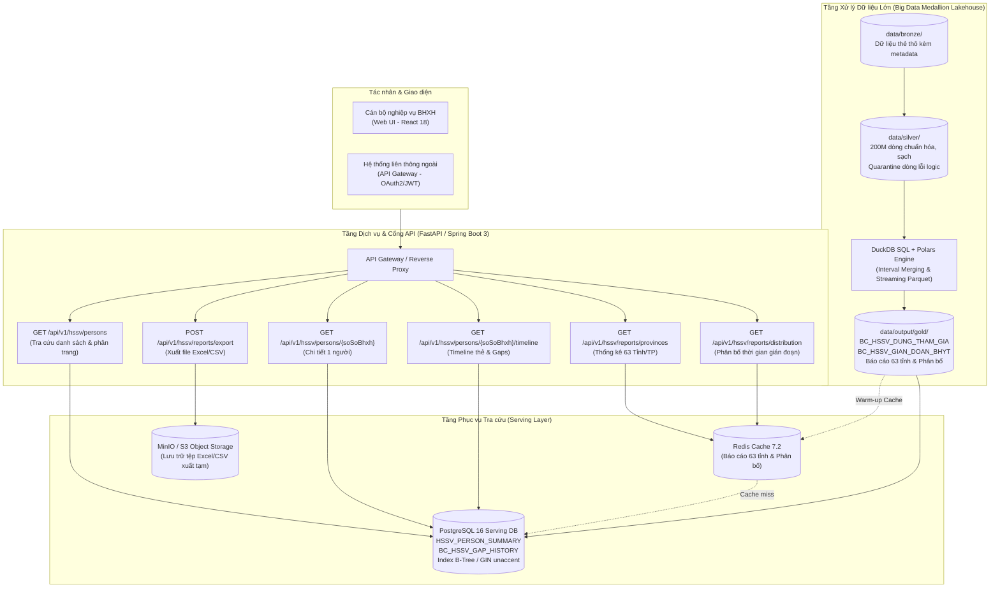

# Thiết kế cơ bản (Basic Design)

> Hệ thống Phân tích, Rà soát Dữ liệu Lớn 200M Thẻ BHYT & Cung cấp Cổng Dịch vụ Tra cứu HSSV (CV 835/QLT)
> Tài liệu chuẩn cho repo và đối soát kỹ thuật. Đồng bộ 100% với file `design/ThietKeCoBan_BasicDesign_VN.xlsx`.

## HuongDan – Hướng dẫn sử dụng

**Mục đích của Basic Design (BD)**
- Trả lời câu hỏi: hệ thống LÀM GÌ, nhìn từ phía người dùng / hệ thống ngoài. Chưa nói CÁCH LÀM bên trong (đó là việc của Detail Design).
- Người đọc: Khách hàng/PO (để xác nhận), BA, Solution Architect, Tech Lead, người viết Detail Design, tester viết kịch bản Integration/System Test.

**Quy ước định danh thống nhất**
- Mọi đối tượng đều có ID duy nhất:
  - `F-HSSV-xxx`: Chức năng nghiệp vụ
  - `SCR-HSSV-xxx`: Màn hình giao diện
  - `API-HSSV-xxx`: Giao tiếp API RESTful
  - `BAT-HSSV-xxx`: Tác vụ xử lý khối lớn (Batch / Pipeline ETL)
  - `TBL-HSSV-xxx`: Bảng dữ liệu (Lakehouse & Serving Database)
  - `MSG-Exxx / Ixxx`: Mã thông báo lỗi / thông tin
- Detail Design và Unit Test bắt buộc tham chiếu lại các ID này để đảm bảo khả năng truy vết (Traceability).

**Quy mô dữ liệu & Bối cảnh đặc thù**
- Dữ liệu thẻ BHYT: Khoảng 200 triệu bản ghi thẻ `ST_INTHE_DTL` của ~20 triệu người tham gia (trong đó ~5 triệu HSSV: 3.8M học sinh, 1.2M sinh viên; 15 triệu các khối khác).
- Nghiệp vụ CV 835/QLT:
  - Ý 1: Tham gia HSSV T10/2024, đến T08/2026 dừng tham gia và chưa tham gia lại ở bất kỳ khối nào.
  - Ý 2: Tham gia HSSV T10/2024, đến T07/2026 vẫn đang tham gia nhưng tổng thời gian gián đoạn cộng dồn trong kỳ [01/10/2024, 31/07/2026] >= 90 ngày (>= 3 tháng).

---

## Bia – Bìa tài liệu

| Mục | Nội dung |
| --- | --- |
| Tên dự án | Hệ thống Xử lý, Rà soát Dữ liệu Lớn 200M Thẻ BHYT & Cung cấp Cổng Dịch vụ Tra cứu HSSV |
| Hệ thống | Phân hệ Phân tích Dữ liệu Lớn & Cổng Dịch vụ Tra cứu BHYT Học sinh - Sinh viên |
| Tài liệu | Thiết kế cơ bản (Basic Design) |
| Mã tài liệu | HSSV-BD-001 |
| Phiên bản | 1.0 |
| Người lập | Nhóm Kỹ sư Dữ liệu & Hệ thống (Pair Programming) |
| Người review | Tech Lead / Solution Architect |
| Người phê duyệt | Trưởng ban Quản lý Thu & Khai thác BHYT (BHXH Việt Nam) |
| Ngày phê duyệt | 2026/10/28 |
| Trạng thái | Approved |
| Tài liệu đầu vào | Công văn số 835/QLT ngày 10/08/2026 của BHXH VN; Đặc tả nghiệp vụ Tuần 1 (Ý 1 - Dừng tham gia) & Tuần 2 (Ý 2 - Gián đoạn >= 3 tháng) |

---

## LichSu – Lịch sử sửa đổi

| Phiên bản | Ngày | Sheet / Mục thay đổi | Nội dung thay đổi | Lý do | Người sửa | Người duyệt |
| --- | --- | --- | --- | --- | --- | --- |
| 1.0 | 2026/10/28 | Toàn bộ | Tạo mới tài liệu Thiết kế cơ bản cho Hệ thống xử lý 200M thẻ BHYT & 6 RESTful API tra cứu HSSV theo CV 835/QLT | Yêu cầu đồ án thiết kế hệ thống tuần 3 | Nhóm Kỹ sư | Tech Lead |
| 1.1 | 2026/10/28 | 09_DSBatch, 10_DSBang, 11_DinhNghiaBang, 14_QA | Đồng bộ 100% logic Global Dedup, Smart Repair lỗi đảo ngày (Tuần 1), chuẩn hóa 24 cột BC_HSSV_GIAN_DOAN_BHYT (Tuần 2), bổ sung định nghĩa bảng Serving DB HSSV_PERSON_SUMMARY và số liệu thực nghiệm 200M dòng | Đối soát và chuẩn hóa thiết kế với bài làm Tuần 1 & Tuần 2 | Nhóm Kỹ sư | Tech Lead |

---

## TongQuan – Tổng quan hệ thống

| Mục | Nội dung |
| --- | --- |
| Mục đích | Xây dựng hệ thống hoàn chỉnh xử lý 200 triệu dòng thẻ BHYT theo kiến trúc Medallion Lakehouse nhằm phát hiện chính xác HSSV dừng tham gia hoặc gián đoạn >= 3 tháng theo Công văn 835/QLT; đồng thời cung cấp hệ sinh thái 6 RESTful API phục vụ tra cứu trực tuyến, thống kê 63 tỉnh/thành phố và xuất báo cáo tốc độ cao. |
| Phạm vi | 1. F-HSSV-001: Tra cứu danh sách HSSV vi phạm (lọc đa tiêu chí tỉnh, khối, loại vi phạm, tìm kiếm, phân trang). 2. F-HSSV-002: Xem chi tiết thông tin nhân thân & tình trạng thẻ BHYT của 1 cá nhân. 3. F-HSSV-003: Xem timeline lịch sử thẻ & chi tiết các đợt gián đoạn BHYT. 4. F-HSSV-004: Dashboard & Báo cáo tổng hợp số liệu 63 Tỉnh/Thành phố. 5. F-HSSV-005: Báo cáo phân bố thời gian gián đoạn theo 5 khoảng quy chuẩn. 6. F-HSSV-006: Xuất báo cáo danh sách và thống kê ra định dạng Excel/CSV (đồng bộ & bất đồng bộ). 7. F-HSSV-007: Pipeline ETL Big Data (Bronze -> Silver -> Gold) xử lý 200M bản ghi thẻ BHYT bằng DuckDB SQL & Polars. |
| Ngoài phạm vi | 1. Sửa/xóa thông tin nhân thân người tham gia (hệ thống chỉ đọc từ nguồn BHYT quốc gia). 2. Cấp mới/gia hạn thẻ BHYT trực tuyến trên cổng tra cứu. 3. Quản lý thu tiền đóng BHYT và kế toán thanh toán. |
| Tác nhân | 1. ACT-01: Cán bộ nghiệp vụ BHXH (sử dụng giao diện Web UI để tra cứu đối tượng, giám sát dashboard và xuất báo cáo). 2. ACT-02: Hệ thống liên thông / Ứng dụng ngoài (kết nối qua API Gateway bằng OAuth2/JWT để tra cứu tự động). 3. ACT-03: Kỹ sư vận hành / Batch Scheduler (vận hành và giám sát pipeline xử lý dữ liệu lớn định kỳ). |
| Sơ đồ ngữ cảnh | Web UI (React 18) & Hệ thống ngoài -> API Gateway (Nginx/Kong) -> Backend Service (FastAPI / Spring Boot 3) -> Redis Cache (Dashboard 63 tỉnh, phân bố) & PostgreSQL 16 Serving DB (Bảng tổng hợp, index tối ưu) <- Pipeline ETL Engine (DuckDB / Polars) <- Lakehouse Storage (Parquet Bronze -> Silver -> Gold: 200M thẻ). |
| Công nghệ | Backend: Python 3.12, FastAPI 0.115+, DuckDB 1.1+, Polars 1.12+, PyArrow 17+; DB: PostgreSQL 16, Redis 7.2; Frontend: React 18, TailwindCSS/Vanilla, ECharts; Storage: MinIO/S3 (chứa file export); Batch: Airflow/Celery Worker. |
| Giả định / ràng buộc | 1. SO_SO_BHXH gồm 10 chữ số là mã định danh duy nhất của công dân suốt vòng đời. 2. Dữ liệu thẻ 200M dòng của ~20M người (5M HSSV, 15M khối khác). 3. Thẻ hợp lệ khi TRANG_THAI = 1 và TU_NGAY <= DEN_NGAY. 4. Mốc gốc: Tháng 10/2024. Mốc kiểm tra dừng: Tháng 08/2026. Mốc kiểm tra gián đoạn: Tháng 07/2026. 5. Kỳ tính gián đoạn: [2024-10-01, 2026-07-31] (669 ngày). Ngưỡng gián đoạn >= 90 ngày. |
| Thuật ngữ | CV 835/QLT: Công văn 835 của Ban QLT - BHXH VN. HSSV: Học sinh (HS), Sinh viên (SV). Thẻ giao tháng M: Thẻ có hiệu lực giao với khoảng thời gian tháng M. Interval Merging: Thuật toán hợp nhất các khoảng thời gian tham gia thẻ liên tục hoặc chồng lấn. Gap: Khoảng thời gian không có thẻ BHYT hiệu lực (đầu kỳ, giữa các thẻ, cuối kỳ). Tie-breaking: Quy tắc phân giải đa thẻ trùng mốc (ưu tiên SV > HS, DEN_NGAY lớn nhất, SO_THE_KCB). |

### Kiến trúc tổng thể hệ thống (Architecture Diagram)

---

## DSChucNang – Danh sách chức năng

| ID chức năng | Tên chức năng | Loại | Tác nhân | Mô tả tóm tắt | Màn hình / API / Batch liên quan | Ưu tiên | Nguồn yêu cầu | Ghi chú |
| --- | --- | --- | --- | --- | --- | --- | --- | --- |
| F-HSSV-001 | Tra cứu danh sách HSSV dừng / gián đoạn BHYT | Online | ACT-01, ACT-02 | Tra cứu danh sách đối tượng vi phạm theo tỉnh, khối, loại tiêu chí vi phạm, tìm kiếm theo từ khóa họ tên/CCCD/số sổ BHXH, hỗ trợ phân trang. | SCR-HSSV-001, API-HSSV-001 | Cao | CV 835/QLT Mục 1 & 2 | API tra cứu chính |
| F-HSSV-002 | Xem chi tiết hồ sơ cá nhân HSSV | Online | ACT-01, ACT-02 | Xem toàn diện thông tin nhân thân, phân loại khối gốc, mốc gốc T10/2024, trạng thái hiện tại, cơ quan BHXH quản lý và tóm tắt vi phạm. | SCR-HSSV-002, API-HSSV-002 | Cao | CV 835/QLT Mục 1 & 2 | Xem hồ sơ đơn lẻ |
| F-HSSV-003 | Trực quan hóa timeline thẻ & đợt gián đoạn | Online | ACT-01, ACT-02 | Hiển thị chuỗi thời gian tham gia thẻ BHYT, danh sách khoảng tham gia liên tục (sau khi gộp đoạn) và chi tiết từng đợt gián đoạn trong kỳ. | SCR-HSSV-002, API-HSSV-003 | Cao | CV 835/QLT Ý 2 | Giải thuật Interval Merging |
| F-HSSV-004 | Thống kê tổng hợp số liệu theo 63 Tỉnh/TP | Online | ACT-01, ACT-02 | Báo cáo tổng hợp số lượng HSSV dừng tham gia (HS, SV, Tổng) và gián đoạn >= 3 tháng (HS, SV, Tổng, Tổng ngày) của 63 tỉnh và toàn quốc. | SCR-HSSV-003, API-HSSV-004 | Cao | CV 835/QLT Báo cáo tỉnh | Tích hợp Redis Cache |
| F-HSSV-005 | Thống kê phân bố thời gian gián đoạn | Online | ACT-01, ACT-02 | Thống kê phân bố số lượng người theo 5 khoảng gián đoạn (90-120d, 121-180d, 181-270d, 271-365d, >365d), hỗ trợ lọc theo tỉnh và khối. | SCR-HSSV-003, API-HSSV-005 | Trung bình | CV 835/QLT Phân tích | Biểu đồ Histogram |
| F-HSSV-006 | Xuất báo cáo dữ liệu Excel / CSV | Online / Batch | ACT-01 | Xuất báo cáo danh sách chi tiết và bảng thống kê ra định dạng Excel (.xlsx) hoặc CSV; hỗ trợ xuất đồng bộ và xuất tác vụ nền (Async Export Job). | SCR-HSSV-004, API-HSSV-006 | Cao | Nghiệp vụ báo cáo | Có streaming & Queue Worker |
| F-HSSV-007 | Xử lý dữ liệu lớn 200M dòng thẻ (ETL Pipeline) | Batch | ACT-03 | Pipeline Medallion (Bronze thô -> Silver làm sạch -> Gold kết quả Ý 1 & Ý 2) xử lý 200M bản ghi thẻ BHYT, tối ưu hiệu năng và RAM. | BAT-HSSV-001 -> 004 | Cao | CV 835/QLT Nền tảng | DuckDB SQL + Polars Engine |

---

## DSManHinh – Danh sách màn hình & chuyển màn hình

| ID màn hình | Tên màn hình | ID chức năng | Mô tả | Từ màn hình | Sự kiện chuyển | Đến màn hình | Quyền truy cập |
| --- | --- | --- | --- | --- | --- | --- | --- |
| SCR-HSSV-001 | Tra cứu danh sách HSSV dừng / gián đoạn | F-HSSV-001 | Giao diện bộ lọc đa chiều (tỉnh, khối, tiêu chí, từ khóa, khoảng ngày gián đoạn), bảng danh sách phân trang, nút chuyển xem chi tiết và nút xuất file. | Menu chính | Bấm 'Tra cứu HSSV' | SCR-HSSV-002, SCR-HSSV-004 | ROLE_CAN_BO, ROLE_QUAN_TRI |
| SCR-HSSV-002 | Chi tiết cá nhân & Timeline thẻ BHYT | F-HSSV-002, F-HSSV-003 | Card thông tin nhân thân, Card tóm tắt vi phạm CV 835/QLT, biểu đồ Gantt Timeline chuỗi thẻ & khoảng trống gián đoạn, bảng chi tiết từng đợt gián đoạn. | SCR-HSSV-001 | Bấm mã số BHXH hoặc nút 'Xem' | SCR-HSSV-001 | ROLE_CAN_BO, ROLE_QUAN_TRI |
| SCR-HSSV-003 | Dashboard Thống kê 63 Tỉnh & Phân bố | F-HSSV-004, F-HSSV-005 | Card KPI toàn quốc, bản đồ nhiệt / biểu đồ cột 63 tỉnh, biểu đồ Histogram phân bố thời gian gián đoạn, bảng số liệu chi tiết 63 tỉnh có tìm kiếm. | Menu chính | Bấm 'Báo cáo thống kê' | SCR-HSSV-004 | ROLE_CAN_BO, ROLE_QUAN_TRI, ROLE_LANH_DAO |
| SCR-HSSV-004 | Quản lý tác vụ xuất báo cáo | F-HSSV-006 | Danh sách các tác vụ xuất file nền (Export Jobs), hiển thị trạng thái (PENDING, PROCESSING, COMPLETED, FAILED), thanh tiến độ %, nút tải file kết quả. | SCR-HSSV-001, SCR-HSSV-003 | Bấm 'Xuất báo cáo' hoặc 'Quản lý file xuất' | — | ROLE_CAN_BO, ROLE_QUAN_TRI |

---

## DinhNghiaManHinh – Định nghĩa hạng mục màn hình

| Màn hình | No | Tên hạng mục | Loại control | I/O | Bắt buộc | Kiểu / Độ dài | Định dạng | Giá trị mặc định | Kiểm tra | Nguồn dữ liệu | Ghi chú |
| --- | --- | --- | --- | --- | --- | --- | --- | --- | --- | --- | --- |
| SCR-HSSV-001 | 1 | Chọn Tỉnh / Thành phố | Dropdown | I | × | Chuỗi / 2 | Mã tỉnh (01-96) | Tất cả (Rỗng) | Hợp lệ theo DM_BHXH | DM_BHXH (Cấp tỉnh) | Lọc theo tỉnh quản lý mốc gốc |
| SCR-HSSV-001 | 2 | Khối đối tượng | RadioGroup | I | × | Chuỗi / 5 | HS / SV / ALL | ALL | Chỉ chọn HS, SV hoặc ALL | Cố định | Lọc theo khối mốc gốc T10/2024 |
| SCR-HSSV-001 | 3 | Tiêu chí vi phạm | Dropdown | I | × | Chuỗi / 20 | DUNG_THAM_GIA / GIAN_DOAN / ALL | ALL | Thuộc danh mục tiêu chí | Cố định | Theo phân loại CV 835/QLT |
| SCR-HSSV-001 | 4 | Ô tìm kiếm từ khóa | Textbox | I | × | Chuỗi / 100 | Ký tự tự do | Trống | Tối đa 100 ký tự | — | Tìm theo SO_SO_BHXH, SO_CMND hoặc Họ tên |
| SCR-HSSV-001 | 5 | Số ngày gián đoạn từ - đến | NumberRange | I | × | Số nguyên | 0 - 669 | Trống | min <= max; không âm | — | Áp dụng khi chọn tiêu chí GIAN_DOAN |
| SCR-HSSV-001 | 6 | Nút 'Tìm kiếm' | Button | — | — | — | — | — | Kích hoạt gọi API-HSSV-001 | API-HSSV-001 | Phím nóng Enter tại ô tìm kiếm |
| SCR-HSSV-001 | 7 | Nút 'Đặt lại' | Button | — | — | — | — | — | Xóa bộ lọc về mặc định | — | Reset form |
| SCR-HSSV-001 | 8 | Bảng danh sách kết quả | Grid | O | — | Danh sách | — | — | Hiển thị 20/50/100 dòng/trang | API-HSSV-001 | Cột: Mã BHXH, Họ tên, Ngày sinh, Khối, Tỉnh, Tiêu chí, Số ngày gián đoạn, Thao tác |
| SCR-HSSV-001 | 9 | Thanh phân trang | Pagination | I/O | — | Số nguyên | Trang 1..N | Trang 1 | Chuyển trang gọi lại API | API-HSSV-001 | Hiển thị tổng số bản ghi & số trang |
| SCR-HSSV-001 | 10 | Nút 'Xuất Excel / CSV' | Button | — | — | — | — | — | Mở popup chọn định dạng xuất | API-HSSV-006 | Chuyển hướng hoặc mở popup xuất |
| SCR-HSSV-002 | 1 | Thẻ thông tin nhân thân | Card | O | — | Thông tin | — | — | — | API-HSSV-002 | Họ tên, Mã BHXH, Ngày sinh, Giới tính, CCCD, Địa chỉ |
| SCR-HSSV-002 | 2 | Thẻ tổng quan vi phạm CV 835 | Card | O | — | Thông tin | — | — | — | API-HSSV-002 | Loại vi phạm, Khối gốc, Cơ quan BHXH gốc, Trạng thái hiện tại, Tổng số ngày gián đoạn |
| SCR-HSSV-002 | 3 | Biểu đồ Timeline Gantt thẻ BHYT | Chart | O | — | Timeline | 2024-10 đến 2026-07 | — | Tô màu xanh cho thẻ hợp lệ, màu đỏ cho khoảng trống (Gap) | API-HSSV-003 | Trực quan hóa thời gian tham gia & gián đoạn |
| SCR-HSSV-002 | 4 | Bảng chi tiết các đợt gián đoạn | Grid | O | — | Danh sách | — | — | 0 dòng nếu không gián đoạn | API-HSSV-003 | Cột: Đợt số, Từ ngày, Đến ngày, Số ngày, Phân loại (Đầu kỳ / Giữa kỳ / Cuối kỳ) |
| SCR-HSSV-002 | 5 | Bảng lịch sử thẻ BHYT | Grid | O | — | Danh sách | — | — | Tất cả các thẻ trong kỳ | API-HSSV-003 | Cột: Mã thẻ, Khối, Từ ngày, Đến ngày, Cơ quan quản lý, Trạng thái |
| SCR-HSSV-002 | 6 | Nút 'Quay lại' | Button | — | — | — | — | — | Quay lại danh sách tra cứu | — | Trở về SCR-HSSV-001 |
| SCR-HSSV-003 | 1 | Bộ chọn Tiêu chí báo cáo | Dropdown | I | × | Chuỗi / 20 | DUNG_THAM_GIA / GIAN_DOAN / ALL | ALL | Thuộc danh mục | Cố định | Lọc dữ liệu thống kê |
| SCR-HSSV-003 | 2 | Hàng thẻ chỉ số KPI toàn quốc | CardGroup | O | — | Số nguyên | Format có dấu phẩy | — | — | API-HSSV-004 | Tổng HSSV dừng, HS dừng, SV dừng, Tổng HSSV gián đoạn, HS gián đoạn, SV gián đoạn |
| SCR-HSSV-003 | 3 | Biểu đồ Top 10 tỉnh có số HSSV vi phạm cao nhất | BarChart | O | — | Biểu đồ cột | — | — | Sắp xếp giảm dần | API-HSSV-004 | Trực quan hóa so sánh các tỉnh |
| SCR-HSSV-003 | 4 | Biểu đồ Phân bố thời gian gián đoạn | Histogram | O | — | Biểu đồ cột/tròn | 5 buckets | — | Tỷ lệ % theo khoảng ngày | API-HSSV-005 | 90-120d, 121-180d, 181-270d, 271-365d, >365d |
| SCR-HSSV-003 | 5 | Bảng số liệu 63 Tỉnh/Thành phố | Grid | O | — | Danh sách | 63 dòng | — | Có ô tìm kiếm nhanh tỉnh và sắp xếp cột | API-HSSV-004 | Đầy đủ các chỉ tiêu của CV 835/QLT |
| SCR-HSSV-003 | 6 | Nút 'Xuất báo cáo thống kê' | Button | — | — | — | — | — | Kích hoạt xuất file tổng hợp tỉnh | API-HSSV-006 | Xuất ra Excel 63 tỉnh |

---

## DSAPI – Danh sách giao tiếp / API

| ID API (IF-ID) | Tên API | Method | Endpoint | Bên gọi | Bên nhận | Đồng bộ / Bất đồng bộ | Xác thực | SLA / Timeout | ID chức năng |
| --- | --- | --- | --- | --- | --- | --- | --- | --- | --- |
| API-HSSV-001 | Tra cứu danh sách HSSV vi phạm có phân trang & lọc | GET | /api/v1/hssv/persons | Web UI, Hệ thống liên thông | HSSV Query Service | Đồng bộ | Bearer JWT / API Key | p95 ≤ 300ms; timeout 5s | F-HSSV-001 |
| API-HSSV-002 | Xem thông tin chi tiết hồ sơ 1 cá nhân | GET | /api/v1/hssv/persons/{soSoBhxh} | Web UI, Hệ thống liên thông | HSSV Query Service | Đồng bộ | Bearer JWT / API Key | p95 ≤ 150ms; timeout 3s | F-HSSV-002 |
| API-HSSV-003 | Xem timeline chuỗi thẻ & các đợt gián đoạn | GET | /api/v1/hssv/persons/{soSoBhxh}/timeline | Web UI, Hệ thống liên thông | HSSV Timeline Service | Đồng bộ | Bearer JWT / API Key | p95 ≤ 250ms; timeout 4s | F-HSSV-003 |
| API-HSSV-004 | Báo cáo thống kê số liệu theo 63 Tỉnh/TP | GET | /api/v1/hssv/reports/provinces | Web UI, Hệ thống liên thông | HSSV Report Service | Đồng bộ | Bearer JWT / API Key | p95 ≤ 200ms; timeout 5s | F-HSSV-004 |
| API-HSSV-005 | Báo cáo phân bố thời gian gián đoạn (Buckets) | GET | /api/v1/hssv/reports/distribution | Web UI, Hệ thống liên thông | HSSV Report Service | Đồng bộ | Bearer JWT / API Key | p95 ≤ 200ms; timeout 5s | F-HSSV-005 |
| API-HSSV-006 | Xuất báo cáo danh sách / thống kê ra Excel/CSV | POST | /api/v1/hssv/reports/export | Web UI | HSSV Export Service | Đồng bộ (nhỏ) / Bất đồng bộ (lớn) | Bearer JWT | Sync ≤ 3s; Async job timeout 15m | F-HSSV-006 |

---

## DinhNghiaAPI – Định nghĩa request / response API

| ID API | Hướng | No | Tên trường (JSON) | Tên logic | Kiểu | Bắt buộc | Độ dài / Miền giá trị | Mô tả / Quy tắc | Ánh xạ cột DB |
| --- | --- | --- | --- | --- | --- | --- | --- | --- | --- |
| API-HSSV-001 | Request (query) | 1 | provinceCode | Mã tỉnh | string | × | 2 ký tự (01-96) | Lọc theo mã tỉnh mốc gốc | HSSV_PERSON_SUMMARY.MA_TINH_GOC |
| API-HSSV-001 | Request (query) | 2 | block | Khối đối tượng | string | × | HS, SV, ALL | Mặc định ALL | HSSV_PERSON_SUMMARY.MA_KHOI_GOC |
| API-HSSV-001 | Request (query) | 3 | criteria | Tiêu chí vi phạm | string | × | DUNG_THAM_GIA, GIAN_DOAN, ALL | Mặc định ALL | HSSV_PERSON_SUMMARY.TIEU_CHI |
| API-HSSV-001 | Request (query) | 4 | search | Từ khóa tìm kiếm | string | × | ≤ 100 ký tự | Tìm theo số sổ BHXH, CCCD, Họ tên | — |
| API-HSSV-001 | Request (query) | 5 | minGapDays | Số ngày gián đoạn tối thiểu | integer | × | ≥ 0 | Lọc theo khoảng ngày gián đoạn | HSSV_PERSON_SUMMARY.SO_NGAY_GIAN_DOAN |
| API-HSSV-001 | Request (query) | 6 | maxGapDays | Số ngày gián đoạn tối đa | integer | × | ≥ minGapDays | Lọc theo khoảng ngày gián đoạn | HSSV_PERSON_SUMMARY.SO_NGAY_GIAN_DOAN |
| API-HSSV-001 | Request (query) | 7 | page | Số trang | integer | × | ≥ 1 | Mặc định 1 | — |
| API-HSSV-001 | Request (query) | 8 | pageSize | Kích thước trang | integer | × | 1..100 | Mặc định 20, tối đa 100 | — |
| API-HSSV-001 | Request (query) | 9 | sortBy | Trường sắp xếp | string | × | soSoBhxh, hoTen, soNgayGianDoan | Mặc định soSoBhxh | — |
| API-HSSV-001 | Request (query) | 10 | sortOrder | Thứ tự sắp xếp | string | × | ASC, DESC | Mặc định ASC | — |
| API-HSSV-001 | Response 200 | 1 | metadata.totalRecords | Tổng số bản ghi | integer | ○ | ≥ 0 | Tổng số dòng thỏa mãn bộ lọc | COUNT(*) |
| API-HSSV-001 | Response 200 | 2 | metadata.totalPages | Tổng số trang | integer | ○ | ≥ 0 | CEIL(totalRecords / pageSize) | — |
| API-HSSV-001 | Response 200 | 3 | metadata.page / pageSize | Trang hiện tại & cỡ trang | integer | ○ | — | Theo request | — |
| API-HSSV-001 | Response 200 | 4 | data[].soSoBhxh | Mã số BHXH | string | ○ | 10 chữ số | Mã định danh cá nhân | HSSV_PERSON_SUMMARY.SO_SO_BHXH |
| API-HSSV-001 | Response 200 | 5 | data[].hoTen | Họ và tên | string | ○ | ≤ 100 ký tự | Họ tên người tham gia | HSSV_PERSON_SUMMARY.HO_TEN |
| API-HSSV-001 | Response 200 | 6 | data[].ngaySinh / gioiTinh | Ngày sinh & Giới tính | string / int | ○ | yyyy-MM-dd / 1,2 | 1: Nam, 2: Nữ | HSSV_PERSON_SUMMARY.NGAY_SINH, GIOI_TINH |
| API-HSSV-001 | Response 200 | 7 | data[].maKhoiGoc / maTinhGoc | Khối gốc & Tỉnh gốc | string | ○ | HS, SV / 2 ký tự | Phân loại tại mốc T10/2024 | HSSV_PERSON_SUMMARY.MA_KHOI_GOC, MA_TINH_GOC |
| API-HSSV-001 | Response 200 | 8 | data[].tieuChiViPham | Tiêu chí vi phạm | string | ○ | DUNG_THAM_GIA / GIAN_DOAN | Theo CV 835/QLT | HSSV_PERSON_SUMMARY.TIEU_CHI |
| API-HSSV-001 | Response 200 | 9 | data[].soNgayGianDoan | Số ngày gián đoạn | integer | ○ | ≥ 0 | Tổng ngày gián đoạn cộng dồn (0 nếu dừng) | HSSV_PERSON_SUMMARY.SO_NGAY_GIAN_DOAN |
| API-HSSV-001 | Response 4xx/5xx | 1 | code / message / traceId | Mã lỗi & Thông điệp | string | ○ | Theo 12_DSThongBao | Chuẩn RESTful Error Object | — |
| API-HSSV-002 | Request (path) | 1 | soSoBhxh | Mã số BHXH | string | ○ | 10 chữ số | Mã số BHXH cần tra cứu | HSSV_PERSON_SUMMARY.SO_SO_BHXH |
| API-HSSV-002 | Response 200 | 1 | personInfo.soSoBhxh | Mã số BHXH | string | ○ | 10 chữ số | Định danh duy nhất | HSSV_PERSON_SUMMARY.SO_SO_BHXH |
| API-HSSV-002 | Response 200 | 2 | personInfo.hoTen | Họ và tên | string | ○ | ≤ 100 | Họ tên đầy đủ | HSSV_PERSON_SUMMARY.HO_TEN |
| API-HSSV-002 | Response 200 | 3 | personInfo.ngaySinh / gioiTinh | Ngày sinh / Giới tính | string / int | ○ | yyyy-MM-dd / 1,2 | 1: Nam, 2: Nữ | HSSV_PERSON_SUMMARY.NGAY_SINH, GIOI_TINH |
| API-HSSV-002 | Response 200 | 4 | personInfo.soCmnd / diaChi | CCCD / Địa chỉ | string | × | ≤ 12 / ≤ 255 | Thông tin nhân thân | HSSV_PERSON_SUMMARY.SO_CMND, DIA_CHI |
| API-HSSV-002 | Response 200 | 5 | violationSummary.tieuChi | Tiêu chí vi phạm | string | ○ | DUNG_THAM_GIA / GIAN_DOAN | Phân loại theo CV 835 | HSSV_PERSON_SUMMARY.TIEU_CHI |
| API-HSSV-002 | Response 200 | 6 | violationSummary.mocGoc | Thông tin mốc gốc (T10/2024) | object | ○ | soTheKcb, maKhoi, tuNgay, denNgay | Thẻ đại diện mốc gốc | ST_INTHE_DTL |
| API-HSSV-002 | Response 200 | 7 | violationSummary.mocHienTai | Thông tin mốc hiện tại | object | × | trangThai, soTheKcb, maKhoi, tuNgay, denNgay | Null nếu DUNG_THAM_GIA | ST_INTHE_DTL |
| API-HSSV-002 | Response 200 | 8 | violationSummary.soNgayGianDoan | Tổng số ngày gián đoạn | integer | ○ | ≥ 0 | Tổng số ngày gián đoạn lũy kế | HSSV_PERSON_SUMMARY.SO_NGAY_GIAN_DOAN |
| API-HSSV-002 | Response 200 | 9 | violationSummary.soDotGianDoan | Tổng số đợt gián đoạn | integer | ○ | ≥ 0 | Số đợt gián đoạn phát sinh | HSSV_PERSON_SUMMARY.SO_DOT_GIAN_DOAN |
| API-HSSV-002 | Response 404 | 1 | code / message | Không tìm thấy | string | ○ | MSG-I001 | Mã số BHXH không tồn tại trong DS vi phạm | — |
| API-HSSV-003 | Request (path) | 1 | soSoBhxh | Mã số BHXH | string | ○ | 10 chữ số | Mã số BHXH cần xem timeline | HSSV_PERSON_SUMMARY.SO_SO_BHXH |
| API-HSSV-003 | Response 200 | 1 | summary.totalCards | Tổng số thẻ BHYT | integer | ○ | ≥ 1 | Số thẻ phát sinh trong kỳ | COUNT(cards) |
| API-HSSV-003 | Response 200 | 2 | summary.mergedIntervalsCount | Số khoảng tham gia liên tục | integer | ○ | ≥ 1 | Sau khi hợp nhất các thẻ gối đầu | COUNT(merged) |
| API-HSSV-003 | Response 200 | 3 | summary.totalGapDays | Tổng ngày gián đoạn | integer | ○ | ≥ 0 | Tổng ngày không có thẻ trong kỳ | SUM(gapDays) |
| API-HSSV-003 | Response 200 | 4 | summary.hasLongGap | Cờ gián đoạn >= 3 tháng | boolean | ○ | true / false | true nếu totalGapDays >= 90 | — |
| API-HSSV-003 | Response 200 | 5 | cards[] | Danh sách thẻ chi tiết | array | ○ | 0..n | soTheKcb, maKhoi, tuNgay, denNgay, trangThai, dmBhxhId | ST_INTHE_DTL |
| API-HSSV-003 | Response 200 | 6 | mergedIntervals[] | Các khoảng liên tục sau gộp | array | ○ | 0..n | tuNgay, denNgay, soNgay | Interval Merging |
| API-HSSV-003 | Response 200 | 7 | gaps[] | Danh sách các đợt gián đoạn | array | ○ | 0..n | dotNo, tuNgay, denNgay, soNgay, phanLoai (DAU_KY, GIUA_KY, CUOI_KY) | BC_HSSV_GAP_HISTORY |
| API-HSSV-004 | Request (query) | 1 | criteria | Tiêu chí lọc | string | × | DUNG_THAM_GIA, GIAN_DOAN, ALL | Mặc định ALL | — |
| API-HSSV-004 | Request (query) | 2 | sortBy | Sắp xếp theo | string | × | maTinh, tongDung, tongGianDoan | Mặc định maTinh | — |
| API-HSSV-004 | Request (query) | 3 | sortOrder | Thứ tự | string | × | ASC, DESC | Mặc định ASC | — |
| API-HSSV-004 | Response 200 | 1 | reportDate | Ngày lập báo cáo | string(date) | ○ | yyyy-MM-dd | Ngày xuất báo cáo | CURRENT_DATE |
| API-HSSV-004 | Response 200 | 2 | nationalSummary | Tổng hợp toàn quốc | object | ○ | tongDungHs, tongDungSv, tongDung, tongGianDoanHs, tongGianDoanSv, tongGianDoan, tongNgayGianDoan | Lũy kế 63 tỉnh | SUM(provinces) |
| API-HSSV-004 | Response 200 | 3 | provinces[].maTinh / tenTinh | Mã & Tên tỉnh | string | ○ | 2 ký tự / ≤ 100 | 63 tỉnh/thành phố | DM_BHXH.MA_DVI, TEN_DVI |
| API-HSSV-004 | Response 200 | 4 | provinces[].dungThamGia | Số liệu dừng tham gia | object | ○ | hs, sv, tong | Theo CV 835 Ý 1 | TK_DBHC.SO_LUONG_DUNG |
| API-HSSV-004 | Response 200 | 5 | provinces[].gianDoan | Số liệu gián đoạn >= 3 tháng | object | ○ | hs, sv, tong, tongNgay, ngayTb | Theo CV 835 Ý 2 | TK_DBHC.SO_LUONG_GIAN_DOAN |
| API-HSSV-005 | Request (query) | 1 | provinceCode | Mã tỉnh | string | × | 2 ký tự | Mặc định rỗng (toàn quốc) | — |
| API-HSSV-005 | Request (query) | 2 | block | Khối đối tượng | string | × | HS, SV, ALL | Mặc định ALL | — |
| API-HSSV-005 | Response 200 | 1 | scope / block | Phạm vi & Khối | string | ○ | TOAN_QUOC hoặc Mã tỉnh / Khối | Theo tham số | — |
| API-HSSV-005 | Response 200 | 2 | totalPersons | Tổng số người gián đoạn | integer | ○ | ≥ 0 | Tổng người trong phạm vi | SUM(buckets) |
| API-HSSV-005 | Response 200 | 3 | buckets[].bucketId / label | Mã & Tên khoảng | integer / string | ○ | 1..5 / '90-120 ngày (3-4 tháng)'... | 5 buckets quy chuẩn | TK_PHAN_BO_GIAN_DOAN |
| API-HSSV-005 | Response 200 | 4 | buckets[].countHs / countSv | Số lượng HS / SV | integer | ○ | ≥ 0 | Số người theo khối | TK_PHAN_BO_GIAN_DOAN |
| API-HSSV-005 | Response 200 | 5 | buckets[].totalCount / percentage | Tổng số & Tỷ lệ % | integer / float | ○ | ≥ 0 / 0.0 - 100.0% | Tỷ trọng phân bố | TK_PHAN_BO_GIAN_DOAN |
| API-HSSV-005 | Response 200 | 6 | buckets[].avgGapDays | Số ngày gián đoạn TB | float | ○ | ≥ 90.0 | Trung bình ngày trong khoảng | TK_PHAN_BO_GIAN_DOAN |
| API-HSSV-006 | Request (body) | 1 | reportType | Loại báo cáo xuất | string | ○ | PERSONS_LIST, PROVINCE_SUMMARY, DISTRIBUTION | Loại dữ liệu cần xuất | — |
| API-HSSV-006 | Request (body) | 2 | fileFormat | Định dạng file | string | ○ | XLSX, CSV | Định dạng tệp tin | — |
| API-HSSV-006 | Request (body) | 3 | filters | Điều kiện lọc | object | × | provinceCode, block, criteria, minGapDays, maxGapDays | Bộ lọc tương tự API-HSSV-001 | — |
| API-HSSV-006 | Response 200 (Sync) | 1 | downloadUrl / expiresAt | URL tải trực tiếp | string | ○ | Presigned URL / yyyy-MM-dd HH:mm:ss | Áp dụng khi dữ liệu ≤ 10,000 dòng | — |
| API-HSSV-006 | Response 202 (Async) | 1 | jobId / status | Mã tác vụ & Trạng thái | string | ○ | UUID / PENDING | Áp dụng khi dữ liệu > 10,000 dòng | SYS_EXPORT_JOB |
| API-HSSV-006 | Response 202 (Async) | 2 | checkStatusUrl | URL kiểm tra tiến độ | string | ○ | /api/v1/hssv/reports/export/{jobId} | Polling kiểm tra tiến độ | — |

---

## DSBatch – Danh sách batch

| ID batch | Tên batch | Lịch chạy | Đầu vào | Đầu ra | Xử lý tóm tắt | Chạy lại được? | Xử lý khi lỗi | Thời gian tối đa | ID chức năng |
| --- | --- | --- | --- | --- | --- | --- | --- | --- | --- |
| BAT-HSSV-001 | Nạp thô & Chuẩn hóa dữ liệu thẻ (Bronze -> Silver) | Hằng ngày 00:30 hoặc Khi có đợt dữ liệu mới | File Parquet thô data/bhyt_data/st_inthe_dtl/ (200 file, ~200M dòng) | Thư mục data/silver/st_inthe_dtl/ và data/silver/quarantine/ | Đọc song song 200 chunk -> Validate kiểu dữ liệu -> Khử trùng toàn cục liên chunk (GlobalDedupTracker) -> Giữ TRANG_THAI IN (0,1), cách ly trạng thái lạ -> Xử lý lỗi đảo ngày TU_NGAY>DEN_NGAY theo chế độ Smart Repair (hoán đổi ngày nếu chu kỳ 25..375 ngày và gắn cờ _FLAG_DATE_SWAPPED, ngược lại đưa vào quarantine) -> Bảo toàn: Bronze = Silver + Quarantine + Dedup_Global. | Có (idempotent theo hash file nguồn) | Dòng lỗi không phục hồi ghi quarantine; > 1% lỗi nghiêm trọng thì dừng batch cảnh báo | 25 phút | F-HSSV-007 |
| BAT-HSSV-002 | Pipeline Gold Ý 1: Rà soát HSSV dừng tham gia BHYT | Hằng tuần 02:00 hoặc On-demand | Dữ liệu Silver st_inthe_dtl/ và DM_BHXH | bc_hssv_dung_tham_gia.parquet và tk_dbhc_hssv_dung_tham_gia.csv | Lọc thẻ hợp lệ TRANG_THAI=1 -> Xác định đối tượng tham gia HS/SV mốc T10/2024 -> Lọc người có tham gia bất kỳ khối nào tại T08/2026 -> Anti-join để tìm người dừng hẳn -> Áp dụng Tie-break (SV > HS, DEN_NGAY DESC, SO_THE_KCB ASC) -> Tổng hợp 63 tỉnh. | Có (Ghi đè Atomic Rename theo ngày mốc) | Lỗi ném ngoại lệ, rollback bản ghi phân vùng tạm, ghi log ERROR | 8 phút | F-HSSV-007, F-HSSV-001 |
| BAT-HSSV-003 | Pipeline Gold Ý 2: Xử lý chuỗi thời gian & Gián đoạn >= 3 tháng | Hằng tuần 03:00 hoặc On-demand | Dữ liệu Silver st_inthe_dtl/ và DM_BHXH | bc_hssv_gian_doan_bhyt.parquet, tk_dbhc_hssv_gian_doan_bhyt.csv, tk_phan_bo_gian_doan.csv | Lọc thẻ TRANG_THAI=1 -> Xác định ứng viên thỏa mãn đồng thời mốc đầu T10/2024 (HS/SV) và mốc cuối T07/2026 (bất kỳ khối) -> Cắt biên vào kỳ [2024-10-01, 2026-07-31] -> Chạy Window Function MAX(den) OVER (...) gộp thẻ chồng lấn/liên tục -> Tính khoảng trống gaps (đầu kỳ, giữa kỳ, cuối kỳ) -> Lọc tổng gap >= 90d -> Xuất kết quả. | Có (Idempotent theo mốc kỳ tính) | Thất bại sẽ phục hồi phân vùng trước đó; cảnh báo qua Slack/Telegram | 18 phút | F-HSSV-007, F-HSSV-001, F-HSSV-003 |
| BAT-HSSV-004 | Đồng bộ Gold sang Serving DB & Refresh Redis Cache | Chạy ngay sau BAT-HSSV-002/003 hoàn tất | Các file Gold Parquet và CSV tổng hợp | PostgreSQL 16 (HSSV_PERSON_SUMMARY, BC_HSSV_GAP_HISTORY, TK_DBHC_HSSV_TONG_HOP) và Redis Cache | Hợp nhất dữ liệu Gold Ý 1 (DUNG_THAM_GIA) và Ý 2 (GIAN_DOAN) nạp vào bảng Serving DB HSSV_PERSON_SUMMARY bằng COPY/Batch Insert -> Rebuild Index (B-Tree, GIN unaccent) -> Cập nhật bảng tổng hợp 63 tỉnh & phân bố -> Tự động xóa & warm-up Cache Redis cho API 004 và 005. | Có (Upsert / Atomic Swap partition) | Ghi log WARN nếu Redis lỗi; không ảnh hưởng dữ liệu PostgreSQL | 10 phút | F-HSSV-001 -> 005 |
| BAT-HSSV-005 | Dọn dẹp file báo cáo xuất tạm & Quản lý vòng đời | Hằng đêm 04:00 | Bảng SYS_EXPORT_JOB và Object Storage (MinIO/S3) | Xóa các file xuất đã quá hạn 7 ngày trên storage | Quét các job có CREATED_AT < NOW() - INTERVAL '7 DAYS' -> Xóa file trên MinIO/S3 -> Cập nhật trạng thái job thành EXPIRED. | Có (Idempotent) | Lỗi xóa file ghi log WARN và thử lại đêm sau | 5 phút | F-HSSV-006 |

---

## DSBang – Danh sách bảng dữ liệu

| ID bảng | Tên vật lý | Tên logic | Mô tả | Ước lượng số bản ghi | Tăng trưởng | Chính sách lưu trữ / xóa | Ghi chú |
| --- | --- | --- | --- | --- | --- | --- | --- |
| TBL-HSSV-001 | ST_INTHE_DTL | Thẻ BHYT chi tiết (Silver) | Bảng lưu trữ lịch sử cấp và quản lý thẻ BHYT đã làm sạch và gắn cờ kiểm toán của toàn bộ người tham gia | 200.000.000 | +5.000.000/kỳ | Lưu trữ định dạng Parquet nén Snappy/Zstd, phân vùng theo chunk/tỉnh | Tầng Silver |
| TBL-HSSV-002 | DM_BHXH | Danh mục cơ quan BHXH | Danh mục cơ quan BHXH cấp quận/huyện/tỉnh để ánh xạ địa bàn quản lý về 63 tỉnh/TP | 705 | Hầu như không | Lưu cố định, cập nhật khi có sáp nhập địa giới hành chính | Danh mục chung |
| TBL-HSSV-003 | BC_HSSV_DUNG_THAM_GIA | Danh sách HSSV dừng tham gia (Gold Ý 1) | Danh sách từng cá nhân HSSV dừng tham gia BHYT từ T10/2024 đến T08/2026 (thực nghiệm trên bộ 200M dòng: 848.413 người) | 848.413 | +50.000/kỳ | Lưu trữ Parquet tầng Gold, đồng bộ sang HSSV_PERSON_SUMMARY | Theo CV 835 Ý 1 |
| TBL-HSSV-004 | BC_HSSV_GIAN_DOAN_BHYT | Danh sách HSSV gián đoạn >= 3 tháng (Gold Ý 2) | Danh sách cá nhân HSSV vẫn tham gia T07/2026 nhưng có tổng thời gian gián đoạn >= 90 ngày (thực nghiệm: ~241.869 người) | 241.869 | +30.000/kỳ | Lưu trữ Parquet tầng Gold, đồng bộ sang HSSV_PERSON_SUMMARY | Theo CV 835 Ý 2 |
| TBL-HSSV-005 | BC_HSSV_GAP_HISTORY | Lịch sử các đợt gián đoạn BHYT | Lưu chi tiết từng khoảng trống gián đoạn của từng người (đợt số, từ ngày, đến ngày, số ngày, phân loại DAU_KY/GIUA_KY/CUOI_KY) | 650.000 | +80.000/kỳ | Lưu trữ Serving DB, quan hệ 1-N với HSSV_PERSON_SUMMARY, index SO_SO_BHXH | Phục vụ API 003 |
| TBL-HSSV-006 | TK_DBHC_HSSV_TONG_HOP | Tổng hợp số liệu 63 Tỉnh/TP | Bảng số liệu tổng hợp các chỉ tiêu dừng (Ý 1) và gián đoạn (Ý 2) của 63 tỉnh/thành phố | 63 | Không đổi (63 tỉnh) | Lưu trữ Serving DB & Cache Redis toàn bộ bảng | Phục vụ API 004 |
| TBL-HSSV-007 | TK_PHAN_BO_GIAN_DOAN | Tổng hợp phân bố thời gian gián đoạn | Bảng tổng hợp số lượng và tỷ lệ % theo 5 khoảng gián đoạn quy chuẩn cho 63 tỉnh và toàn quốc | 320 | Theo kỳ báo cáo | Lưu trữ Serving DB & Cache Redis | Phục vụ API 005 |
| TBL-HSSV-008 | SYS_EXPORT_JOB | Quản lý tác vụ xuất báo cáo | Lưu thông tin các yêu cầu xuất file bất đồng bộ, tiến độ, URL tải và thời gian hết hạn | 50.000 | +1.000/tháng | Tự động dọn dẹp các bản ghi quá 7-30 ngày (BAT-HSSV-005) | Phục vụ API 006 |
| TBL-HSSV-009 | SYS_AUDIT_LOG | Nhật ký tra cứu & khai thác dữ liệu | Ghi lại nhật ký người dùng nào, lúc nào, tra cứu mã BHXH nào, xuất báo cáo gì | 1.000.000 | +50.000/tháng | Lưu trữ tối thiểu 1 năm theo quy định an toàn thông tin cấp độ 3 | Bảo mật ATTT |
| TBL-HSSV-010 | HSSV_PERSON_SUMMARY | Bảng hợp nhất tra cứu HSSV vi phạm (Serving DB) | Bảng Serving DB hợp nhất từ Gold Ý 1 (DUNG_THAM_GIA) và Gold Ý 2 (GIAN_DOAN) để phục vụ truy vấn trực tuyến tốc độ cao | 1.090.282 | +80.000/kỳ | PostgreSQL 16, đánh B-Tree Composite Index và GIN unaccent trên họ tên | Phục vụ API 001, 002, 006 |

---

## DinhNghiaBang – Định nghĩa bảng

| Bảng | No | Tên cột | Tên logic | Kiểu dữ liệu | Độ dài | PK | NOT NULL | Mặc định | FK / Index | Mô tả |
| --- | --- | --- | --- | --- | --- | --- | --- | --- | --- | --- |
| BC_HSSV_DUNG_THAM_GIA | 1 | SO_SO_BHXH | Mã số BHXH | VARCHAR | 10 | ○ | ○ | — | PK, B-tree | Mã định danh cá nhân duy nhất |
| BC_HSSV_DUNG_THAM_GIA | 2 | HO_TEN | Họ và tên | VARCHAR | 100 | — | ○ | — | GIN unaccent | Họ tên người tham gia |
| BC_HSSV_DUNG_THAM_GIA | 3 | NGAY_SINH | Ngày sinh | DATE | — | — | ○ | — | — | Ngày sinh định dạng YYYY-MM-DD |
| BC_HSSV_DUNG_THAM_GIA | 4 | GIOI_TINH | Giới tính | SMALLINT | — | — | ○ | — | — | 1: Nam, 2: Nữ |
| BC_HSSV_DUNG_THAM_GIA | 5 | SO_CMND | Số CCCD / CMND | VARCHAR | 12 | — | × | — | B-tree | 12 số CCCD hoặc 9 số CMND |
| BC_HSSV_DUNG_THAM_GIA | 6 | DIA_CHI | Địa chỉ cư trú | VARCHAR | 255 | — | × | — | — | Địa chỉ nơi cư trú |
| BC_HSSV_DUNG_THAM_GIA | 7 | SO_THE_KCB_GOC | Mã thẻ mốc gốc T10/2024 | VARCHAR | 15 | — | ○ | — | — | Mã thẻ BHYT đại diện mốc gốc |
| BC_HSSV_DUNG_THAM_GIA | 8 | MA_KHOI_GOC | Khối đối tượng mốc gốc | VARCHAR | 10 | — | ○ | — | IDX_KHOI_GOC | HS hoặc SV |
| BC_HSSV_DUNG_THAM_GIA | 9 | TU_NGAY_GOC | Từ ngày thẻ gốc | DATE | — | — | ○ | — | — | Ngày bắt đầu thẻ mốc gốc |
| BC_HSSV_DUNG_THAM_GIA | 10 | DEN_NGAY_GOC | Đến ngày thẻ gốc | DATE | — | — | ○ | — | — | Ngày hết hạn thẻ mốc gốc |
| BC_HSSV_DUNG_THAM_GIA | 11 | DM_BHXH_ID_GOC | Mã cơ quan BHXH gốc | INTEGER | — | — | ○ | — | FK -> DM_BHXH | Cơ quan quản lý tại mốc gốc (tương đương DM_BHXH_ID) |
| BC_HSSV_DUNG_THAM_GIA | 12 | MA_TINH_GOC | Mã tỉnh quản lý gốc | VARCHAR | 20 | — | ○ | — | IDX_TINH_GOC | Mã tỉnh phân bổ báo cáo (tương đương MA_TINH) |
| BC_HSSV_DUNG_THAM_GIA | 13 | NGAY_GOC | Mốc bắt đầu xét | DATE | — | — | ○ | '2024-10-01' | — | Cố định 2024-10-01 |
| BC_HSSV_DUNG_THAM_GIA | 14 | NGAY_KIEM_TRA | Mốc kết thúc xét | DATE | — | — | ○ | '2026-08-10' | — | Mốc kiểm tra T08/2026 theo CV 835/QLT |
| BC_HSSV_DUNG_THAM_GIA | 15 | CREATED_AT | Thời điểm tạo bản ghi | TIMESTAMP | — | — | ○ | CURRENT_TIMESTAMP | — | Thời gian ghi bản ghi |
| BC_HSSV_GIAN_DOAN_BHYT | 1 | SO_SO_BHXH | Mã số BHXH | VARCHAR | 10 | ○ | ○ | — | PK, B-tree | Mã định danh cá nhân duy nhất |
| BC_HSSV_GIAN_DOAN_BHYT | 2 | HO_TEN | Họ và tên | VARCHAR | 100 | — | ○ | — | GIN unaccent | Họ tên người tham gia |
| BC_HSSV_GIAN_DOAN_BHYT | 3 | NGAY_SINH | Ngày sinh | DATE | — | — | ○ | — | — | Ngày sinh |
| BC_HSSV_GIAN_DOAN_BHYT | 4 | GIOI_TINH | Giới tính | SMALLINT | — | — | ○ | — | — | 1: Nam, 2: Nữ |
| BC_HSSV_GIAN_DOAN_BHYT | 5 | SO_CMND | Số CCCD / CMND | VARCHAR | 12 | — | × | — | B-tree | Số CCCD / CMND |
| BC_HSSV_GIAN_DOAN_BHYT | 6 | DIA_CHI | Địa chỉ cư trú | VARCHAR | 255 | — | × | — | — | Địa chỉ cư trú |
| BC_HSSV_GIAN_DOAN_BHYT | 7 | SO_THE_KCB_GOC | Mã thẻ mốc gốc | VARCHAR | 15 | — | ○ | — | — | Thẻ đại diện T10/2024 |
| BC_HSSV_GIAN_DOAN_BHYT | 8 | MA_KHOI_GOC | Khối đối tượng mốc gốc | VARCHAR | 10 | — | ○ | — | IDX_GD_KHOI_GOC | HS hoặc SV |
| BC_HSSV_GIAN_DOAN_BHYT | 9 | TU_NGAY_GOC | Ngày bắt đầu thẻ gốc | DATE | — | — | ○ | — | — | Ngày bắt đầu thẻ mốc gốc T10/2024 |
| BC_HSSV_GIAN_DOAN_BHYT | 10 | DEN_NGAY_GOC | Ngày kết thúc thẻ gốc | DATE | — | — | ○ | — | — | Ngày kết thúc thẻ mốc gốc T10/2024 |
| BC_HSSV_GIAN_DOAN_BHYT | 11 | DM_BHXH_ID_GOC | Cơ quan BHXH gốc | INTEGER | — | — | ○ | — | FK -> DM_BHXH | Mã cơ quan quản lý tại mốc gốc |
| BC_HSSV_GIAN_DOAN_BHYT | 12 | MA_TINH_GOC | Mã tỉnh quản lý gốc | VARCHAR | 20 | — | ○ | — | IDX_GD_TINH_GOC | Mã tỉnh phân bổ báo cáo |
| BC_HSSV_GIAN_DOAN_BHYT | 13 | SO_THE_KCB_HIEN_TAI | Mã thẻ mốc hiện tại | VARCHAR | 15 | — | ○ | — | — | Thẻ đại diện T07/2026 |
| BC_HSSV_GIAN_DOAN_BHYT | 14 | MA_KHOI_HIEN_TAI | Khối tham gia hiện tại | VARCHAR | 10 | — | ○ | — | — | HS, SV, DN, GD, TE... |
| BC_HSSV_GIAN_DOAN_BHYT | 15 | TU_NGAY_HIEN_TAI | Ngày bắt đầu thẻ hiện tại | DATE | — | — | ○ | — | — | Ngày bắt đầu thẻ mốc T07/2026 |
| BC_HSSV_GIAN_DOAN_BHYT | 16 | DEN_NGAY_HIEN_TAI | Ngày kết thúc thẻ hiện tại | DATE | — | — | ○ | — | — | Ngày kết thúc thẻ mốc T07/2026 |
| BC_HSSV_GIAN_DOAN_BHYT | 17 | DM_BHXH_ID_HIEN_TAI | Cơ quan BHXH hiện tại | INTEGER | — | — | ○ | — | FK -> DM_BHXH | Mã cơ quan quản lý tại mốc T07/2026 |
| BC_HSSV_GIAN_DOAN_BHYT | 18 | MA_TINH_HIEN_TAI | Mã tỉnh quản lý hiện tại | VARCHAR | 20 | — | ○ | — | — | Mã tỉnh quản lý mốc hiện tại |
| BC_HSSV_GIAN_DOAN_BHYT | 19 | SO_DOT_GIAN_DOAN | Số đợt gián đoạn | INTEGER | — | — | ○ | — | — | Số lần ngắt quãng không có thẻ |
| BC_HSSV_GIAN_DOAN_BHYT | 20 | SO_NGAY_GIAN_DOAN | Tổng số ngày gián đoạn | INTEGER | — | — | ○ | — | IDX_GD_DAYS | Tổng ngày trống cộng dồn (>= 90) |
| BC_HSSV_GIAN_DOAN_BHYT | 21 | SO_THANG_GIAN_DOAN | Số tháng gián đoạn quy chuẩn | NUMERIC | 4,1 | — | ○ | — | — | = SO_NGAY_GIAN_DOAN / 30.0 |
| BC_HSSV_GIAN_DOAN_BHYT | 22 | NGAY_GOC | Mốc bắt đầu kỳ xét | DATE | — | — | ○ | '2024-10-01' | — | Cố định 2024-10-01 |
| BC_HSSV_GIAN_DOAN_BHYT | 23 | NGAY_KIEM_TRA | Mốc kết thúc kỳ xét | DATE | — | — | ○ | '2026-07-31' | — | Cố định 2026-07-31 (Kỳ 669 ngày) |
| BC_HSSV_GIAN_DOAN_BHYT | 24 | CREATED_AT | Thời điểm tạo bản ghi | TIMESTAMP | — | — | ○ | CURRENT_TIMESTAMP | — | Thời gian ghi bản ghi |
| HSSV_PERSON_SUMMARY | 1 | SO_SO_BHXH | Mã số BHXH | VARCHAR | 10 | ○ | ○ | — | PK, B-tree | Khóa chính người tham gia (Do ĐK2 của Ý 1 và Ý 2 loại trừ nhau nên mỗi mã số chỉ thuộc 1 tiêu chí) |
| HSSV_PERSON_SUMMARY | 2 | HO_TEN | Họ và tên | VARCHAR | 100 | — | ○ | — | B-tree | Họ và tên có dấu |
| HSSV_PERSON_SUMMARY | 3 | HO_TEN_UNACCENT | Họ tên không dấu | VARCHAR | 100 | — | ○ | — | GIN (gin_trgm_ops) | Cột chuẩn hóa không dấu phục vụ tìm kiếm ILIKE nhanh |
| HSSV_PERSON_SUMMARY | 4 | NGAY_SINH / GIOI_TINH | Ngày sinh & Giới tính | DATE / SMALLINT | — | — | ○ | — | — | Thông tin nhân thân |
| HSSV_PERSON_SUMMARY | 5 | SO_CMND / DIA_CHI | CCCD & Địa chỉ | VARCHAR | 12 / 255 | — | × | — | IDX_CMND | Thông tin định danh phụ |
| HSSV_PERSON_SUMMARY | 6 | TIEU_CHI | Tiêu chí vi phạm CV 835 | VARCHAR | 20 | — | ○ | — | IDX_SUMMARY_FILTER | DUNG_THAM_GIA (Ý 1) hoặc GIAN_DOAN (Ý 2) |
| HSSV_PERSON_SUMMARY | 7 | MA_KHOI_GOC / MA_TINH_GOC | Khối gốc & Tỉnh gốc | VARCHAR | 10 / 20 | — | ○ | — | IDX_SUMMARY_FILTER | Composite Index (MA_TINH_GOC, TIEU_CHI, MA_KHOI_GOC) |
| HSSV_PERSON_SUMMARY | 8 | DM_BHXH_ID_GOC | Mã cơ quan BHXH gốc | INTEGER | — | — | ○ | — | FK -> DM_BHXH | Cơ quan BHXH quản lý tại mốc T10/2024 |
| HSSV_PERSON_SUMMARY | 9 | SO_THE_KCB_GOC / TU_NGAY_GOC / DEN_NGAY_GOC | Thông tin thẻ mốc gốc | VARCHAR / DATE | 15 | — | ○ | — | — | Thẻ đại diện tại mốc gốc T10/2024 |
| HSSV_PERSON_SUMMARY | 10 | SO_THE_KCB_HIEN_TAI / MA_KHOI_HIEN_TAI / TU_NGAY_HIEN_TAI / DEN_NGAY_HIEN_TAI | Thông tin thẻ mốc hiện tại | VARCHAR / DATE | 15 / 10 | — | × | NULL | — | Null nếu TIEU_CHI = 'DUNG_THAM_GIA'; có giá trị nếu 'GIAN_DOAN' |
| HSSV_PERSON_SUMMARY | 11 | SO_DOT_GIAN_DOAN / SO_NGAY_GIAN_DOAN / SO_THANG_GIAN_DOAN | Chỉ số gián đoạn | INTEGER / NUMERIC | — | — | ○ | 0 / 0.0 | IDX_GD_DAYS | Bằng 0 nếu dừng tham gia; >= 90 ngày nếu gián đoạn |
| HSSV_PERSON_SUMMARY | 12 | NGAY_GOC / NGAY_KIEM_TRA / CREATED_AT | Mốc thời gian báo cáo | DATE / TIMESTAMP | — | — | ○ | CURRENT_TIMESTAMP | — | Metadata đồng bộ từ tầng Gold |
| BC_HSSV_GAP_HISTORY | 1 | ID / SO_SO_BHXH / DOT_NO | Khóa định danh đợt gián đoạn | BIGINT / VARCHAR(10) / INT | — | ○ | ○ | — | PK, IDX_GAP_PERSON | Thứ tự đợt gián đoạn của cá nhân (1..N) |
| BC_HSSV_GAP_HISTORY | 2 | TU_NGAY / DEN_NGAY / SO_NGAY | Khoảng thời gian trống | DATE / INTEGER | — | — | ○ | — | — | Từ ngày, đến ngày và số ngày trống của đợt |
| BC_HSSV_GAP_HISTORY | 3 | PHAN_LOAI / GHI_CHU | Phân loại đợt gián đoạn | VARCHAR | 20 / 255 | — | ○ | — | — | DAU_KY (trước thẻ đầu), GIUA_KY (giữa 2 đoạn), CUOI_KY (sau thẻ cuối) |
| TK_DBHC_HSSV_TONG_HOP | 1 | MA_TINH / TEN_TINH | Mã & Tên Tỉnh/TP | VARCHAR | 20 / 200 | ○ | ○ | — | PK | 63 Tỉnh/Thành phố trực thuộc TW |
| TK_DBHC_HSSV_TONG_HOP | 2 | SO_LUONG_HS_DUNG / SO_LUONG_SV_DUNG / TONG_SO_DUNG | Chỉ tiêu dừng tham gia (Ý 1) | BIGINT | — | — | ○ | 0 | — | Tổng hợp từ BC_HSSV_DUNG_THAM_GIA |
| TK_DBHC_HSSV_TONG_HOP | 3 | SO_LUONG_HS_GIAN_DOAN / SO_LUONG_SV_GIAN_DOAN / TONG_SO_GIAN_DOAN / TONG_NGAY_GIAN_DOAN / NGAY_GIAN_DOAN_TRUNG_BINH | Chỉ tiêu gián đoạn (Ý 2) | BIGINT / NUMERIC | — | — | ○ | 0 | — | Tổng hợp từ BC_HSSV_GIAN_DOAN_BHYT |
| TK_PHAN_BO_GIAN_DOAN | 1 | MA_TINH / MA_KHOI / BUCKET_ID | Khóa phân bố | VARCHAR / INT | 20 / 10 | ○ | ○ | — | PK, IDX_DISTRIBUTION | Mã tỉnh ('ALL' hoặc 01..96), Khối ('ALL','HS','SV'), Bucket (1..5) |
| TK_PHAN_BO_GIAN_DOAN | 2 | LABEL / MIN_DAYS / MAX_DAYS | Mô tả khoảng ngày | VARCHAR / INT | 50 | — | ○ | — | — | 5 khoảng: 90-120, 121-180, 181-270, 271-365, >365 ngày |
| TK_PHAN_BO_GIAN_DOAN | 3 | COUNT_HS / COUNT_SV / TOTAL_COUNT / PERCENTAGE / AVG_GAP_DAYS | Số liệu thống kê bucket | BIGINT / NUMERIC | — | — | ○ | 0 | — | Số lượng HS, SV, Tổng, Tỷ lệ % và Số ngày gián đoạn trung bình |

---

## DSThongBao – Danh sách thông báo

| Mã thông báo | Loại (E/W/I) | Nội dung hiển thị | Tham số | HTTP status (API) | Nơi sử dụng | Ghi chú |
| --- | --- | --- | --- | --- | --- | --- |
| MSG-E001 | E | Vui lòng nhập {0}. | {0}=Tên trường bắt buộc | 400 | API-001, API-002, API-006 | Thiếu tham số bắt buộc |
| MSG-E002 | E | {0} không đúng định dạng ({1}). | {0}=Tên trường, {1}=Quy cách chuẩn | 400 | API-001, API-002, API-003 | Sai định dạng (VD: Mã BHXH phải 10 số) |
| MSG-E003 | E | Khoảng ngày gián đoạn không hợp lệ (từ ngày phải nhỏ hơn hoặc bằng đến ngày và không âm). | — | 400 | API-001, API-006 | minGapDays > maxGapDays |
| MSG-E004 | E | Mã tỉnh {0} không tồn tại trong danh mục BHXH Việt Nam. | {0}=Mã tỉnh | 400 | API-001, API-004, API-005 | Sai mã tỉnh |
| MSG-E005 | E | Khối đối tượng không hợp lệ ({0}). Giá trị cho phép: HS, SV, ALL. | {0}=Giá trị nhập | 400 | API-001, API-005, API-006 | Sai mã khối |
| MSG-E006 | E | Tiêu chí vi phạm không hợp lệ ({0}). Giá trị cho phép: DUNG_THAM_GIA, GIAN_DOAN, ALL. | {0}=Giá trị nhập | 400 | API-001, API-004, API-006 | Sai tiêu chí |
| MSG-E007 | E | Trang tra cứu {0} vượt quá tổng số trang ({1}). | {0}=Trang yêu cầu, {1}=Tổng trang | 400 | API-001 | Trang không hợp lệ |
| MSG-E008 | E | Định dạng xuất báo cáo không được hỗ trợ ({0}). Cho phép: XLSX, CSV. | {0}=Định dạng yêu cầu | 400 | API-006 | Sai định dạng file xuất |
| MSG-E009 | E | Loại báo cáo không hợp lệ ({0}). Cho phép: PERSONS_LIST, PROVINCE_SUMMARY, DISTRIBUTION. | {0}=Loại báo cáo | 400 | API-006 | Sai loại báo cáo |
| MSG-E010 | E | Tác vụ xuất báo cáo {0} đã thất bại trong quá trình xử lý. | {0}=Mã tác vụ (JobId) | 500 | API-006 | Lỗi worker xuất file |
| MSG-I001 | I | Không tìm thấy thông tin đối tượng với mã số BHXH {0}. | {0}=Mã số BHXH | 404 | API-002, API-003 | Không có trong danh sách vi phạm |
| MSG-I002 | I | Tác vụ xuất báo cáo đã được khởi tạo thành công với mã {0}. Vui lòng kiểm tra tiến độ. | {0}=JobId | 202 | API-006 | Khởi tạo job xuất nền thành công |
| MSG-I003 | I | Tác vụ {0} đang được xử lý ({1}%). | {0}=JobId, {1}=Tiến độ | 200 | API-006 | Job đang chạy |
| MSG-I004 | I | Tác vụ {0} đã hoàn tất. Tệp tin sẵn sàng tải về. | {0}=JobId | 200 | API-006 | Job hoàn thành |
| MSG-E900 | E | Dữ liệu người tham gia {0} không nhất quán (phát hiện nhiều hơn 1 bản ghi tổng hợp). | {0}=Mã số BHXH | 500 | API-002 | Vi phạm ràng buộc dữ liệu duy nhất |
| MSG-E999 | E | Hệ thống đang bận hoặc gặp sự cố kỹ thuật. Vui lòng thử lại sau. | — | 500 / 503 | Toàn hệ thống | Lỗi DB hoặc Timeout |

---

## PhiChucNang – Yêu cầu phi chức năng

| Hạng mục | Chi tiết | Yêu cầu / Chỉ tiêu | Cách đo / kiểm chứng | Ghi chú |
| --- | --- | --- | --- | --- |
| Hiệu năng (Online) | Thời gian phản hồi API tra cứu danh sách (API-001) | p95 ≤ 300ms, p99 ≤ 500ms tại 150 req/s | Kiểm thử tải bằng k6 / JMeter trên 500 người dùng đồng thời | Có phân trang Keyset/Offset tối ưu |
| Hiệu năng (Online) | Thời gian phản hồi API xem chi tiết & timeline (API-002, API-003) | p95 ≤ 200ms tại 200 req/s | Kiểm thử tải bằng k6 | Đọc trực tiếp qua Primary Key B-Tree Index |
| Hiệu năng (Online) | Thời gian phản hồi Dashboard 63 tỉnh & Phân bố (API-004, API-005) | p95 ≤ 150ms tại 300 req/s | Kiểm thử tải bằng k6 | Đọc từ Redis Cache (in-memory) |
| Hiệu năng (Batch) | Thời gian chạy toàn bộ Pipeline 200M thẻ (BAT-001 -> BAT-004) | Tổng thời gian ≤ 45 phút trên máy chủ 8 cores, 32GB RAM | Đo thời gian thực tế bằng monitor script | DuckDB song song + Parquet nén Snappy |
| Hiệu năng (Batch) | Bộ nhớ RAM đỉnh (Peak RAM) của tiến trình xử lý | Peak RAM ≤ 16GB (không gây OOM hệ thống) | Giám sát qua psutil Process Tree Monitor | Kỹ thuật Streaming chunk & Window Aggregation |
| Bảo mật | Xác thực & Phân quyền truy cập | OAuth2 / JWT Bearer Token; phân quyền RBAC theo vai trò cán bộ nghiệp vụ, lãnh đạo, quản trị | Kiểm thử thâm nhập & phân quyền API | Tích hợp SSO BHXH Việt Nam |
| Bảo mật | Bảo vệ dữ liệu nhạy cảm (PII) | Che 4 số cuối CCCD trên log; mã hóa dữ liệu lưu trữ (Encryption at Rest) | Kiểm toán mã nguồn và file log | Tuân thủ Nghị định 13/2023/NĐ-CP về bảo vệ dữ liệu cá nhân |
| Bảo mật | Nhật ký truy vết (Audit Log) | Ghi lại 100% các lượt tra cứu thông tin cá nhân và xuất báo cáo vào TBL-HSSV-009 | Kiểm tra bảng SYS_AUDIT_LOG | Phục vụ thanh tra, kiểm tra chuyên ngành |
| Độ khả dụng | Uptime hệ thống dịch vụ | ≥ 99.5% trong giờ hành chính; RTO ≤ 30 phút, RPO ≤ 24 giờ | Hệ thống giám sát Prometheus / Grafana | Kiến trúc High Availability có dự phòng |
| Khả năng mở rộng | Khả năng tăng trưởng dữ liệu | Hệ thống thiết kế sẵn sàng mở rộng lên 500 triệu dòng thẻ BHYT mà không cần thay đổi kiến trúc | Thực nghiệm benchmark dữ liệu tăng dần | Mô hình Lakehouse Partition Sharding |

---

## QA – Quản lý hỏi đáp

| No | Ngày hỏi | Người hỏi | Sheet / Mục | Câu hỏi | Người trả lời | Trả lời | Ngày trả lời | Trạng thái | Đã phản ánh vào tài liệu? |
| --- | --- | --- | --- | --- | --- | --- | --- | --- | --- |
| 1 | 2026/10/24 | Kỹ sư dữ liệu | Phạm vi mốc gốc | Tháng 10/2024 người có cả thẻ HS và thẻ SV giao cùng tháng thì tính là khối nào? | Tech Lead | Áp dụng Tie-break: Ưu tiên phân loại khối Sinh viên (SV > HS). | 2026/10/24 | Closed | Có (Mục 03, 08) |
| 2 | 2026/10/25 | Kỹ sư backend | Kỳ tính gián đoạn | Kỳ tính gián đoạn 01/10/2024 - 31/07/2026 có tính khoảng trống trước thẻ đầu tiên và sau thẻ cuối cùng không? | PO / Nghiệp vụ | Có. Tính trọn vẹn cả hai đầu kỳ. Ví dụ thẻ đầu bắt đầu từ 15/10/2024 thì khoảng 01/10 - 14/10 được tính là gap. | 2026/10/25 | Closed | Có (Mục 03, 08, 09) |
| 3 | 2026/10/25 | Kỹ sư backend | Cơ quan báo cáo | Một người học cấp 3 ở Hà Nội (T10/2024), lên đại học ở TP.HCM (T07/2026) thì số liệu phân bổ về tỉnh nào? | PO / Nghiệp vụ | Phân bổ theo MA_TINH_GOC (nơi bắt đầu tham gia với tư cách HSSV tại mốc T10/2024 - Hà Nội). | 2026/10/26 | Closed | Có (Mục 08, 10) |
| 4 | 2026/10/26 | Kỹ sư frontend | API Phân trang | Khi dữ liệu kết quả lên tới hàng triệu dòng, API-001 dùng Offset hay Keyset pagination? | Solution Architect | Kết hợp: Dùng Offset Pagination cho 50 trang đầu (tiện nhảy trang trên UI) và Keyset Pagination (theo SO_SO_BHXH) cho duyệt dữ liệu lớn / xuất báo cáo. | 2026/10/26 | Closed | Có (Mục 08) |
| 5 | 2026/10/27 | Tester | Ngưỡng gián đoạn | Người có 2 đợt gián đoạn: đợt 1 nghỉ 30 ngày, đợt 2 nghỉ 60 ngày thì có thỏa mãn gián đoạn >= 3 tháng không? | Nghiệp vụ | Có. Tổng thời gian gián đoạn cộng dồn đạt 30 + 60 = 90 ngày >= 90 ngày (tương đương 3 tháng đóng). | 2026/10/27 | Closed | Có (Mục 03, 08) |
| 6 | 2026/10/28 | Kỹ sư DevOps | Xuất file lớn | Yêu cầu xuất danh sách 1 triệu dòng thì API xử lý thế nào để tránh timeout? | Solution Architect | Áp dụng Asynchronous Export Job: Trả về HTTP 202 Accepted kèm JobId; Worker chạy ngầm streaming dữ liệu nén ZIP/Parquet/CSV đẩy lên MinIO và trả signed URL tải về. | 2026/10/28 | Closed | Có (Mục 07, 08, 09) |
| 7 | 2026/10/28 | Kỹ sư dữ liệu | 09 - BAT-001 | Lỗi đảo ngày (TU_NGAY > DEN_NGAY) do nhập liệu có cách ly hết vào Quarantine không? | Tech Lead | Áp dụng chế độ Smart Repair (Tuần 1 Ngày 5): Nếu độ lệch nằm trong chu kỳ thẻ hợp lệ (25..375 ngày) thì tự động hoán đổi ngày và gắn cờ `_FLAG_DATE_SWAPPED = True` để tránh Dương tính giả (131 ca); chỉ cách ly vào Quarantine các dòng rác ngoài chu kỳ. | 2026/10/28 | Closed | Có (Mục 09) |
