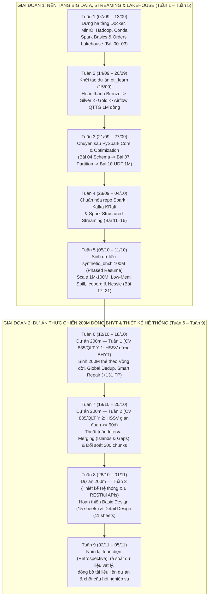

# BÁO CÁO TỔNG KẾT & NHÌN LẠI QUÁ TRÌNH THỰC TẬP KỸ SƯ DỮ LIỆU (RETROSPECTIVE REPORT)

- **Giai đoạn thực tập:** `07/09/2026` – `05/11/2026` (9 tuần)
- **Môi trường phát triển:** Windows 11 Pro (12 Logical Cores, 16 GB RAM), Python 3.11 / 3.14, PySpark 4.0.1 / 3.5, DuckDB 1.5.6, PyArrow 25.0.1, Numba 0.61.2, Docker Desktop (Airflow, Spark Cluster, Kafka KRaft, MinIO S3, Project Nessie, Apache Iceberg).
- **Phạm vi tổng hợp:** Toàn bộ 3 dự án thực tập chính thức trên máy trạm:
  1. **`spark introduce learn`** (`https://github.com/muontrothanhtop1hacklor/pyspark-course.git`) — Lộ trình 22 bài Lab từ PySpark cơ bản, Tối ưu hóa, Kafka Structured Streaming đến Lakehouse (MinIO/Iceberg/Nessie) & Scale 1M–100M dòng.
  2. **`etl_learn`** (`https://github.com/muontrothanhtop1hacklor/etl_course.git`) — Dự án ETL chuẩn Medallion (Bronze $\to$ Silver/Quarantine $\to$ Gold $\to$ Validate) trên dữ liệu nghiệp vụ Quá trình tham gia (QTTG) BHXH 1 triệu dòng, điều phối qua Airflow + Spark Cluster.
  3. **`200m`** (`https://github.com/muontrothanhtop1hacklor/BHYT_HS-SV.git`) — Dự án trọng tâm xử lý dữ liệu lớn **200 triệu dòng thẻ BHYT (20 triệu người)** và Thiết kế Hệ thống & 6 RESTful APIs theo Công văn số **835/QLT** của BHXH Việt Nam.

---

## PHẦN I. BIÊN NIÊN SỬ 9 TUẦN THỰC TẬP (CHRONOLOGICAL TIMELINE)

### Bảng đối chiếu dấu vết thời gian thực tế trên hệ thống (`C:\Users\Administrator`)

| Tuần | Mốc thời gian | Dự án trọng tâm | Dấu vết hệ thống & Git Commit tiêu biểu | Sản phẩm bàn giao chính |
| :---: | :---: | :--- | :--- | :--- |
| **Tuần 1** | `07/09 – 13/09` | `spark introduce learn` | Cài `.docker` (`07/09`), tạo repo (`08/09`), cài `minio`, `hadoop`, `miniconda3`; commits `606d4bf` $\to$ `3799d59` | Bài `00`, `00b`, `01`, `02-orders-lakehouse`, `03-airflow-orchestration` |
| **Tuần 2** | `14/09 – 20/09` | `etl_learn` | Cài JDK (`14/09`), tạo `etl_learn` (`15/09`); commits `c3e6645` (`15/09`) $\to$ `04d9faa` (`18/09`) | Pipeline QTTG BHXH 1M dòng: `bronze_qttg.py`, `silver_qttg.py`, `gold_qttg.py`, `validate_qttg.py`, Airflow DAG |
| **Tuần 3** | `21/09 – 27/09` | `spark introduce learn` | Commits `6cbb84e` (`21/09`) $\to$ `f61b3f2` (`26/09`) | Bài `04` (Data Types), `05` (Joins), `06` (Window Dedup), `07` (Partition Lab), `08` (Quarantine), `09` (Full ETL), `10` (UDF 1M Benchmark) |
| **Tuần 4** | `28/09 – 04/10` | `spark introduce learn` | Cài `.antigravity-ide` (`28/09`); commits `c40f809` (`28/09`) $\to$ `5154336` (`03/10`) | Tái cấu trúc `exercises/`; Bài `11` (Batch vs Stream), `12` (Kafka KRaft), `13` (Spark-Kafka), `14` (Watermark), `15` (Multi-Sink), `16` (Triggers) |
| **Tuần 5** | `05/10 – 11/10` | `spark introduce learn` | Commits `b1da665` (`06/10`) $\to$ `5d941d3` (`09/10`), `82cb46f` (`13/10`) | Bộ sinh `synthetic_bhxh` (100K–100M, `resume_100M.py`); Bài `17`–`21` (Medallion Scale, Low-Mem Spill, Iceberg/Nessie, Custom Airflow Image) |
| **Tuần 6** | `12/10 – 18/10` | `200m` (Tuần 1 - Ý 1) | Tạo `200m` (`12/10`); commits `7f09a6b` (`13/10`) $\to$ `384a89a` (`15/10`) | Bộ sinh [`gen_bhyt.py`](../common/data_gen/gen_bhyt.py) 200M dòng; Pipeline Bronze/Silver/Gold Ý 1 (`848.413` người); `GlobalDedupTracker` & `Smart Repair`; 44/44 unit tests |
| **Tuần 7** | `19/10 – 25/10` | `200m` (Tuần 2 - Ý 2) | Commits `26c1791`, `0ae2423`, `66fbb9b` (`23/10`); `_metadata.json` (`23/10 14:50`) | Giải thuật Interval Merging ([`timeline_algorithm.py`](../bai_tuan2_y2_hssv_gian_doan/p2_thuat_toan_timeline/timeline_algorithm.py), [`gold_logic_y2.py`](../bai_tuan2_y2_hssv_gian_doan/p3_gold/gold_logic_y2.py)), kết quả Gold Ý 2 (`242.290` người) & đối soát [`verify_sql_duckdb_y2.py`](../bai_tuan2_y2_hssv_gian_doan/p4_doi_soat/verify_sql_duckdb_y2.py) |
| **Tuần 8** | `26/10 – 01/11` | `200m` (Tuần 3 - Thiết kế) | Commits `86dc952`, `bde311c`, `08fbb20` (`28/10`) | Hồ sơ [`ThietKeCoBan_BasicDesign_VN`](../design/ThietKeCoBan_BasicDesign_VN.md) (`.md` & `.xlsx` 15 sheets) và [`ThietKeChiTiet_DetailDesign_VN`](../design/ThietKeChiTiet_DetailDesign_VN.md) (`.md` & `.xlsx` 11 sheets) |
| **Tuần 9** | `02/11 – 05/11` | Tổng hợp 3 dự án | Rà soát toàn diện các kho mã nguồn và dữ liệu đầu ra | Báo cáo tổng kết thực tập, kiểm toán dữ liệu vật lý, đồng bộ tài liệu và chốt câu hỏi nghiệp vụ |

---

## PHẦN II. MÔ TẢ CHI TIẾT NHỮNG GÌ ĐÃ HỌC VÀ LÀM ĐƯỢC

### 1. Dự án 1: `spark introduce learn` — Nền tảng PySpark, Streaming & Lakehouse

#### 1.1. Làm chủ PySpark Core, Quản trị Schema & Làm sạch dữ liệu (Bài 00 – 06, 08, 09)
* **Cơ chế lưu trữ phân tán của Spark (`00-read-write-basics`):**
  * Hiểu rõ vì sao lệnh `.write.csv()` / `.write.parquet()` của Spark không tạo ra một file đơn lẻ mà tạo ra một thư mục chứa nhiều `part-0000x-...` (mỗi task/partition ghi độc lập một file để tối đa hóa băng thông I/O song song) kèm file cờ `_SUCCESS` báo hiệu commit hoàn tất.
* **Kiểm soát kiểu dữ liệu & Schema Enforcement (`04-data-types`, `08-read-write-advance`):**
  * Thay thế thói quen dùng `inferSchema=True` (buộc Spark phải đọc quét qua toàn bộ dữ liệu 2 lần) bằng việc khai báo `StructType` / `StructField` tường minh.
  * Sử dụng `DecimalType(18, 2)` cho các cột tiền tệ (`amount`, `MUC_LUONG`) để tránh sai số biểu diễn nhị phân của `DoubleType`/`FloatType`.
  * Xử lý dữ liệu ngày tháng hỗn hợp nhiều định dạng (`yyyy-MM-dd`, `dd/MM/yyyy`, ngày không tồn tại như `31/02/2025`, `2025-13-40`) kết hợp phân tách dữ liệu thành 2 luồng: `valid_orders` và `invalid_orders` (gắn cột `error_reason` ghi rõ nguyên nhân lỗi để phục vụ đối soát).
* **Phép Join, Bắt dữ liệu mồ côi & Khử trùng bằng Window (`05-joins`, `06-customer-transactions`):**
  * Nắm vững rủi ro mất dữ liệu âm thầm khi dùng `Inner Join` nếu bảng giao dịch phát sinh mã khách hàng chưa kịp đồng bộ về bảng danh mục (`customers`). Áp dụng mẫu thiết kế chuẩn: dùng `Left Join` hoặc `Left Anti Join` để cô lập tập `unmapped_transactions` vào vùng cách ly.
  * Sử dụng Window Function `ROW_NUMBER() OVER (PARTITION BY transaction_id ORDER BY updated_at DESC)` để khử trùng lặp bản ghi cập nhật nhiều lần, và dùng `RANK()` / `DENSE_RANK()` để tìm Top-3 khách hàng chi tiêu cao nhất mỗi tỉnh.
  * Thiết lập nguyên tắc **Audit Reconciliation**: Luôn kiểm chứng phương trình $\text{Raw} = \text{Valid} + \text{Invalid} + \text{Duplicates}$ sau mỗi pipeline (`09-full-etl-pipeline`).

#### 1.2. Thực nghiệm Tối ưu hóa Phân vùng & Hiệu năng UDF (Bài 07, 10, 21)
* **Thực nghiệm `repartition` vs `coalesce` vs `partitionBy` (`07-partitioning-performance`):**
  * Thực hiện đo đạc trên 200.000 dòng đơn hàng (10 tỉnh lệch tải, tắt AQE `spark.sql.adaptive.enabled = false` để quan sát hành vi vật lý thuần túy):
    * `coalesce(2)` chỉ mất **0.80s** (gộp cơ học các partition hiện có, không shuffle), nhanh gấp **~2.9 lần** so với `repartition(2)` (**2.30s** do phải full shuffle qua mạng/đĩa).
    * Phát hiện hiện tượng **Hash Collision**: Khi gọi `repartition("province")` với `spark.sql.shuffle.partitions = 8`, dù có 10 tỉnh nhưng hàm băm `hash(province) % 8` chỉ rơi vào **6/8 buckets** (2 bucket trống, 6 file sinh ra).
    * Chứng minh một tính chất cực kỳ quan trọng của Spark: Mọi phép `repartition`/`coalesce` đặt **trước** `groupBy("province")` đều bị xóa bỏ cấu trúc phân vùng ở bước xuất file cuối cùng vì bản thân `groupBy` tự sinh ra một Shuffle Stage mới theo `spark.sql.shuffle.partitions`.
    * Thực nghiệm **Small Files Problem** với `repartition(200)`: Sinh ra 200 file Parquet siêu nhỏ (trung bình chỉ **18.28 KB/file**), làm tăng thời gian ghi lên **3.02s** và gây nghẽn metadata khi đọc lại.
* **Thực nghiệm Benchmark 1.000.000 dòng giữa Python UDF, Built-in và Pandas UDF (`10-udf-pandas-udtf`):**
  * Đo bằng thao tác ghi toàn bộ 1 triệu dòng ra Parquet (`.write.parquet()`, tránh dùng `.show(10)` vì Spark tối ưu cắt sớm):
    * **Python UDF (`@udf`):** Mất **9.21s** (Physical Plan hiện `ArrowEvalPython` — Catalyst coi như hộp đen không thể tối ưu, tốn chi phí tuần tự hóa từng dòng giữa JVM và Python Worker).
    * **Built-in Functions (`F.initcap`, `F.trim`, `F.regexp_replace`, `F.when`):** Mất **3.98s** (nhanh hơn **2.31 lần**, chạy thuần trong JVM với kế hoạch `Project` được Catalyst tối ưu hóa).
    * **Vectorized Pandas UDF (`@pandas_udf`):** Mất **3.11s** (nhanh hơn **~3 lần** so với Python UDF nhờ truyền dữ liệu dạng cột theo lô qua Apache Arrow và tính toán vector hóa bằng C/NumPy).
    * Thực hành **UDTF (`@udtf` kết hợp `LATERAL`)** để tách 1 dòng thành nhiều dòng và đối chiếu với `F.explode(F.split(...))`.

#### 1.3. Chuyên đề Kafka & Spark Structured Streaming (Bài 11 – 16)
* **Đối chiếu trực diện Batch và Streaming (`11-batch-vs-streaming`):**
  * Kiểm chứng tính tương đương kết quả (Parity): Cùng tập 30 đơn hàng (21 hợp lệ, 9 lỗi, tổng tiền 40.000.000 VND), luồng Streaming qua 3 micro-batches cho kết quả Parquet cuối cùng khớp 100% với Batch.
  * Thực nghiệm 5 kịch bản lỗi kinh điển của Structured Streaming để hiểu bản chất:
    1. Không khai báo Schema khi `readStream` $\to$ Ném lỗi `IllegalArgumentException: Schema must be specified`.
    2. Nạp lại file CSV trùng tên vào thư mục nguồn $\to$ Spark tự động bỏ qua (0 dòng xử lý) nhờ đối chiếu nhật ký `FileStreamSourceLog` trong `checkpoint/sources/0/`.
    3. Dùng `outputMode("append")` trên phép `groupBy` mà không có Watermark $\to$ Ném lỗi `AnalysisException` vì Spark không biết khi nào một nhóm thời gian đã đóng hoàn toàn để xuất bản ghi cuối.
    4. Dùng `ROW_NUMBER() OVER (Window)` không gắn thời gian trên luồng Streaming $\to$ Ném lỗi `NON_TIME_WINDOW_NOT_SUPPORTED_IN_STREAMING` (tránh phình State Store vô hạn).
* **Tích hợp Kafka KRaft, Watermark, Checkpoint & Multi-Sink (Bài 12 – 16):**
  * Dựng cụm Kafka KRaft trên Docker, đọc stream từ topic `orders_stream`, parse JSON payload, kết hợp `Stream-Static Join` với bảng `customers.csv`.
  * Áp dụng `foreachBatch` trong `15-spark-end-to-end-pipeline` và `16-spark-triggers-monitoring` để giải quyết bài toán vừa dùng được `Window.partitionBy` khử trùng lặp trong từng micro-batch, vừa `cache()` DataFrame để ghi đồng thời ra 3 đích (Valid Sink, Dead-Letter Queue Sink, Aggregated Revenue Sink) mà chỉ cần đọc Kafka 1 lần, kết hợp `Trigger(availableNow=True)` để tiết kiệm tài nguyên.

#### 1.4. Mở rộng quy mô 1M – 100M dòng, Iceberg/Nessie & Airflow (Bài 17 – 21)
* **Quản lý gián đoạn khi sinh 100M dòng (`logs/chapter-17.md`, `resume_100M.py`):**
  * Khi quá trình sinh 100M dòng bị hủy giữa chừng ở chunk 45/167 (1.39 GB), đã thiết kế cơ chế **Phased Resume**: đọc Parquet footer bằng PyArrow để kiểm tra toàn vẹn tức thì mà không nạp vào RAM, dùng seed tuyến tính `seed = 42 + chunk_id` để giữ tính tất định 100%, và ghi nguyên tử qua file `.tmp` $\to$ `os.replace`.
* **Benchmark Medallion 1M vs 10M & Thử nghiệm giới hạn RAM (`17-medallion-airflow-scale`, `18-data-scaling-performance`):**
  * Với cấu hình tiêu chuẩn (`8g` RAM, `200` shuffle partitions): Tập `1M` hoàn thành trong **`~34,0s`** (`Bronze 13s`, `Silver 10s`, `Gold 11s`); Tập `10M` hoàn thành trong **`~315,0s`** (`Bronze 57s`, `Silver 220s`, `Gold 38s`).
  * Với cấu hình ép giới hạn RAM (`1g` RAM cho `1M`/`10M`, `2g` cho `100M`): Quan sát trực tiếp cơ chế *Spill in-memory bytes to disk* tại bước Join và `partitionBy("MA_TINH")`, hiểu rõ vai trò của việc chia nhỏ `spark.sql.shuffle.partitions` để tránh OOM.
* **Quản trị Data Lakehouse hiện đại (`19-iceberg-nessie-catalog`, `20-airflow-pyspark-integration`):**
  * Chuyển đổi từ Parquet thuần sang bảng **Apache Iceberg** lưu trên **MinIO S3** và quản lý catalog bằng **Project Nessie**, thực hành tạo nhánh dữ liệu (`branch`), cập nhật dữ liệu và **Time Travel** về snapshot cũ.
  * Tự đóng gói `Dockerfile` cho Airflow tích hợp sẵn OpenJDK 17 và PySpark để điều phối trực tiếp các job Lakehouse.

---

### 2. Dự án 2: `etl_learn` — Pipeline Medallion QTTG BHXH 1 triệu dòng

#### 2.1. Phân tích Nghiệp vụ & Hạt dữ liệu (Data Grain)
Từ tài liệu `PHAN_TICH_NGHIEP_VU_QTTG_BHXH.md`, đã nắm vững cấu trúc dữ liệu lịch sử đồng bộ của ngành BHXH:
* **Bảng cha `RAW_QTTG_BHXH` (142.857 dòng):** Mỗi dòng là một bản chụp (snapshot) của một người lao động (`SO_SO_BHXH`, khóa kỹ thuật `NLD_ID`) tại một thời điểm `CREATED_AT`. Một người lao động có nhiều dòng ứng với nhiều lần đồng bộ.
* **Bảng con `RAW_QTTG_BHXH_DETAIL` (1.000.000 dòng):** Mỗi dòng là một giai đoạn đóng BHXH (`TU_THANG` – `DEN_THANG`, `MA_DON_VI`, `MUC_LUONG`) gắn với một bản chụp cha qua `MASTER_ID = RAW_QTTG_BHXH.ID`.
* **Quy tắc sống còn khi làm ETL:** Không bao giờ được tổng hợp thẳng trên toàn bộ 1.000.000 dòng Detail ở Bronze vì các giai đoạn đóng sẽ bị nhân bản qua nhiều lần `CREATED_AT`. Tầng Silver bắt buộc phải lọc bản ghi Master mới nhất của từng `SO_SO_BHXH` trước, rồi chỉ giữ lại các dòng Detail trỏ vào `MASTER_ID` mới nhất đó.

#### 2.2. Kiến trúc 5 Bước đã triển khai & Số liệu xác minh thực tế

| Tầng xử lý | File thực thi | Kỹ thuật & Quy tắc nghiệp vụ áp dụng | Kết quả số liệu thực tế |
| :--- | :--- | :--- | :--- |
| **1. Bronze** | `bronze_qttg.py` | Đọc CSV gốc, bổ sung metadata (`source_file`, `load_time`, `layer`), kiểm tra toàn vẹn khóa ngoại và định dạng tháng. | Master: **`142.857`** dòng Detail: **`1.000.000`** dòng (`INVALID_DETAIL=0`, `INVALID_MONTH=0`) |
| **2. Silver** | `silver_qttg.py` | - Khử trùng Master theo `SO_SO_BHXH` (`ORDER BY to_timestamp(CREATED_AT) DESC, ID DESC`, `row_number() = 1`). - Chuẩn hóa `TU_THANG`, `DEN_THANG` (cắt đuôi `.0`, kiểm tra regex `^\d{6}$`, năm `1960..hiện tại`, tháng `01..12`, `TU_THANG <= DEN_THANG`). - Chuẩn hóa `MUC_LUONG` về `DECIMAL(18,2)`. - Kiểm tra `NLD_ID` khớp an toàn với Master (`eqNullSafe`). | Silver Master: **`21.838`** người duy nhất Silver Detail hợp lệ: **`169.658`** dòng |
| **3. Quarantine** | `silver_qttg.py` | Cách ly toàn bộ Detail không hợp lệ vào `spark_lake/quarantine/qttg_bhxh_detail` kèm cột `_quarantine_reason` (`MASTER_NOT_CURRENT`, `NLD_ID_MISMATCH`, `INVALID_VALUE`). Bảo toàn: $169.658 + 830.342 = 1.000.000$. | Quarantine Detail: **`830.342`** dòng |
| **4. Gold** | `gold_qttg.py` | Dùng hàm `sequence(MIN_MONTH, MAX_MONTH, INTERVAL 1 MONTH)` + `explode` sinh bảng chiều `dim_thang`; Join khoảng `THANG_DATE BETWEEN TU_THANG_DATE AND DEN_THANG_DATE` để tính 5 KPI theo tháng. | `dim_thang`: **`629`** tháng `bao_cao_bhxh_thang`: **`629`** dòng (từ `197402` đến nay) |
| **5. Validate** | `validate_qttg.py` | Kiểm tra tự động 4 điều kiện hợp đồng dữ liệu (Data Contract): `duplicate_people == 0`, `orphan_detail == 0`, `invalid_period == 0`, `duplicate_month == 0`. | `STATUS=SUCCESS` `ERROR_ROWS=0` |

---

### 3. Dự án 3: `200m` — Xử lý 200M dòng thẻ BHYT & Thiết kế Hệ thống (CV 835/QLT)

#### 3.1. Bộ sinh dữ liệu Vòng đời Đối tượng ([`common/data_gen/`](../common/data_gen/README.md))
* Xây dựng [`gen_bhyt.py`](../common/data_gen/gen_bhyt.py) dùng **Numba `@njit`** biên dịch mã máy kết hợp đa tiến trình, sinh dữ liệu cho **20.000.000 người tham gia** tạo ra **195.305.908 dòng thẻ BHYT** chia vào 200 chunks Parquet (`part-00000` $\to$ `part-00199`, tổng dung lượng ~4,59 GB).
* Mỗi người có lịch sử thẻ xuyên suốt nhiều năm theo đúng quy luật đời thực (học sinh $\to$ sinh viên $\to$ ra trường đi làm doanh nghiệp `DN` hoặc hộ gia đình `GD`, gián đoạn 1–2 tháng hoặc $\ge 3$ tháng, cấp đổi thẻ hủy `TRANG_THAI=0`), đồng thời tiêm chính xác **1.949.678 dòng lỗi** thuộc 5 loại vào dữ liệu và xuất nhật ký `dirty_log` + bảng chân lý `persons_gt`.

#### 3.2. Tuần 1 ([`bai_tuan1_y1_hssv_dung_bhyt`](../bai_tuan1_y1_hssv_dung_bhyt/README.md)) — Ý 1: HSSV dừng tham gia BHYT
* **Bài toán:** Tìm HSSV có thẻ hiệu lực giao tháng 10/2024 (`TU_NGAY < 2024-11-01 AND DEN_NGAY >= 2024-10-01`, `MA_KHOI IN ('HS', 'SV')`) nhưng đến tháng 08/2026 không còn thẻ hợp lệ ở bất kỳ khối nào.
* **Xử lý Tầng Bronze & Silver ([`build_bronze.py`](../bai_tuan1_y1_hssv_dung_bhyt/p2_bronze_silver/build_bronze.py), [`build_silver.py`](../bai_tuan1_y1_hssv_dung_bhyt/p2_bronze_silver/build_silver.py)):**
  * Bổ sung 4 cột lineage (`_SOURCE_FILE`, `_CHUNK_ID`, `_INGESTED_AT`, `_BATCH_ID`).
  * Đối soát khớp tuyệt đối 100% với `dirty_log` trên cả 5 loại lỗi (sai lệch = 0 dòng):
    * **Loại 1 (`TU_NGAY > DEN_NGAY`):** `390.254` dòng.
    * **Loại 2 (`HO_TEN` IS NULL):** `389.918` dòng (gắn cờ `_FLAG_NAME_NULL`).
    * **Loại 3 (`GIOI_TINH` $\notin \{1, 2\}$):** `390.216` dòng (gắn cờ `_FLAG_GENDER_INVALID`).
    * **Loại 4 (`MA_KHOI` chữ thường / dư khoảng trắng):** `389.768` dòng (chuẩn hóa `TRIM(UPPER())`, cứu được `+1.646` HSSV về đúng tập gốc tháng 10/2024).
    * **Loại 5 (Trùng lặp `ID` thẻ):** `389.522` dòng (khử trùng).
* **Đột phá Kỹ thuật Ngày 3 & Ngày 5 ([`bao_cao_ngay3.md`](../bai_tuan1_y1_hssv_dung_bhyt/bao_cao/bao_cao_ngay3.md), [`bao_cao_ngay5.md`](../bai_tuan1_y1_hssv_dung_bhyt/bao_cao/bao_cao_ngay5.md)):**
  1. **Điều tra gốc rễ +131 ca Dương tính giả ([`phan_tich_131_nguoi.py`](../bai_tuan1_y1_hssv_dung_bhyt/p2_bronze_silver/phan_tich_131_nguoi.py)):** Chứng minh 100% số người chênh lệch giữa Silver Quarantine (`850.190`) và Raw đã chuẩn hóa Loại 4 (`850.059`, tức `848.413` Raw gốc + `1.646` Loại 4) là những người thuộc kịch bản `SWITCH` (đã ra trường đóng BHYT Doanh nghiệp/Hộ gia đình tại tháng 08/2026), nhưng thẻ tháng 08/2026 của họ bị nhập ngược ngày (`TU_NGAY > DEN_NGAY`). Khi đẩy mù quáng vào Quarantine, họ bị mất thẻ tháng 08/2026 nên bị kết luận oan là "dừng tham gia".
  2. **Cơ chế `Smart Repair` có kiểm soát:** Bổ sung chế độ `--mode-loai1 smart-repair`: Nếu `TU_NGAY > DEN_NGAY` nhưng khoảng lệch $\Delta = \text{TU\_NGAY} - \text{DEN\_NGAY} \in [25, 375]$ ngày (đúng chu kỳ cấp thẻ 1, 3, 6, 12 tháng của BHXH), hệ thống tự động hoán đổi lại ngày và gắn cờ `_FLAG_DATE_SWAPPED = True`, triệt tiêu hoàn toàn 131 ca Dương tính giả, đưa độ chính xác về **100% (`848.413` người)**.
  3. **Khử trùng toàn cục liên chunk (`GlobalDedupTracker`):** Thay thế `np.unique` cục bộ từng file bằng cấu trúc `GlobalDedupTracker` thread-safe xuyên suốt 200 chunks, chỉ tốn thêm ~1,2 GB RAM.
  4. **So sánh 2 kiến trúc tính Gold ([`build_gold.py`](../bai_tuan1_y1_hssv_dung_bhyt/p3_gold/build_gold.py)):**
     * *Cách 1 (Chunk-based đa luồng):* Chạy **61,89s**, RSS đỉnh **1,50 GB**.
     * *Cách 2 (Global DuckDB SQL - không phụ thuộc giả định phân vùng):* Chạy **31,69s** (Cold Run) và **22,49s** (Hot Run ~ 8,65 triệu dòng/giây), RSS đỉnh **2,68 GB**, kết quả khớp Cách 1 tuyệt đối 100% ($Set_G \setminus Set_C = 0$).

#### 3.3. Tuần 2 ([`bai_tuan2_y2_hssv_gian_doan`](../bai_tuan2_y2_hssv_gian_doan/README.md)) — Ý 2: HSSV gián đoạn BHYT $\ge 3$ tháng
* **Bài toán:** Tìm HSSV tham gia tháng 10/2024 (`HS`/`SV`), đến tháng 07/2026 vẫn đang tham gia BHYT (bất kỳ khối nào), nhưng trong cửa sổ $W = [\text{2024-10-01}, \text{2026-07-31}]$ (669 ngày) có tổng số ngày không có thẻ hiệu lực cộng dồn $\ge 90$ ngày.
* **Giải thuật Chuỗi thời gian ([`timeline_algorithm.py`](../bai_tuan2_y2_hssv_gian_doan/p2_thuat_toan_timeline/timeline_algorithm.py), [`gold_logic_y2.py`](../bai_tuan2_y2_hssv_gian_doan/p3_gold/gold_logic_y2.py)):**
  1. **Lọc ứng viên 2 đầu:** Chỉ giữ những `SO_SO_BHXH` thỏa mãn đồng thời mốc gốc T10/2024 và mốc kiểm tra T07/2026, áp dụng Tie-break chọn thẻ đại diện ở cả 2 mốc.
  2. **Cắt biên (Clipping):** Cắt mọi thẻ hợp lệ (`TRANG_THAI = 1`) về cửa sổ: `tu_clip = GREATEST(TU_NGAY, '2024-10-01')`, `den_clip = LEAST(DEN_NGAY, '2026-07-31')`.
  3. **Hợp nhất đoạn liên tục/chồng lấn/lồng nhau (Islands & Gaps):**
     * Tính `prev_max_den = MAX(den) OVER (PARTITION BY SO_SO_BHXH ORDER BY tu, den ROWS BETWEEN UNBOUNDED PRECEDING AND 1 PRECEDING)`.
     * Đánh dấu đoạn mới khi `tu > prev_max_den + INTERVAL 1 DAY` (vì `tu == prev_max_den + 1 ngày` là hai thẻ nối tiếp liên tục không ngắt quãng).
     * Gom nhóm theo `grp_id = SUM(is_new_grp) OVER (...)` để tìm `[m_tu, m_den]` của từng khoảng tham gia liên tục.
  4. **Quét đủ 3 loại khoảng trống (`gap_events`):**
     * Khoảng trống **đầu kỳ (`DAU_KY`)**: `MIN(m_tu) - DATE '2024-10-01'` (nếu thẻ đầu tiên bắt đầu sau ngày `01/10/2024`).
     * Khoảng trống **giữa kỳ (`GIUA_KY`)**: `m_tu - LAG(m_den) - 1` giữa 2 đoạn liên tục.
     * Khoảng trống **cuối kỳ (`CUOI_KY`)**: `DATE '2026-07-31' - MAX(m_den)` (nếu thẻ cuối cùng kết thúc trước ngày `31/07/2026`).
* **Kết quả chạy thực tế mới nhất (ngày `23/10/2026` trong `_metadata.json`):**
  * Tổng số HSSV gián đoạn $\ge 90$ ngày: **242.290 người** (Học sinh: **176.042**, Sinh viên: **66.248**, số ngày gián đoạn trung bình: **144,5 ngày**).
  * Thời gian chạy 200 chunks: **247,89 giây (~4,1 phút)**, RAM Process Tree đỉnh chỉ **1.073,68 MB (~1,05 GB)**.
  * Kiểm chứng độc lập bằng [`verify_sql_duckdb_y2.py`](../bai_tuan2_y2_hssv_gian_doan/p4_doi_soat/verify_sql_duckdb_y2.py) khớp 100% từng mã sổ BHXH, khối gốc, số đợt và số ngày gián đoạn.

#### 3.4. Tuần 3 ([`design/`](../design/README.md)) — Thiết kế Hệ thống & Cổng Dịch vụ 6 RESTful APIs
* Xây dựng bộ tài liệu thiết kế chuẩn công nghiệp đồng bộ giữa Markdown và Excel:
  * **Basic Design (`HSSV-BD-001`):** [`ThietKeCoBan_BasicDesign_VN.md`](../design/ThietKeCoBan_BasicDesign_VN.md) & [`.xlsx`](../design/ThietKeCoBan_BasicDesign_VN.xlsx) (15 sheets: Hướng dẫn, Bìa, Lịch sử, Tổng quan, DS Chức năng, DS Màn hình, Layout Màn hình, Định nghĩa Màn hình, DS API, Định nghĩa API, DS Batch, DS Bảng, Định nghĩa Bảng, DS Thông báo, Phi chức năng, Q&A).
  * **Detail Design (`HSSV-DD-001`):** [`ThietKeChiTiet_DetailDesign_VN.md`](../design/ThietKeChiTiet_DetailDesign_VN.md) & [`.xlsx`](../design/ThietKeChiTiet_DetailDesign_VN.xlsx) (11 sheets: Hướng dẫn, Bìa, Lịch sử, Tổng quan Module, Tham số I/O, Xử lý chi tiết 35 bước, Định nghĩa 8 câu SQL kèm 5 kịch bản lỗi, Ma trận 15 Check đầu vào, Xử lý Exception & Log, 32 kịch bản Unit Test, Q&A).
* **Kiến trúc Serving Layer & 6 APIs:**
  1. `GET /api/v1/hssv/persons` (`API-HSSV-001`): Tra cứu danh sách đa tiêu chí, tìm kiếm họ tên không dấu qua GIN Index `gin_trgm_ops`, phân trang (`p95 <= 300ms`).
  2. `GET /api/v1/hssv/persons/{soSoBhxh}` (`API-HSSV-002`): Xem chi tiết nhân thân, thẻ mốc gốc T10/2024, thẻ mốc hiện tại và tóm tắt vi phạm (`p95 <= 150ms`).
  3. `GET /api/v1/hssv/persons/{soSoBhxh}/timeline` (`API-HSSV-003`): Xem danh sách thẻ, các khoảng đã gộp (`mergedIntervals`) và từng đợt gián đoạn (`gaps`: `DAU_KY`, `GIUA_KY`, `CUOI_KY`) (`p95 <= 250ms`).
  4. `GET /api/v1/hssv/reports/provinces` (`API-HSSV-004`): Báo cáo 63 Tỉnh/TP và tổng hợp toàn quốc đọc từ Redis Cache (`p95 <= 200ms`).
  5. `GET /api/v1/hssv/reports/distribution` (`API-HSSV-005`): Phân bố số lượng gián đoạn theo 5 buckets (`90-120d`, `121-180d`, `181-270d`, `271-365d`, `>365d`) (`p95 <= 200ms`).
  6. `POST /api/v1/hssv/reports/export` (`API-HSSV-006`): Xuất báo cáo Excel/CSV theo cơ chế Hybrid (Đồng bộ trả `downloadUrl` ngay nếu $\le 10.000$ dòng; Bất đồng bộ qua Queue Worker + MinIO trả `HTTP 202 Accepted` kèm `jobId` nếu $> 10.000$ dòng).

---

## PHẦN III. RÀ SOÁT HIỆN TRẠNG DỮ LIỆU VẬT LÝ & ĐỒNG BỘ TÀI LIỆU (PENDING ISSUES & DATA AUDIT)

Qua kiểm tra trực tiếp toàn bộ cây thư mục dữ liệu vật lý, file metadata/manifest và mã nguồn trên cả 3 dự án, **100% các pipeline và tập dữ liệu lớn đều đã được chạy hoàn tất và lưu đầy đủ trên ổ đĩa**; các điểm lệch trước đó chỉ là do một số file tài liệu `.md` chưa được cập nhật lại sau lần chạy cuối:

### 1. Hiện trạng dữ liệu & các mục đã đồng bộ trong dự án `200m`
| Mã | Hạng mục kiểm tra | Hiện trạng thực tế trên đĩa | Trạng thái xử lý |
| :---: | :--- | :--- | :---: |
| **TĐ-01** | **Đồng bộ số liệu mới nhất của Ý 2 (`242.290` người) vào văn bản báo cáo & thiết kế** | File kết quả vật lý `data/output/gold_y2/20241001_20260731_gap3m/_metadata.json` đã chạy hoàn tất ngày `23/10/2026 14:50:46` với **242.290 người** (HS: `176.042`, SV: `66.248`, TB: `144,5` ngày, thời gian chạy `247,89s`, RSS `1.073,68 MB`), kèm đầy đủ file Parquet/CSV và 20 bài kiểm thử pytest (`13/13` unit tests + `7/7` invariant tests). | **Đã cập nhật xong `.md`** ([`bao_cao_giai_phap_y2.md`](../bai_tuan2_y2_hssv_gian_doan/bao_cao/bao_cao_giai_phap_y2.md), [`design/README.md`](../design/README.md), [`ThietKeCoBan_BasicDesign_VN.md`](../design/ThietKeCoBan_BasicDesign_VN.md), [`ThietKeChiTiet_DetailDesign_VN.md`](../design/ThietKeChiTiet_DetailDesign_VN.md)) |
| **TĐ-02** | **Giải trình số liệu giữa Gold Ý 1 trên Silver (`850.190`) và Raw Oracle (`848.413`)** | Theo `data/silver/_sql_audit.json` và [`verify_sql_duckdb.py`](../bai_tuan1_y1_hssv_dung_bhyt/p4_doi_soat/verify_sql_duckdb.py), cả 2 con số đều hoàn toàn chính xác và khớp phương trình cân bằng: `848.413 (Raw Oracle) + 1.646 (Chuẩn hóa Loại 4 cứu thẻ hs/sv chữ thường) + 131 (Cách ly Loại 1 đảo ngày) = 850.190 (Silver/Gold)`. Không cần chạy lại. | **Đã kiểm chứng khớp 100%** |
| **TĐ-03** | **Thư mục `data/output/dev_a/` và `data/output/dev_b/`** | Được khai báo trong [`common/config.py`](../common/config.py) và sử dụng làm fallback cho công cụ đối soát chéo [`compare_results.py`](../bai_tuan1_y1_hssv_dung_bhyt/p4_doi_soat/compare_results.py) (có `.gitkeep` được quản lý bởi Git). | **Giữ nguyên theo thiết kế** |
| **TĐ-04** | **Hiện thực hóa (Coding) tầng Serving DB & 6 RESTful APIs** | Đề bài Tuần 3 yêu cầu xây dựng bộ tài liệu Basic Design (`HSSV-BD-001`) & Detail Design (`HSSV-DD-001`) (đã hoàn thành cả bản `.xlsx` và `.md`). Phần lập trình Backend FastAPI / PostgreSQL / Redis sẽ thực hiện nếu nằm trong lộ trình tuần tiếp theo. | **Chờ định hướng Tuần 4+** |

### 2. Hiện trạng dữ liệu & các mục đã đồng bộ trong dự án `etl_learn`
| Mã | Hạng mục kiểm tra | Hiện trạng thực tế trên đĩa | Trạng thái xử lý |
| :---: | :--- | :--- | :---: |
| **TĐ-05** | **Kiểm tra bộ dữ liệu CSV gốc 1M dòng và Parquet Lakehouse** | Trong `requirements/data/` đã có sẵn đầy đủ 2 file gốc `RAW_QTTG_BHXH_MASTER.csv` (`37,76 MB` — `142.857` dòng) và `RAW_QTTG_BHXH_DETAIL.csv` (`248,82 MB` — `1.000.000` dòng), đồng thời `solution/output/spark_lake/{bronze,silver,quarantine,gold}` đã có đầy đủ kết quả chạy ngày `18/09/2026`. | **Đầy đủ 100% (Không thiếu file)** |
| **TĐ-06** | **Đồng bộ đường dẫn trong `etl_learn/README.md`** | Đã cập nhật đường dẫn trong `etl_learn/README.md` từ `solution/spark/apps/qttg/bronze_qttg.py` về đúng đường dẫn thực tế `solution/apps/qttg/bronze_qttg.py`. | **Đã cập nhật xong `.md`** |

### 3. Hiện trạng dữ liệu & các mục đã đồng bộ trong dự án `spark introduce learn`
| Mã | Hạng mục kiểm tra | Hiện trạng thực tế trên đĩa | Trạng thái xử lý |
| :---: | :--- | :--- | :---: |
| **TĐ-07** | **Cập nhật bảng kết quả Benchmark vào `logs/chapter-18.md`** | Kết quả chạy `benchmark_etl.py` cho cả tập `1M` (`~34,0s`) và `10M` (`~315,0s`) đã có sẵn trong `synthetic_bhxh/output/{1M,10M}/lakehouse/` từ ngày `09/10/2026`. Đã trích xuất số liệu thực tế điền hoàn chỉnh vào Mục 6 và Mục 8 của `logs/chapter-18.md`. | **Đã cập nhật xong `.md`** |
| **TĐ-08** | **Bộ dữ liệu 100M và file đáp án lỗi trong `synthetic_bhxh/`** | Toàn bộ 167/167 chunks (`chunk_00000` $\to$ `chunk_00166`) của tập `100M` và file đáp án đầy đủ `error_keys_100M.csv` (`80,51 MB`) đã được sinh hoàn tất ngày `08/10/2026`. | **Đầy đủ 100%** |

---

## PHẦN IV. CÁC VẤN ĐỀ PHÁT SINH & BÀI HỌC KINH NGHIỆM (ISSUES ENCOUNTERED & LESSONS LEARNED)

Trong 9 tuần thực tập, quá trình va chạm với dữ liệu lớn trên môi trường Windows đã làm phát sinh **7 vấn đề kỹ thuật & nghiệp vụ điển hình** cùng cách xử lý triệt để:

1. **Vấn đề 1 — Bẫy "Sinh dữ liệu giả lập ngẫu nhiên rời rạc" (Tuần 6 / Dự án `200m` Ngày 1):**
   * *Hiện tượng:* Ở Ngày 1 của `200m`, script sinh từng dòng thẻ ngẫu nhiên độc lập. Khi chạy kiểm thử 10.000 dòng, cả 1.398/1.398 HSSV tham gia tháng 10/2024 đều bị tính là "dừng tham gia" ở tháng 08/2026 (tỷ lệ dừng 100%). Hai nhánh code của 2 lập trình viên đối chiếu khớp nhau 100% nhưng thực chất không kiểm chứng được các ca biên.
   * *Cách giải quyết:* Đập đi xây lại bộ sinh [`gen_bhyt.py`](../common/data_gen/gen_bhyt.py) theo mô hình **Person Lifecycle (Vòng đời đối tượng)** với 6 kịch bản rõ ràng, cố ý gài các ca biên (thẻ vắt qua ngày đầu/cuối tháng, chuyển khối, thẻ hủy, gián đoạn nhiều đợt) và xuất bảng đáp án chuẩn `persons_gt` độc lập với code ETL.
2. **Vấn đề 2 — Đánh đổi giữa "Cách ly mù quáng (Blind Quarantine)" và "Sửa lỗi thông minh (Smart Repair)" (Tuần 6 / Dự án `200m` Ngày 3–5):**
   * *Hiện tượng:* Khi áp dụng quy tắc "mọi dòng có `TU_NGAY > DEN_NGAY` đều đưa vào Quarantine", kết quả tầng Gold bị lệch tăng thêm **+131 người dừng tham gia** so với đáp án đã chuẩn hóa Loại 4.
   * *Cách giải quyết:* Truy vết ngược từ Ground Truth phát hiện 131 người này thực tế vẫn đang tham gia BHYT ở khối Doanh nghiệp (`DN`) tại tháng 08/2026, nhưng thẻ mới của họ bị nhân viên nhập liệu gõ ngược ngày bắt đầu và ngày kết thúc. Từ đó rút ra bài học sâu sắc: Trong Data Engineering, cách ly dữ liệu lỗi ở bảng lịch sử có thể làm biến dạng trạng thái của đối tượng ở tầng tổng hợp (gây False Positive). Giải pháp là bổ sung chế độ **Smart Repair** dựa trên miền giá trị nghiệp vụ (chu kỳ thẻ $25..375$ ngày) đi kèm cờ kiểm toán `_FLAG_DATE_SWAPPED = True`.
3. **Vấn đề 3 — Bẫy "Thẻ lồng nhau (Nested Intervals)" và "Khoảng trống ở hai biên kỳ" trong bài toán Chuỗi thời gian (Tuần 7 / Dự án `200m` Ý 2):**
   * *Hiện tượng:*
     * Nếu chỉ so sánh `tu_hien_tai` với `LAG(den)` của dòng ngay trước đó, khi một người có 1 thẻ dài (`01/10/2024` $\to$ `31/12/2025`) và 1 thẻ ngắn nằm lọt bên trong (`01/01/2025` $\to$ `31/03/2025`), dòng tiếp theo (`01/01/2026`) sẽ so với `31/03/2025` và tính sai thành gián đoạn 9 tháng!
     * Bản cài đặt đầu tiên chỉ tính khoảng trống giữa các thẻ (`with_gaps`) mà quên mất: một thẻ giao tháng 10/2024 nhưng bắt đầu từ ngày `20/10/2024` thì vẫn có 19 ngày trống đầu kỳ (`01/10` $\to$ `19/10`), hoặc thẻ cuối hết hạn ngày `05/07/2026` thì vẫn có 26 ngày trống cuối kỳ (`06/07` $\to$ `31/07`).
   * *Cách giải quyết:* Dùng Window Function tích lũy `MAX(den) OVER (... ROWS BETWEEN UNBOUNDED PRECEDING AND 1 PRECEDING)` để luôn giữ biên kết thúc xa nhất, và `UNION ALL` thêm 2 nhánh tính gap đầu kỳ (`MIN(m_tu) - '2024-10-01'`) và gap cuối kỳ (`'2026-07-31' - MAX(m_den)`).
4. **Vấn đề 4 — Khử trùng lặp cục bộ vs Khử trùng lặp toàn cục (Cross-chunk Deduplication):**
   * *Hiện tượng:* Khi xử lý 200 chunks độc lập để tiết kiệm RAM, hàm `np.unique` chỉ khử được các bản ghi trùng `ID` nằm trong cùng 1 file chunk; nếu bản ghi trùng rơi vào 2 chunk khác nhau thì lọt lưới.
   * *Cách giải quyết:* Xây dựng `GlobalDedupTracker` giữ tập `set` các `int64` ID toàn cục có `threading.Lock()` bảo vệ, vừa xử lý theo từng chunk vừa đảm bảo tính duy nhất trên toàn bộ 200 triệu dòng.
5. **Vấn đề 5 — Tràn bộ nhớ (OOM), Ảo giác đo RAM hệ thống & Lựa chọn Engine xử lý (PySpark vs DuckDB):**
   * *Hiện tượng:*
     * Chạy PySpark local trên 100M–200M dòng với cấu hình mặc định gặp lỗi `java.lang.OutOfMemoryError: Java heap space` / `Py4JNetworkError`.
     * Ở Ngày 2 của `200m`, đo `psutil.virtual_memory().used` ghi nhận đỉnh RAM 14,59 GB / 15,44 GB khiến nhóm tưởng rằng pipeline ngốn gần hết 16 GB RAM.
   * *Cách giải quyết:*
     * Viết lại bộ đo `MemoryMonitor` đệ quy theo cây tiến trình (`parent.memory_info().rss + sum(child.rss)`), chứng minh Windows + ứng dụng nền đã chiếm sẵn ~9,5 GB RAM, còn bản thân tiến trình DuckDB/Python xử lý 200M dòng chỉ tốn **1,05 GB – 2,70 GB RAM**.
     * Với bài toán xử lý trên 1 máy chủ đơn lẻ (Single-node Lakehouse), sử dụng **DuckDB SQL + PyArrow Parquet (nén ZSTD)** cho tốc độ quét 200M dòng chỉ trong **~31 giây**, nhanh và nhẹ hơn rất nhiều so với khởi tạo JVM của PySpark.
6. **Vấn đề 6 — Sự cố Hủy tiến trình giữa chừng khi sinh dữ liệu lớn (Tuần 5 / `synthetic_bhxh` 100M):**
   * *Hiện tượng:* Đang sinh 100M dòng thì bị cancel ở chunk 45/167; nếu chạy lại từ đầu sẽ mất hàng giờ đồng hồ và mất tính khớp nối với danh sách lỗi (`error_keys`) đã sinh.
   * *Cách giải quyết:* Thiết kế kiến trúc **Checkpoint + Deterministic Seed (`seed = 42 + i`) + Atomic Rename (`.tmp` $\to$ `.parquet`)**, cho phép chạy tiếp từ chunk 45 và tái tạo lại chính xác mảng lỗi của 45 chunk đầu mà không cần ghi đè lại đĩa.
7. **Vấn đề 7 — Khác biệt môi trường Windows Host, Encoding UTF-8 và Docker Linux Container:**
   * *Hiện tượng:* Lỗi `UnicodeEncodeError: 'charmap' codec can't encode character '\u0110'` khi in chữ `Đ` tiếng Việt trên PowerShell; lỗi `UnsupportedClassVersionError` do xung đột Java 8/11 với PySpark 3.5/4.0; lỗi lệch đường dẫn Windows (`\`) khi truyền vào DuckDB/Spark hoặc mount vào Docker (`/opt/spark/...`).
   * *Cách giải quyết:* Chuẩn hóa `sys.stdout.reconfigure(encoding='utf-8')`, nâng cấp Dockerfile lên OpenJDK 17, luôn dùng `.as_posix()` cho đường dẫn Parquet và tách cấu hình qua biến môi trường.

---

## PHẦN V. CÁC CÂU HỎI CẦN LÀM RÕ VỚI MENTOR / NGHIỆP VỤ (OPEN QUESTIONS)

Để hoàn thiện trọn vẹn sản phẩm và chuẩn bị cho giai đoạn tiếp theo, dưới đây là **4 câu hỏi quan trọng** cần được xác nhận:

1. **Câu hỏi 1 — Quan hệ giữa Tập kết quả Ý 1 và Ý 2 trên bảng `HSSV_PERSON_SUMMARY`:**
   * *Bối cảnh:* Ý 1 xét mốc dừng tại **tháng 08/2026**, trong khi Ý 2 xét mốc còn tham gia tại **tháng 07/2026** và có gián đoạn $\ge 90$ ngày trong kỳ `[10/2024, 07/2026]`.
   * *Tình huống giao thoa:* Một sinh viên tham gia tháng 10/2024, nghỉ gián đoạn 4 tháng năm 2025, sau đó mua thẻ lại có hiệu lực đến hết ngày **31/07/2026**, rồi từ **01/08/2026** không đóng tiếp nữa. Khi đó, sinh viên này thỏa mãn **cả Ý 2** (tháng 07/2026 vẫn tham gia, gián đoạn $\ge 90$ ngày) **lẫn Ý 1** (đến tháng 08/2026 đã dừng tham gia).
   * *Vấn đề cần chốt:* Trong Thiết kế Tuần 3, bảng Serving DB `HSSV_PERSON_SUMMARY` hiện đang đặt `SO_SO_BHXH` làm khóa chính duy nhất với 1 cột `TIEU_CHI` (`DUNG_THAM_GIA` hoặc `GIAN_DOAN`). Vậy với người thỏa mãn cả 2 ý, hệ thống nên:
     * **(PA1):** Đổi khóa chính của `HSSV_PERSON_SUMMARY` thành khóa phức hợp `(SO_SO_BHXH, TIEU_CHI)` để lưu được cả 2 bản ghi?
     * **(PA2):** Giữ `SO_SO_BHXH` là khóa chính duy nhất nhưng thêm giá trị `TIEU_CHI = 'CA_HAI'` (hoặc tách thành 2 cột boolean `IS_DUNG_THAM_GIA`, `IS_GIAN_DOAN`)?
     * **(PA3):** Ưu tiên xếp vào nhóm `DUNG_THAM_GIA` (Ý 1) vì tại thời điểm tháng 08/2026 họ đã nghỉ hẳn?
2. **Câu hỏi 2 — Cách hiểu "Gián đoạn từ 3 tháng trở lên" trong Ý 2:**
   * Hiện tại pipeline đang tính theo **tổng số ngày gián đoạn cộng dồn trong kỳ $\ge 90$ ngày** (`SUM(gap_days) >= 90`, ví dụ nghỉ 2 đợt: đợt 1 nghỉ 30 ngày + đợt 2 nghỉ 60 ngày = 90 ngày $\to$ Đạt). Cần xác nhận lần cuối với nghiệp vụ BHXH: Công văn 835/QLT yêu cầu **tổng gián đoạn cộng dồn $\ge 90$ ngày**, hay yêu cầu phải có **ít nhất 1 đợt gián đoạn liên tục kéo dài $\ge 90$ ngày**?
3. **Câu hỏi 3 — Hiển thị trạng thái thẻ đã qua `Smart Repair` trên API & Giao diện:**
   * Ở tầng Silver, các thẻ bị nhập ngược ngày (`TU_NGAY > DEN_NGAY`) trong chu kỳ hợp lệ ($25..375$ ngày) đã được tự động đảo lại ngày và gắn cờ `_FLAG_DATE_SWAPPED = True`. Khi cán bộ BHXH tra cứu chi tiết lịch sử thẻ qua `API-HSSV-003 (GET /persons/{soSoBhxh}/timeline)`, có cần bổ sung trường `isDateSwapped: boolean` vào response JSON để hiển thị nhãn cảnh báo ("Thẻ đã được hệ thống tự động hiệu chỉnh ngày") cho cán bộ nghiệp vụ biết không?
4. **Câu hỏi 4 — Trọng tâm công việc giai đoạn tới (Tuần 4+ của dự án `200m`):**
   * Sau khi hoàn tất bước tổng kết và rà soát thiết kế này, nhiệm vụ tiếp theo của kỳ thực tập sẽ là **hiện thực hóa (coding) hệ thống Backend 6 RESTful APIs (FastAPI / PostgreSQL / Redis) + Dashboard UI** theo đúng bản Detail Design Tuần 3, hay chuyển sang một chuyên đề/bài toán mới?
