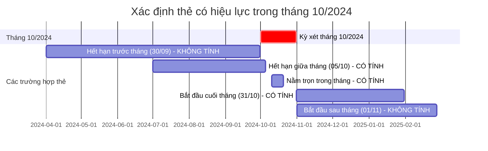

# Tuần 1 – Bài toán HSSV dừng tham gia BHYT (CV 835/QLT – Ý 1)

---

## 1. Bối cảnh & Đề bài

Căn cứ Công văn số **835/QLT** ngày 10/08/2026 của Ban Quản lý thu và phát triển người tham gia (BHXH Việt Nam) về việc cung cấp số liệu học sinh, sinh viên (HSSV) tham gia BHYT:

> **Yêu cầu Ý 1:**
> *"Học sinh, sinh viên tham gia BHYT từ tháng 10/2024 nhưng đến nay đã dừng tham gia nhưng chưa tham gia lại.*
> *(Tách riêng danh sách học sinh và sinh viên)"*

**Mục tiêu của Tuần 1:**
- Hiểu sâu bản chất nghiệp vụ quản lý thẻ BHYT HSSV.
- Thống nhất các bảng dữ liệu nguồn và cấu trúc bảng đích cần có.
- Cùng nhau tạo một bộ **Fake Data** chuẩn thực tế (khoảng 200 triệu dòng) để dùng chung.
- Mỗi bạn **tự nghiên cứu giải pháp, tự phân tích và độc lập xây dựng luồng xử lý** để giải quyết bài toán Ý 1 trong vòng 1 tuần.

---

## 2. Giải thích chi tiết nghiệp vụ

### 2.1. Các thực thể cốt lõi trong quản lý BHYT

| Thực thể | Ý nghĩa nghiệp vụ | Trường dữ liệu đại diện |
|---|---|---|
| **Người tham gia** | Mỗi cá nhân có duy nhất 1 mã số định danh BHXH đi suốt cuộc đời. | `SO_SO_BHXH` (10 chữ số) |
| **Thẻ BHYT** | Minh chứng cho quyền lợi khám chữa bệnh trong một khoảng thời gian nhất định. Một người qua các năm sẽ có nhiều thẻ khác nhau (cấp mới, gia hạn, chuyển trường, chuyển đổi đối tượng...). | Bản ghi trong `ST_INTHE_DTL` |
| **Mã khối đối tượng** | Phân loại nhóm đối tượng đóng BHYT: Học sinh (`HS`), Sinh viên (`SV`), Trẻ em dưới 6 tuổi (`TE`), Người lao động doanh nghiệp (`DN`), Hộ gia đình (`GD`)... | `MA_KHOI` |
| **Thời hạn thẻ** | Thẻ có giá trị sử dụng từ ngày bắt đầu đến hết ngày kết thúc. | `TU_NGAY`, `DEN_NGAY` |
| **Trạng thái thẻ** | Chỉ những thẻ có trạng thái hợp lệ, đang có hiệu lực sử dụng mới được tính. Các thẻ bị thu hồi, cấp đổi, hủy do sai thông tin sẽ không còn giá trị. | `TRANG_THAI` (1 = Hiệu lực, 0 = Hết hiệu lực/Hủy) |
| **Cơ quan quản lý** | Cơ quan BHXH cấp quận/huyện/cơ sở quản lý thẻ, trực thuộc BHXH cấp tỉnh/thành phố. | `DM_BHXH_ID` (khóa liên kết sang danh mục BHXH) |

### 2.2. Định nghĩa: Thế nào là "Có tham gia BHYT tại tháng M"?

Trong quản lý thu BHYT, một người được xác định là **có tham gia tại tháng M** khi người đó có **ít nhất một thẻ BHYT hợp lệ (`TRANG_THAI = 1`) mà khoảng thời hạn của thẻ có giao với tháng M**.

Quy tắc giao thời gian:
- Thẻ bắt đầu trước khi tháng M kết thúc: `TU_NGAY < Ngày đầu tháng (M + 1)`
- Thẻ kết thúc vào hoặc sau ngày đầu tháng M: `DEN_NGAY >= Ngày đầu tháng M`

> [!NOTE]
> Không xét cố định vào một ngày (ví dụ chỉ xét ngày 01/10), vì thực tế thẻ HSSV có thể được cấp và có hiệu lực ở các ngày bất kỳ trong tháng do lịch đóng tiền của nhà trường.

### 2.3. Bản chất nghiệp vụ của Ý 1: "Đã dừng và chưa tham gia lại"

Bài toán đặt ra 2 mốc thời gian:
1. **Mốc gốc (Tháng 10/2024):** Người đó **đang tham gia với tư cách là HSSV** (có thẻ `MA_KHOI` là `HS` hoặc `SV` hợp lệ giao với tháng 10/2024).
2. **Mốc hiện tại ("đến nay" - Tháng 08/2026 theo ngày công văn):** Người đó **đã dừng tham gia và chưa tham gia lại**.

---

## 3. Các bảng dữ liệu cần có

### 3.1. Bảng dữ liệu nguồn: `ST_INTHE_DTL` (Thẻ BHYT chi tiết)

Bảng ghi nhận lịch sử cấp và quản lý thẻ BHYT. Các trường cần thiết phục vụ bài toán:

| Tên trường | Ý nghĩa | Vai trò trong bài toán |
|---|---|---|
| `ID` | Mã định danh bản ghi thẻ | Định danh duy nhất dòng thẻ |
| `SO_SO_BHXH` | Mã số BHXH | Khóa định danh người |
| `SO_THE_KCB` | Mã thẻ BHYT (15 ký tự) | Thông tin hiển thị báo cáo |
| `HO_TEN`, `NGAY_SINH`, `GIOI_TINH`, `SO_CMND`, `DIA_CHI` | Thông tin nhân thân | Thông tin chi tiết người tham gia |
| `MA_KHOI` | Mã khối đối tượng (`HS`, `SV`, `DN`, `GD`...) | Phân loại HSSV và các khối khác |
| `TU_NGAY` | Ngày thẻ bắt đầu hiệu lực | Xác định khoảng thời gian tham gia |
| `DEN_NGAY` | Ngày thẻ hết hiệu lực | Xác định khoảng thời gian tham gia |
| `TRANG_THAI` | Trạng thái thẻ (1: hiệu lực, 0: hủy) | Lọc bản ghi hợp lệ |
| `DM_BHXH_ID` | Mã cơ quan BHXH quản lý thu | Phân bổ địa bàn quản lý |

### 3.2. Bảng danh mục: `DM_BHXH` (Cơ quan BHXH)

Dùng để quy đổi cơ quan quản lý thẻ về địa bàn tỉnh/thành phố:
- `ID`: Mã định danh đơn vị.
- `MA_DVI`, `TEN_DVI`: Mã và tên cơ quan BHXH.
- `MA_CHA`: Mã cơ quan cấp trên (đơn vị huyện/cơ sở trỏ lên mã BHXH tỉnh tương ứng).

### 3.3. Các bảng kết quả đầu ra cần có

1. **Bảng danh sách chi tiết (`BC_HSSV_DUNG_THAM_GIA`):**
   - Chứa danh sách từng cá nhân HSSV thỏa mãn điều kiện dừng tham gia.
   - Ghi nhận thông tin người tham gia, thông tin thẻ tại mốc gốc tháng 10/2024, phân loại rõ là Học sinh hay Sinh viên, cơ quan BHXH quản lý, cùng các mốc thời gian báo cáo (`NGAY_GOC`, `NGAY_KIEM_TRA`).

2. **Bảng tổng hợp thống kê (`TK_DBHC_HSSV_DUNG_THAM_GIA`):**
   - Tổng hợp theo từng Tỉnh/Thành phố.
   - Các chỉ tiêu bắt buộc: Số lượng học sinh dừng, Số lượng sinh viên dừng, Tổng số người dừng tham gia.

---

## 4. Yêu cầu tạo Fake Data chuẩn thực tế

### 4.1. Quy mô dữ liệu
- **Giai đoạn dữ liệu:** Từ **2024 đến 2026**.
- **Số lượng đối tượng:** Khoảng **20 triệu người**. Trong đó:
  - Học sinh, Sinh viên: Khoảng **5 triệu người** (Học sinh ~3.8 triệu, Sinh viên ~1.2 triệu).
  - Các khối khác (Doanh nghiệp, Hộ gia đình, Trẻ em, Hưu trí...): Khoảng **15 triệu người**.
- **Tổng số bản ghi thẻ (`ST_INTHE_DTL`):** Khoảng **200 triệu bản ghi**.

### 4.2. Nguyên tắc tạo Fake Data
- **Hai bạn thống nhất dùng chung MỘT bộ dữ liệu fake:**
  Hai bạn cùng bàn bạc spec, viết script sinh dữ liệu và sinh vào một không gian dữ liệu chung. Việc dùng chung dữ liệu giúp bảo đảm khi mỗi bạn tự viết job, kết quả đầu ra có thể so sánh đối chiếu trực tiếp với nhau mà không bị lệch do ngẫu nhiên.
- **Sinh dữ liệu theo vòng đời đối tượng (Person Lifecycle):**
  Không tạo ngẫu nhiên từng dòng thẻ rời rạc. Mỗi người được cấp thẻ theo chu kỳ (3 tháng, 6 tháng, 1 năm), thẻ gia hạn nối tiếp thẻ trước.
- **Phản ánh đúng thực tế nhân khẩu học & mùa vụ:**
  - Độ tuổi phù hợp khối: Học sinh (6–18 tuổi), Sinh viên (18–25 tuổi), Trẻ em (< 6 tuổi).
  - Tính mùa vụ của HSSV: Thẻ tập trung bắt đầu vào đầu năm học (tháng 10 hoặc tháng 1); tỉ lệ kết thúc hoặc dừng tham gia cao vào mùa hè (tháng 6–9).
- **Mô phỏng đầy đủ các nhóm tình huống:**
  1. HSSV tham gia liên tục xuyên suốt từ 2024 sang 2026.
  2. HSSV có tham gia tháng 10/2024, sau đó hết hạn và dừng hẳn không đóng tiếp.
  3. HSSV tháng 10/2024 chuyển sang khối khác vào năm 2025–2026 (ví dụ tốt nghiệp đi làm sang khối `DN`, hoặc mua thẻ `GD`).
  4. Người có thẻ bị hủy/cấp đổi (`TRANG_THAI = 0`) và thẻ thay thế tương ứng.
  5. Các tình huống chuyển trường/chuyển địa bàn giữa các kỳ.
  6. Các tình huống gián đoạn (để phục vụ tiếp cho bài toán Tuần 2).

---

## 5. Yêu cầu thực hiện trong tuần

Trong thời gian **1 tuần**, hai bạn sẽ tự chủ thực hiện:
1. **Thiết kế & Sinh Fake Data:**
   - Hoàn thiện kịch bản và sinh đủ khối lượng dữ liệu yêu cầu vào môi trường thực hành.
2. **Phân tích bài toán & Thiết kế luồng xử lý:**
   - Tự lựa chọn giải pháp và công nghệ phù hợp để xử lý tập dữ liệu lớn.
   - Tự thiết kế cấu trúc lưu trữ kết quả đảm bảo tính toàn vẹn và có khả năng chạy lại (idempotent).
3. **Lập trình & Đối chiếu:**
   - Mỗi bạn độc lập hoàn thiện chương trình báo cáo.
   - Đối chiếu số liệu đầu ra giữa hai bạn để tìm ra điểm khác biệt (nếu có) và cùng giải trình nguyên nhân.
