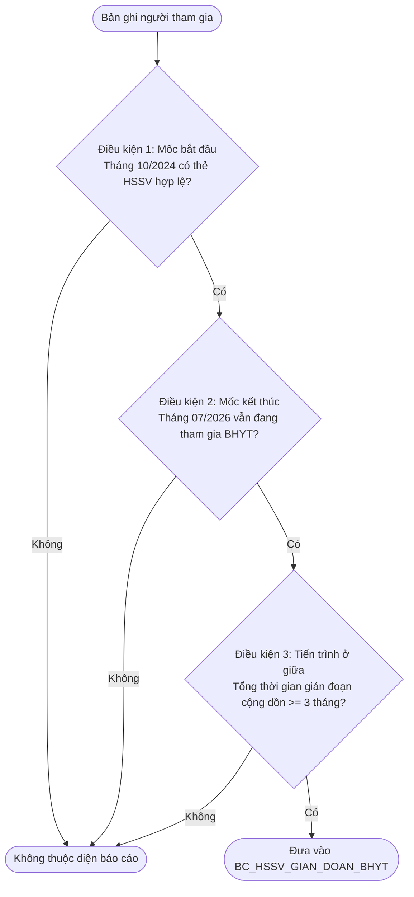
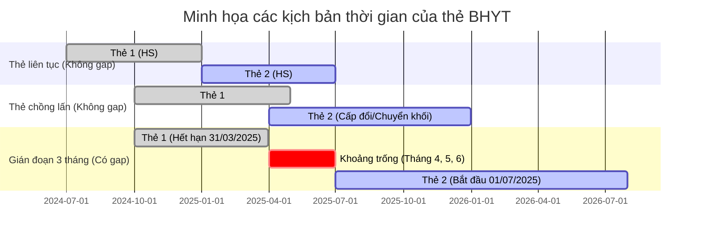

# Tuần 2 – HSSV vẫn tham gia nhưng gián đoạn ≥ 3 tháng (CV 835/QLT – Ý 2)

---

## 1. Bối cảnh & Đề bài

Căn cứ Công văn số **835/QLT** ngày 10/08/2026 của Ban Quản lý thu và phát triển người tham gia (BHXH Việt Nam) về việc rà soát số liệu học sinh, sinh viên (HSSV) tham gia BHYT:

> **Yêu cầu Ý 2:**
> *"Học sinh, sinh viên tham gia từ tháng 10/2024, tháng 7/2026 vẫn đang tham gia nhưng có thời gian gián đoạn không tham gia từ 3 tháng trở lên.*
> *(Tách riêng danh sách học sinh và sinh viên)"*

**Mục tiêu của Tuần 2:**
- Sử dụng tiếp bộ **Fake Data chung (200 triệu dòng)** đã tạo từ Tuần 1.
- Hiểu rõ bản chất toán học và nghiệp vụ quản lý **chuỗi thời gian (timeline / intervals / gaps)** của quá trình đóng BHYT.
- Tự phân tích thuật toán, thiết kế giải pháp và lập trình hoàn thiện bài toán Ý 2 với hiệu năng cao, kiểm thử toàn diện và đối soát độc lập.

---

## 2. Giải thích chi tiết nghiệp vụ

### 2.1. Ba điều kiện thỏa mãn đồng thời

Một cá nhân được đưa vào danh sách báo cáo của **Ý 2** khi và chỉ khi thỏa mãn đồng thời cả 3 điều kiện:

1. **Điều kiện mốc bắt đầu (Tháng 10/2024):**
   - Tại tháng 10/2024, người đó đang tham gia BHYT với tư cách là **Học sinh (`HS`)** hoặc **Sinh viên (`SV`)**.
   - Nghĩa là: Có ít nhất một thẻ BHYT hợp lệ (`TRANG_THAI = 1`), `MA_KHOI IN ('HS', 'SV')`, có khoảng hiệu lực giao với tháng 10/2024:
     > `TU_NGAY < '2024-11-01'` **VÀ** `DEN_NGAY >= '2024-10-01'`

2. **Điều kiện mốc kết thúc (Tháng 07/2026):**
   - Tại tháng 07/2026, người đó **vẫn đang tham gia BHYT** (có thẻ hợp lệ thuộc bất kỳ khối đối tượng nào trong hệ thống, ví dụ: `HS`, `SV`, `DN`, `GD`, `TE`, `HT`...).
   - Nghĩa là: Có ít nhất một thẻ BHYT hợp lệ (`TRANG_THAI = 1`), có khoảng hiệu lực giao với tháng 07/2026:
     > `TU_NGAY < '2026-08-01'` **VÀ** `DEN_NGAY >= '2026-07-01'`

3. **Điều kiện tiến trình ở giữa (Từ 10/2024 đến 07/2026):**
   - Trong khoảng thời gian giữa 2 mốc trên, người đó có **tổng thời gian gián đoạn không tham gia BHYT cộng dồn từ 3 tháng trở lên**.

---

### 2.2. Làm rõ khái niệm "Gián đoạn không tham gia từ 3 tháng trở lên"

Bài toán Ý 2 phức tạp hơn Ý 1 vì không chỉ đối chiếu 2 thời điểm độc lập mà phải xét **toàn bộ diễn biến lịch sử thẻ của người đó trong suốt giai đoạn 10/2024 – 07/2026**.

#### A. Thế nào là khoảng thời gian gián đoạn?
Là khoảng thời gian mà người tham gia **hoàn toàn không có bất kỳ thẻ BHYT hợp lệ nào có hiệu lực**.

- **Thẻ liên tục:** Thẻ mới có hiệu lực ngay sau khi thẻ cũ hết hạn (ví dụ thẻ A hết hạn `2024-12-31`, thẻ B bắt đầu từ `2025-01-01`). Trường hợp này $T_B = D_A + 1\text{ ngày} \implies$ **Không có gián đoạn**.
- **Thẻ chồng lấn / cấp đổi:** Khi đổi thẻ hoặc chuyển đơn vị, có thể có 2 thẻ có thời hạn gối đầu nhau (ví dụ thẻ A có hạn đến `2025-06-30`, thẻ B bắt đầu từ `2025-05-01`). Khoảng thời gian gối đầu này vẫn là **thời gian tham gia liên tục**.
- **Có khoảng trống (Gap):** Thẻ cũ kết thúc nhưng sau một thời gian mới có thẻ mới phát sinh. Khoảng thời gian trống đó chính là **thời gian gián đoạn**:
  $$[\text{Gap Start}, \text{Gap End}] = [D_{\text{cũ}} + 1\text{ ngày}, T_{\text{mới}} - 1\text{ ngày}]$$
  $$\text{Số ngày gián đoạn} = T_{\text{mới}} - D_{\text{cũ}} - 1$$

#### B. Quy tắc tính cộng dồn "từ 3 tháng trở lên"
- **Tính cộng dồn:** Tính tổng thời gian gián đoạn (không có thẻ BHYT hiệu lực) trong suốt kỳ từ 10/2024 đến 07/2026. Nếu tổng thời gian không tham gia cộng dồn này từ 3 tháng trở lên thì đưa vào danh sách kết quả.
- **Biên kỳ:** Kỳ tính là `[2024-10-01, 2026-07-31]`, bao gồm cả hai ngày. Ngày không có thẻ hợp lệ trước thẻ đầu tiên và sau thẻ cuối cùng trong kỳ cũng được tính. Ví dụ thẻ đầu bắt đầu 15/10 thì 01/10–14/10 được tính; thẻ cuối hết hạn 15/07 thì 16/07–31/07 được tính.
- **Các đợt gián đoạn ngắn rải rác được cộng dồn lại:**
  Ví dụ: Nghỉ 1 tháng (30 ngày) ở hè 2025, rồi nghỉ tiếp 2 tháng (61 ngày) ở đầu năm 2026:
  $$\text{Tổng thời gian gián đoạn} = 30 + 61 = 91\text{ ngày} \ge 90\text{ ngày} \implies \text{Thỏa mãn điều kiện!}$$
- **Quy chuẩn ngưỡng:**
  - Theo luật BHYT và quản lý thu BHXH: 1 tháng đóng tương đương 30 ngày.
  - Ngưỡng gián đoạn từ 3 tháng trở lên tương ứng với:
    $$\text{Tổng số ngày gián đoạn} \ge 90\text{ ngày}$$
  - Hoặc xét theo số tháng lịch hoàn toàn không có thẻ tham gia: $\ge 3\text{ tháng}$.

---

## 3. Các bảng dữ liệu cần có

### 3.1. Dữ liệu nguồn
- Bảng `ST_INTHE_DTL` (Thẻ BHYT chi tiết): Truy xuất toàn bộ lịch sử các thẻ có `TRANG_THAI = 1` và có hiệu lực giao với khoảng thời gian từ `2024-10-01` đến `2026-07-31`.
- Bảng `DM_BHXH` (Cơ quan BHXH): Danh mục quy đổi cơ quan quản lý về mã tỉnh/thành phố chuẩn.

### 3.2. Bảng kết quả đầu ra cần có

#### 1. Bảng danh sách chi tiết: `BC_HSSV_GIAN_DOAN_BHYT`
| Tên cột | Kiểu dữ liệu | Ý nghĩa nghiệp vụ |
|---|---|---|
| `SO_SO_BHXH` | `VARCHAR(10)` | Mã số BHXH (Khóa chính) |
| `HO_TEN` | `VARCHAR(100)` | Họ và tên người tham gia |
| `NGAY_SINH` | `DATE` | Ngày sinh |
| `GIOI_TINH` | `SMALLINT` | 1: Nam, 2: Nữ |
| `SO_CMND` | `VARCHAR(12)` | CCCD / CMND |
| `DIA_CHI` | `VARCHAR(255)` | Địa chỉ cư trú |
| `SO_THE_KCB_GOC` | `VARCHAR(15)` | Thẻ BHYT đại diện tại mốc gốc T10/2024 |
| `MA_KHOI_GOC` | `VARCHAR(10)` | Phân loại mốc gốc (`HS` hoặc `SV`) |
| `TU_NGAY_GOC` | `DATE` | Ngày bắt đầu thẻ mốc gốc |
| `DEN_NGAY_GOC` | `DATE` | Ngày kết thúc thẻ mốc gốc |
| `DM_BHXH_ID_GOC` | `INTEGER` | Cơ quan BHXH quản lý tại mốc gốc |
| `MA_TINH_GOC` | `VARCHAR(20)` | Mã tỉnh/thành phố quản lý tại mốc gốc |
| `SO_THE_KCB_HIEN_TAI` | `VARCHAR(15)` | Thẻ BHYT đại diện tại mốc hiện tại T07/2026 |
| `MA_KHOI_HIEN_TAI` | `VARCHAR(10)` | Khối tham gia hiện tại (`HS`, `SV`, `DN`, `GD`,...) |
| `TU_NGAY_HIEN_TAI` | `DATE` | Ngày bắt đầu thẻ mốc hiện tại |
| `DEN_NGAY_HIEN_TAI` | `DATE` | Ngày kết thúc thẻ mốc hiện tại |
| `DM_BHXH_ID_HIEN_TAI` | `INTEGER` | Cơ quan BHXH quản lý hiện tại |
| `MA_TINH_HIEN_TAI` | `VARCHAR(20)` | Mã tỉnh/thành phố quản lý hiện tại |
| `SO_DOT_GIAN_DOAN` | `INTEGER` | Số đợt gián đoạn phát sinh trong kỳ |
| `SO_NGAY_GIAN_DOAN` | `INTEGER` | Tổng số ngày gián đoạn cộng dồn |
| `SO_THANG_GIAN_DOAN` | `NUMERIC(4,1)` | Số tháng gián đoạn quy chuẩn ($= \text{Số ngày} / 30.0$) |
| `NGAY_GOC` | `DATE` | Mốc bắt đầu: `2024-10-01` |
| `NGAY_KIEM_TRA` | `DATE` | Mốc kết thúc: `2026-07-31` |
| `CREATED_AT` | `TIMESTAMP` | Thời điểm tạo bản ghi báo cáo |

#### 2. Bảng tổng hợp thống kê: `TK_DBHC_HSSV_GIAN_DOAN_BHYT`
| Tên cột | Kiểu dữ liệu | Ý nghĩa nghiệp vụ |
|---|---|---|
| `MA_TINH` | `VARCHAR(20)` | Mã tỉnh/thành phố (Khóa chính) |
| `TEN_TINH` | `VARCHAR(200)` | Tên tỉnh/thành phố |
| `SO_LUONG_HS_GIAN_DOAN` | `BIGINT` | Số lượng học sinh gián đoạn $\ge 3$ tháng |
| `SO_LUONG_SV_GIAN_DOAN` | `BIGINT` | Số lượng sinh viên gián đoạn $\ge 3$ tháng |
| `TONG_SO_NGUOI_GIAN_DOAN` | `BIGINT` | Tổng số người gián đoạn $\ge 3$ tháng |
| `TONG_NGAY_GIAN_DOAN` | `BIGINT` | Tổng số ngày gián đoạn lũy kế của toàn tỉnh |
| `NGAY_BAO_CAO` | `DATE` | Ngày ký công văn / lập báo cáo |

---

## 4. Quy tắc giải quyết xung đột đa thẻ (Tie-breaking)

1. **Tại mốc gốc (Tháng 10/2024):**
   - Nếu có nhiều thẻ giao tháng 10/2024: Ưu tiên `SV` > `HS`.
   - Nếu cùng khối: Chọn thẻ có `DEN_NGAY` lớn nhất.
   - Nếu cùng `DEN_NGAY`: Chọn theo thứ tự `SO_THE_KCB` (alphabetical).

2. **Tại mốc hiện tại (Tháng 07/2026):**
   - Nếu có nhiều thẻ giao tháng 07/2026: Ưu tiên thẻ có `DEN_NGAY` lớn nhất.
   - Nếu cùng `DEN_NGAY`: Chọn theo thứ tự `SO_THE_KCB` (alphabetical).

3. **Cơ quan quản lý báo cáo thống kê:**
   - Phân bổ theo `MA_TINH_GOC` (địa bàn nơi đối tượng bắt đầu tham gia với tư cách HSSV).
