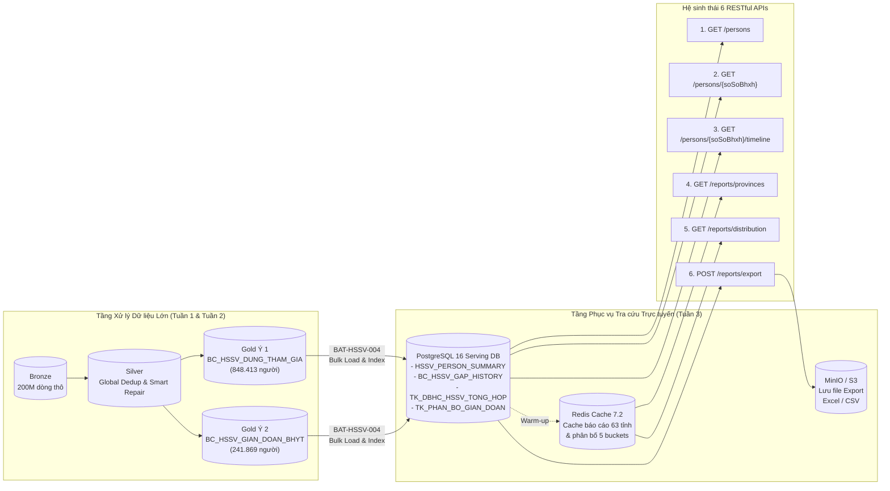

# Tuần 3 – Thiết kế Hệ thống Xử lý 200M Dòng Thẻ BHYT & Cổng Dịch vụ API Tra cứu HSSV (CV 835/QLT)

---

## 1. Bối cảnh & Đề bài

Kế thừa kết quả phân tích và xử lý dữ liệu từ **Tuần 1 (Ý 1: HSSV dừng tham gia BHYT)** và **Tuần 2 (Ý 2: HSSV vẫn tham gia nhưng gián đoạn $\ge 3$ tháng)** theo Công văn số **835/QLT** ngày 10/08/2026 của BHXH Việt Nam:

> **Yêu cầu Tuần 3:**
> *"Dựa trên bài tập 2 tuần vừa rồi và bộ biểu mẫu thiết kế chuẩn, thực hiện thiết kế hệ thống xử lý 200M dòng thẻ BHYT (dừng tham gia, gián đoạn > 3 tháng) và thiết kế bộ 6 RESTful API tra cứu kết quả:*
> - `GET /api/v1/hssv/persons` *(Tra cứu danh sách lọc theo tỉnh/khối/tiêu chí, phân trang).*
> - `GET /api/v1/hssv/persons/{soSoBhxh}` *(Xem chi tiết 1 người).*
> - `GET /api/v1/hssv/persons/{soSoBhxh}/timeline` *(Xem timeline thẻ & các đợt gián đoạn).*
> - `GET /api/v1/hssv/reports/provinces` *(Thống kê theo 63 Tỉnh/TP).*
> - `GET /api/v1/hssv/reports/distribution` *(Thống kê phân bố thời gian gián đoạn).*
> - `POST /api/v1/hssv/reports/export` *(Xuất báo cáo Excel/CSV).*
>
> *Sản phẩm nộp cuối tuần là bộ tài liệu Thiết kế cơ bản (Basic Design) và Thiết kế chi tiết (Detail Design), chưa yêu cầu lập trình code API."*

---

## 2. Giải thích chi tiết Kiến trúc & Nghiệp vụ Tích hợp

### 2.1. Sơ đồ luồng dữ liệu từ Batch Lakehouse (Tuần 1 & 2) sang Serving Layer (Tuần 3)

### 2.2. Nguyên tắc kế thừa từ bài làm Tuần 1 và Tuần 2

1. **Tính loại trừ nhau giữa Ý 1 và Ý 2 trên bảng hợp nhất `HSSV_PERSON_SUMMARY`:**
   - **Ý 1 (`TIEU_CHI = 'DUNG_THAM_GIA'`):** Có thẻ `HS`/`SV` giao tháng 10/2024 nhưng **không còn thẻ hợp lệ** tại tháng 08/2026.
   - **Ý 2 (`TIEU_CHI = 'GIAN_DOAN'`):** Có thẻ `HS`/`SV` giao tháng 10/2024, **vẫn còn thẻ hợp lệ** tại tháng 07/2026 và có tổng số ngày gián đoạn trong kỳ `[2024-10-01, 2026-07-31]` $\ge 90$ ngày.
   - Khi đồng bộ sang Serving DB (`HSSV_PERSON_SUMMARY`), khóa chính `SO_SO_BHXH` được bảo toàn tính duy nhất kèm cột phân loại `TIEU_CHI` và Composite Index `(MA_TINH_GOC, TIEU_CHI, MA_KHOI_GOC)` cùng GIN Index không dấu trên `HO_TEN_UNACCENT`.

2. **Kế thừa kỹ thuật làm sạch tầng Silver (Tuần 1 Ngày 5):**
   - `BAT-HSSV-001` áp dụng `GlobalDedupTracker` khử trùng `ID` liên chunk và cơ chế **Smart Repair** hoán đổi các thẻ bị nhập ngược ngày (`TU_NGAY > DEN_NGAY`) nhưng nằm trong chu kỳ hợp lệ ($25 \le \Delta \le 375$ ngày), gắn cờ `_FLAG_DATE_SWAPPED = True`, bảo toàn phương trình:
     $$\text{Bronze} = \text{Silver} + \text{Quarantine} + \text{Dedup}_{\text{Global}}$$

3. **Kế thừa giải thuật gộp chuỗi thời gian Interval Merging (Tuần 2):**
   - Sử dụng Window Function `MAX(den) OVER (PARTITION BY SO_SO_BHXH ORDER BY tu, den ROWS BETWEEN UNBOUNDED PRECEDING AND 1 PRECEDING)` để xử lý chính xác cả thẻ liên tục, thẻ chồng lấn và thẻ lồng nhau (nested intervals).
   - Các đợt gián đoạn (đầu kỳ `DAU_KY`, giữa kỳ `GIUA_KY`, cuối kỳ `CUOI_KY`) được trích xuất vào bảng `BC_HSSV_GAP_HISTORY` để phục vụ trực tiếp cho `GET /api/v1/hssv/persons/{soSoBhxh}/timeline`.

---

## 3. Đặc tả 6 RESTful APIs cần thiết kế

| Mã API | Method & Endpoint | Mục đích nghiệp vụ | Bảng dữ liệu / Cache truy xuất | SLA (p95) |
|---|---|---|---|---|
| **API-HSSV-001** | `GET /api/v1/hssv/persons` | Tra cứu danh sách HSSV vi phạm theo mã tỉnh (`provinceCode`), khối (`block`: `HS`/`SV`/`ALL`), tiêu chí (`criteria`: `DUNG_THAM_GIA`/`GIAN_DOAN`/`ALL`), khoảng ngày gián đoạn, từ khóa (`search`) và phân trang (`page`, `pageSize`). | `HSSV_PERSON_SUMMARY` | $\le 300\text{ ms}$ |
| **API-HSSV-002** | `GET /api/v1/hssv/persons/{soSoBhxh}` | Xem chi tiết thông tin nhân thân, thẻ đại diện tại mốc gốc T10/2024, thẻ tại mốc hiện tại và tóm tắt vi phạm của 1 cá nhân. | `HSSV_PERSON_SUMMARY`, `DM_BHXH` | $\le 150\text{ ms}$ |
| **API-HSSV-003** | `GET /api/v1/hssv/persons/{soSoBhxh}/timeline` | Xem toàn bộ lịch sử thẻ hợp lệ trong kỳ, danh sách khoảng tham gia liên tục sau khi gộp (`mergedIntervals`) và chi tiết từng đợt gián đoạn (`gaps`). | `ST_INTHE_DTL`, `BC_HSSV_GAP_HISTORY` | $\le 250\text{ ms}$ |
| **API-HSSV-004** | `GET /api/v1/hssv/reports/provinces` | Báo cáo tổng hợp số liệu dừng tham gia và gián đoạn $\ge 3$ tháng theo 63 Tỉnh/Thành phố và tổng hợp toàn quốc (`nationalSummary`). | Redis Cache $\rightarrow$ `TK_DBHC_HSSV_TONG_HOP` | $\le 200\text{ ms}$ |
| **API-HSSV-005** | `GET /api/v1/hssv/reports/distribution` | Thống kê phân bố số lượng và tỷ lệ % HSSV gián đoạn theo 5 khoảng thời gian quy chuẩn (`90-120d`, `121-180d`, `181-270d`, `271-365d`, `>365d`). | Redis Cache $\rightarrow$ `TK_PHAN_BO_GIAN_DOAN` | $\le 200\text{ ms}$ |
| **API-HSSV-006** | `POST /api/v1/hssv/reports/export` | Xuất báo cáo ra Excel (`XLSX`) hoặc `CSV`. Hỗ trợ xuất đồng bộ ($\le 10.000$ dòng, trả `downloadUrl`) và bất đồng bộ ($> 10.000$ dòng, trả `HTTP 202` kèm `jobId`). | `HSSV_PERSON_SUMMARY`, `SYS_EXPORT_JOB`, MinIO | Sync $\le 3\text{ s}$ |

---

## 4. Sản phẩm bàn giao trong thư mục `design/`

Toàn bộ sản phẩm thiết kế của Tuần 3 được đặt tại thư mục [`design/`](../../design/) và đồng bộ 100% giữa định dạng Excel (`.xlsx`) và Markdown (`.md`):

1. **Thiết kế cơ bản (Basic Design – Mã tài liệu `HSSV-BD-001`):**
   - File Excel: [`design/ThietKeCoBan_BasicDesign_VN.xlsx`](../../design/ThietKeCoBan_BasicDesign_VN.xlsx) (15 sheets: `00_HuongDan` $\rightarrow$ `14_QA`).
   - File Markdown: [`design/ThietKeCoBan_BasicDesign_VN.md`](../../design/ThietKeCoBan_BasicDesign_VN.md).
2. **Thiết kế chi tiết (Detail Design – Mã tài liệu `HSSV-DD-001`):**
   - File Excel: [`design/ThietKeChiTiet_DetailDesign_VN.xlsx`](../../design/ThietKeChiTiet_DetailDesign_VN.xlsx) (11 sheets: `00_HuongDan` $\rightarrow$ `10_QA`).
   - File Markdown: [`design/ThietKeChiTiet_DetailDesign_VN.md`](../../design/ThietKeChiTiet_DetailDesign_VN.md).
